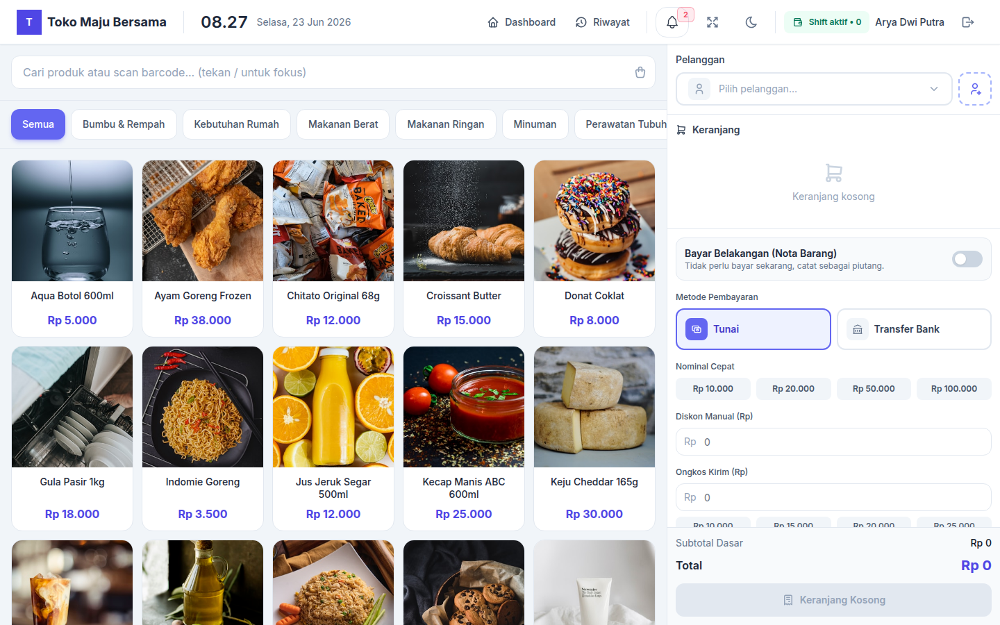
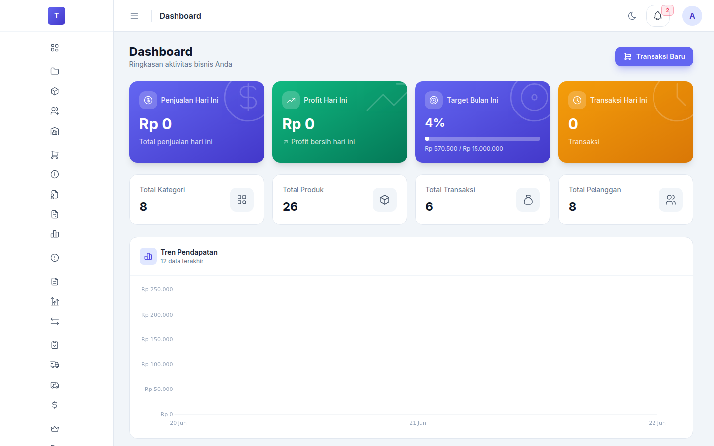
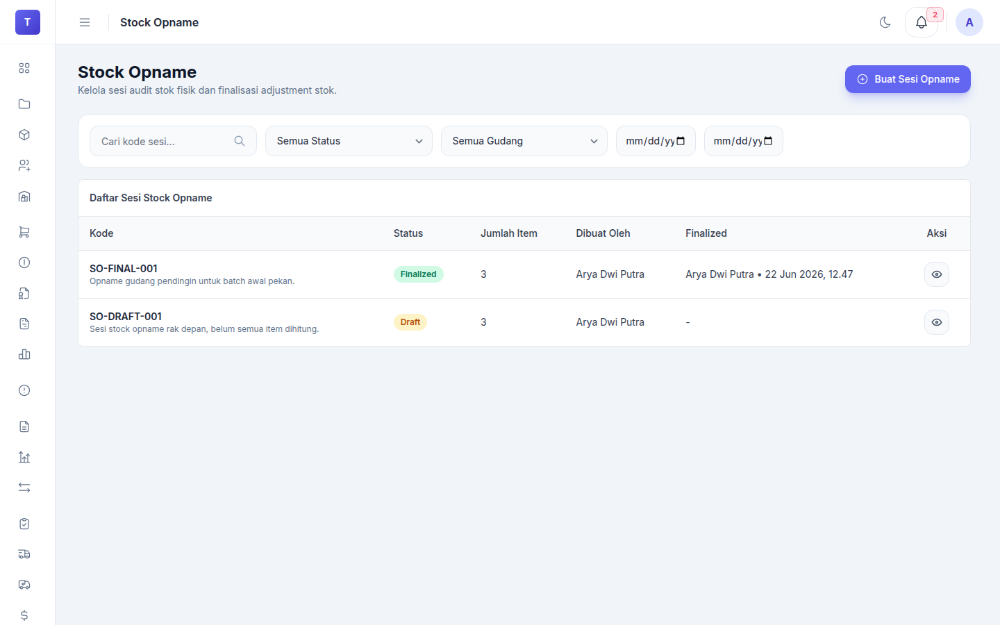
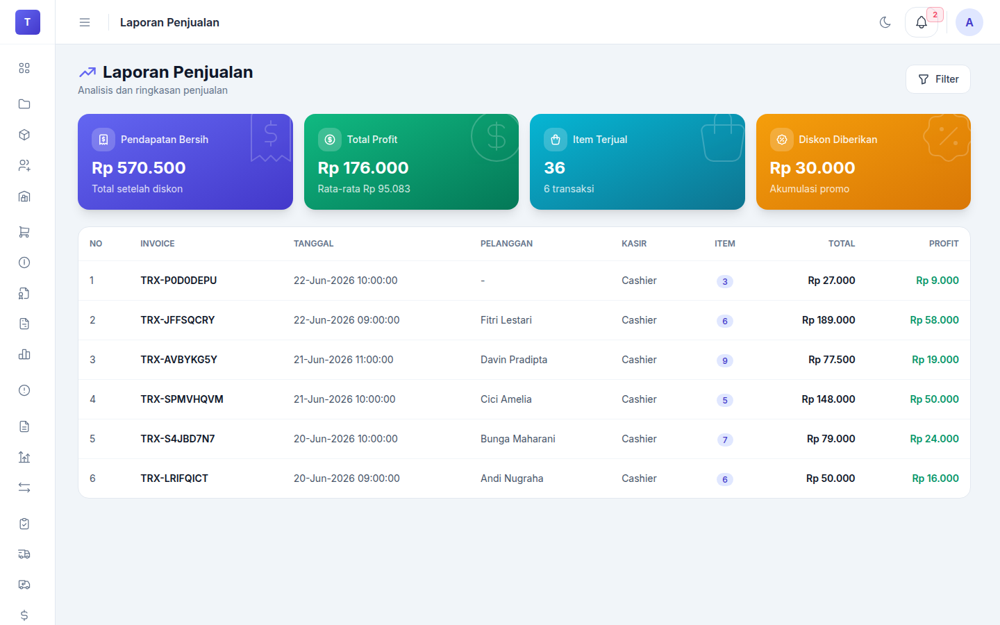
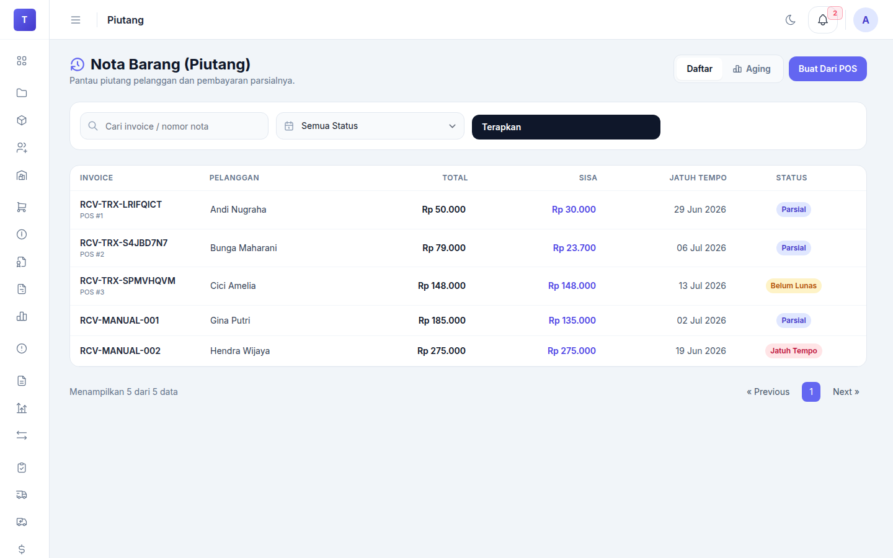
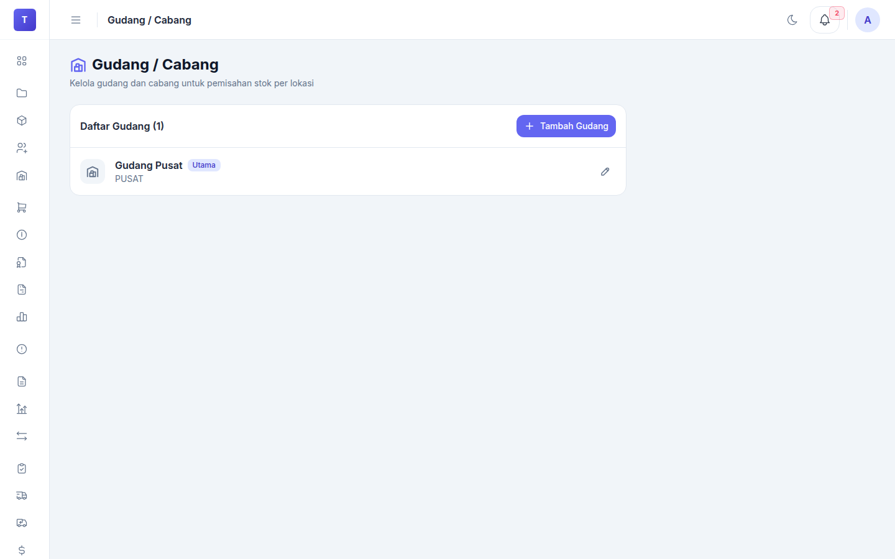

# Point of Sales

Sistem kasir berbasis Laravel + Inertia + React untuk transaksi penjualan, inventory audit, purchasing, finance, CRM, loyalty, dan observability operasional — dengan dukungan multi-warehouse, PPN, dan offline mode.

> 200+ GitHub stars • Open-source • GNU AGPL-3.0 License

---

## Cuplikan Layar

| POS Checkout | Dashboard | Stock Opname |
|:---:|:---:|:---:|
|  |  |  |
| **Sales Report** | **Receivables** | **Multi-Warehouse** |
|  |  |  |

📸 **[Lihat galeri lengkap (33 screenshot)](docs/screenshots.md)**

---

## Fitur Utama

### POS & Transaksi
- Pencarian produk via barcode / keyword
- Barcode scanner via kamera (PWA)
- Cart multi-item dengan hold/resume
- Checkout multi-metode: tunai, transfer bank, Midtrans, Xendit, pay later
- Multi-satuan produk (pcs, box, kg, karton) dengan konversi stok otomatis
- Multi-price list: harga berbeda per kelompok pelanggan
- Promo engine: diskon, qty break, bundle, buy-x-get-y
- Diskon dengan approval workflow
- PPN 11% (exclusive/inclusive)
- Thermal printer support (WebUSB)
- Offline mode (queue transaksi saat offline, sync saat online)

### Inventory & Multi-Warehouse
- Manajemen produk + kategori + barcode
- Stok terpisah per gudang/cabang
- Transfer stok antar warehouse (draft → send → receive)
- Stock opname per warehouse
- Stock mutation history
- Batch/expiry date tracking (FEFO)
- Composite products / kits
- Reorder point + auto-PO suggestion
- Low stock notification

### Purchasing
- Purchase Order (draft → ordered → partial → completed)
- Goods Receiving (dengan input batch)
- Supplier Returns
- Payables (hutang supplier) dengan aging

### Finance
- Receivables (piutang pelanggan) dengan partial payment
- Aging analysis + collection notes
- PPN/PPh tax management
- Customer portal: lihat invoice + bayar piutang online

### CRM & Loyalty
- Customer management + wilayah Indonesia
- Member tiers (regular, silver, gold, platinum)
- Poin loyalty (earn/redeem)
- Voucher customer
- Customer segments (manual & auto)
- Campaign automation (reminder, promo broadcast)
- **WhatsApp Gateway** — kirim pesan otomatis via whatsapp-web.js (QR scan, session persistent)

### Reports & Documents
- Sales report + filter + summary
- Profit report + margin analysis
- Advanced sales insights (hourly, cashier performance, repeat customer)
- PDF invoice, receipt (80mm/58mm), shipping label
- PDF receivable/payable
- Export ke Excel (produk, customer, transaksi)

### Admin
- Full RBAC (users, roles, permissions)
- Audit log (before/after snapshot)
- Import produk & customer dari Excel
- **App Versioning** — versi aplikasi terpusat (`APP_VERSION`), tampil di sidebar + POS navbar

### Integrasi
- **WhatsApp Gateway** — terhubung via Node.js service (`whatsapp-service/`)
- **Payment Gateways** — Midtrans, Xendit

---

## Quick Start

### Local setup

Everything runs on the host: PHP 8.4, Composer, MySQL 8.4 and Node 22+. No containers.

#### Machine setup (Windows, once)

On macOS or Linux, install the same versions and PHP extensions your usual way.

1. Laragon: `winget install LeNgocKhoa.Laragon` (installs to `C:\laragon`).
2. PHP: download the PHP 8.4 x64 Thread Safe zip (8.4.28) from `windows.php.net`, check its sha256, and unzip it into
   `C:\laragon\bin\php\php-8.4.28-Win32-vs17-x64`. Copy `php.ini-development` to `php.ini` and set (`bcmath` is
   built in):

   ```ini
   extension_dir = "C:/laragon/bin/php/php-8.4.28-Win32-vs17-x64/ext"
   memory_limit = 512M
   extension=curl
   extension=exif
   extension=fileinfo
   extension=gd
   extension=intl
   extension=mbstring
   extension=openssl
   extension=pdo_mysql
   extension=pdo_sqlite
   extension=sodium
   extension=sqlite3
   extension=zip
   ```

3. Composer: the one Laragon ships, in `C:\laragon\bin\composer`.
4. MySQL: unzip the official MySQL 8.4 LTS Windows zip (8.4.11, from `cdn.mysql.com`) into
   `C:\laragon\bin\mysql\mysql-8.4.11-winx64`. Save this as `my.ini` in that folder:

   ```ini
   [mysqld]
   basedir=C:/laragon/bin/mysql/mysql-8.4.11-winx64
   datadir=C:/laragon/data/mysql-8.4
   port=3306
   bind-address=127.0.0.1
   character-set-server=utf8mb4
   collation-server=utf8mb4_unicode_ci
   max_allowed_packet=64M

   [client]
   port=3306
   default-character-set=utf8mb4
   ```

   Then, in an administrator Command Prompt in its `bin` folder, create the data folder (`root` gets an empty
   password) and the `MySQL84` Windows service, which starts with Windows:

   ```bat
   mysqld --defaults-file=C:\laragon\bin\mysql\mysql-8.4.11-winx64\my.ini --initialize-insecure
   mysqld --install MySQL84 --defaults-file=C:\laragon\bin\mysql\mysql-8.4.11-winx64\my.ini
   net start MySQL84
   ```

   - Don't use Laragon's bundled MySQL 8.4.3: its zip lacks `lib/private` (ICU) and `mysqld` crashes during migrations.
   - Don't press Laragon's "Start All" for MySQL: the `MySQL84` service already holds port 3306.
5. Add the PHP folder, `C:\laragon\bin\composer` and the MySQL `bin` folder to your user `PATH`. In a new terminal,
   `php -v` shows 8.4.
6. Create the database:

   ```bash
   mysql -uroot -h127.0.0.1 -e "CREATE DATABASE point_of_sales CHARACTER SET utf8mb4 COLLATE utf8mb4_unicode_ci"
   ```

#### Project setup (each clone and each worktree)

```bash
composer install                  # every worktree needs its own vendor/
PUPPETEER_SKIP_DOWNLOAD=true npm install
cp .env.example .env              # only when there is no .env yet
php artisan key:generate          # same: a new key breaks sessions and encrypted data
php artisan migrate --seed
php artisan storage:link
```

`.env.example` already matches the setup above (`DB_HOST=127.0.0.1`, `DB_PORT=3306`, `DB_DATABASE=point_of_sales`,
`DB_USERNAME=root`, empty `DB_PASSWORD`). Set `APP_URL=http://localhost:8000`. In an older `.env`, change the `DB_*`
values to these.

#### Run

```bash
php artisan serve                 # http://localhost:8000
php artisan queue:listen          # queue worker, second terminal
npm run dev                       # Vite, third terminal

# or all of them in one terminal
composer run dev

# Setelah server berjalan, buka http://localhost:8000.
# Pada instalasi pertama, aplikasi otomatis mengarahkan ke /setup.

# WhatsApp Gateway (opsional) — untuk kirim WA otomatis
cd whatsapp-service
npm install && npm start
```

Tidak ada akun default. Setelah `migrate --seed`, buka root aplikasi (`http://localhost:8000`); pada instalasi pertama aplikasi otomatis mengarahkan ke `/setup` untuk membuat akun admin dan profil toko.
Ingin langsung mencoba dengan data contoh? Jalankan `php artisan seed:demo --force`. Seeder ini membuat dataset demo lengkap (outlet `MAL`/`TKB`/`PUT`, produk, transaksi, purchasing, CRM, dine-in, bahan baku dengan satuan beli dan resep) beserta tiga akun siap pakai — lihat `docs/demo-data.md`.

End-to-end tests (Playwright; `npm run e2e:up`, `npm run test:e2e`, then `npm run e2e:down`): see [`tests/e2e/README.md`](tests/e2e/README.md).

## Agent setup

We work with AI coding agents under the rules in [`AGENTS.md`](AGENTS.md). The workflow skills come
from [mattpocock/skills](https://github.com/mattpocock/skills) (align → spec → TDD → review → PR).
The repo is already configured for them (`AGENTS.md` → Agent skills, `docs/agents/`), so don't run
`/setup-matt-pocock-skills` again.

| Agent | Setup |
|---|---|
| Claude Code | Nothing: `.claude/settings.json` enables the plugin. Trust the folder and accept the install prompt when you first open the repo (or run `claude plugin install mattpocock-skills@claude-plugins-official`) |
| Codex | Reads `AGENTS.md` automatically. Once: `codex plugin marketplace add mattpocock/skills && codex plugin add mattpocock-skills@mattpocock` |
| GitHub Copilot | `copilot plugin marketplace add mattpocock/skills && copilot plugin install mattpocock-skills@mattpocock` |
| Cursor, OpenCode, Windsurf, others | `npx skills@latest add mattpocock/skills -a <agent>` (don't commit the copied files) |

Stack skills (Laravel, Inertia, React, Vitest, MySQL, UI/UX, ...) are pinned in `skills-lock.json`
and git-ignored. Restore them once after cloning with `npx skills experimental_install`;
`CLAUDE.md` → *Use the Project Skills* says which one to load for which code.

Claude Code also loads a guard hook from `.claude/settings.json` (needs `python3` or `python` on
your PATH). It blocks edits to secrets and protected files, pushes to the default branch and AI
attribution lines, and asks before destructive commands. If it blocks something you really need,
do that step yourself; don't disable the hook.

Then follow [`AGENTS.md`](AGENTS.md): `/grill-with-docs` → `/to-spec` → `/implement` →
`/code-review` → `/pr` (or `/ship-issue <n>` for a `ready-for-agent` issue). Use the plugin's
`/code-review`; it checks the diff against `CODING_STANDARDS.md` and the issue, and follows
[`REVIEW.md`](REVIEW.md).

Prerequisites: `git`, [`gh`](https://cli.github.com/) (logged in: `gh auth login`), Python 3.9+.

## Dokumentasi Detail

| Dokumen | Isi |
|---------|-----|
| `docs/getting-started.md` | Setup lengkap |
| `docs/demo-data.md` | Seeder demo lengkap + akun demo |
| `docs/configuration.md` | Konfigurasi environment, payment, pajak, printer, WhatsApp |
| `docs/architecture-overview.md` | Arsitektur, middleware, service layer, Node service |
| `docs/feature-index.md` | Indeks semua modul (44 fitur) |

## REST API (OpenAPI)

Dikasir menyediakan REST API untuk integrasi mobile app / pihak ketiga. Dokumentasi interaktif otomatis (Scramble) tersedia di:

- **UI docs:** `/docs/api` — coba endpoint langsung dari browser (Try It)
- **OpenAPI spec:** `/docs/api.json` — untuk generate client (Postman, OpenAPI Generator, Swagger Codegen)

Semua endpoint (kecuali `auth/login`, `auth/register`, webhooks) memerlukan **Bearer token**:

```bash
# 1. Login → dapat token
curl -X POST https://dikasir.web.id/api/v1/auth/login \
  -H "Content-Type: application/json" \
  -d '{"email":"admin@example.com","password":"password"}'
# → {"token": "1|abc123...", "user": {...}}

# 2. Panggil API dengan token
curl https://dikasir.web.id/api/v1/products \
  -H "Authorization: Bearer 1|abc123..."
```

**Modul yang tersedia** (`/api/v1/`):

| Modul | Endpoint | Keterangan |
|-------|----------|------------|
| Auth | `auth/login`, `auth/logout`, `auth/me`, `auth/register` | Token-based (Sanctum) |
| Produk | `products` | CRUD + search + kategori |
| Pelanggan | `customers` | CRUD + loyalty member |
| Kategori | `categories` | CRUD |
| Gudang | `warehouses` | CRUD (multi-warehouse) |
| Supplier | `suppliers` | CRUD |
| POS | `pos/shift`, `pos/products`, `pos/cart`, `pos/hold`, `pos/checkout`, `pos/transactions` | Alur kasir lengkap (mobile) |

Base URL: `https://dikasir.web.id/api/v1` (dev: `http://localhost:8000/api/v1`)

### Per Modul

- POS & Transaksi, Sales Return, Cashier Shift
- Inventory: produk, stock opname, mutation, warehouse, stock transfer, batch, composite
- Purchasing: PO, goods receiving, supplier return, payables
- Finance: receivables, PPN
- Pricing: pricing rules, price list, loyalty, vouchers
- CRM: member, segments, campaigns, **WhatsApp Gateway**
- Reports: sales, profit, insights, dokumen PDF
- Tools: import/export, mobile POS, thermal printer, offline mode

## Troubleshooting Umum

1. **Permission cache stale setelah seeding** — logout lalu login lagi
2. **Webhook Midtrans/Xendit tidak bekerja** — pastikan `APP_URL` public, bukan `localhost`
3. **Gambar produk tidak tampil** — jalankan `php artisan storage:link`
4. **Route error 500** — jalankan `php artisan migrate` untuk modul baru
5. **Test gagal karena PPN** — pastikan `tax_rate=0` di test Product::create
6. **Vite tidak jalan** — pastikan `composer run dev` berjalan; command tersebut juga menjalankan Vite
7. **WhatsApp QR tidak muncul** — pastikan `whatsapp-service/` sudah jalan (`npm start`)
8. **WhatsApp terputus** — klik "Hubungkan Ulang" di Settings > WhatsApp, scan ulang QR

## Kontribusi

1. Branch dari `development`: `git checkout -b feature/nama-fitur development`
2. Buat PR ke `development`
3. PR ke `main` hanya dari `development` via branching release

Pastikan `php artisan test` lulus sebelum PR.

Static analysis (Larastan level 5, baseline in `phpstan-baseline.gen.neon`): `composer analyse`. New code must not add errors; do not regenerate the baseline to hide them (regenerate with `--generate-baseline=phpstan-baseline.gen.neon`).

## Lisensi

GNU Affero General Public License v3.0 (AGPL-3.0)
