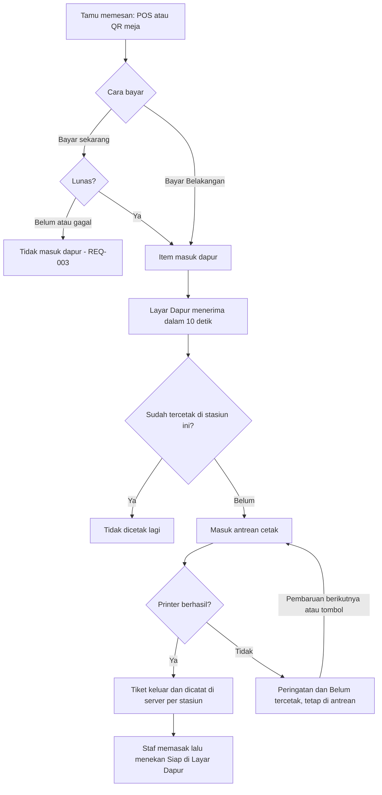
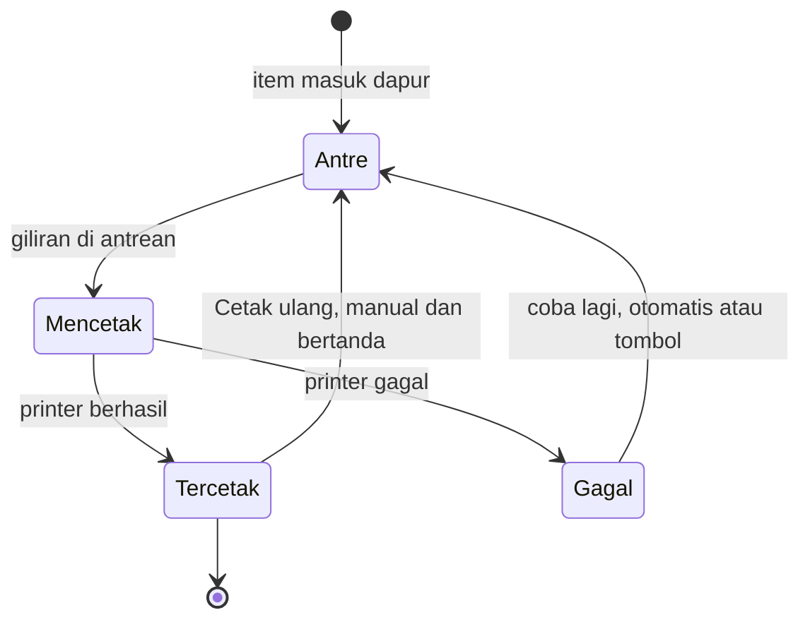

# REQ-004: Printer tiket dapur

- **Status:** ready
- **Owner:** @radityaaa43
- **Module:** module:sales
- **Updated:** 2026-11-26

## User story

Sebagai staf dapur di kedai yang bekerja dengan kertas, saya ingin setiap pesanan yang masuk dapur
langsung tercetak di printer dapur, agar saya bisa memasak dari tiket tanpa terus menatap layar.

Sebagai kasir, saya ingin pesanan yang sudah saya terima tidak perlu saya sampaikan lagi ke dapur,
agar antrean kasir tidak tertahan.

Sebagai pemilik, saya ingin tahu kalau printer dapur bermasalah, agar tidak ada pesanan yang
terlewat.

## Context

REQ-003 (#232) memberi semua pesanan alur dapur dan **Layar Dapur** (#258). Banyak kedai masih
memakai kertas di dapur. Mereka belum punya layar, atau dapurnya terlalu panas dan basah untuk
tablet. Aplikasi sudah bisa mencetak struk ke printer thermal lewat **WebUSB ESC/POS** dari browser
(`resources/js/Utils/escpos.js`, Settings → Printer, `docs/features/thermal-printer.md`). REQ-003
menaruh printer dapur di luar cakupan. REQ ini menambahkannya.

**Keputusan** (Business/PM, didelegasikan pemilik, 2026-11-26; pemilik menyetujui urutan A → B → C
→ D):

1. **Stasiun cetak adalah perangkat yang membuka Layar Dapur**, dengan printer yang terhubung lewat
   USB ke perangkat itu. Perangkatnya bisa tablet atau PC di dapur, atau PC kasir yang membuka Layar
   Dapur di tab terpisah dengan printer kedua di dekat jendela dapur. Semua pesanan, termasuk QR meja,
   masuk Layar Dapur, sehingga semuanya tercetak.
   - Ditolak: mencetak dari layar checkout kasir, karena pesanan QR meja tidak lewat checkout.
   - Ditolak: printer jaringan (LAN), karena server di cloud tidak bisa menjangkau jaringan toko.
2. **Satu tiket per pesanan setiap kali item masuk dapur.** Waktunya sama dengan aturan REQ-003:
   *Bayar sekarang* saat lunas, *Bayar Belakangan* langsung.
3. **Tiket tanpa harga.** Dapur hanya butuh menu, jumlah dan catatan.
4. **Pesanan tambahan** (REQ-003 AC-21) dicetak sebagai tiket **TAMBAHAN**. **Item yang dibatalkan**
   (REQ-003 AC-11) dicetak sebagai tiket **DIBATALKAN**, supaya dapur berhenti membuat.
5. **Satu kali per stasiun, juga setelah dimuat ulang.**
   - Setiap item dicetak sekali per stasiun cetak. Catatan "sudah dicetak" disimpan di server per
     stasiun, sehingga memuat ulang halaman atau memasang tablet kedua tidak mencetak ulang semuanya.
   - Cetak ulang selalu manual dan bertanda **CETAK ULANG**.
6. **Layar tetap sumber kebenaran.** Gagal cetak tidak pernah menghapus atau menahan pesanan. Pesanan
   tetap di Layar Dapur dan kegagalannya terlihat.
7. **Pengaturan per perangkat.** Cetak otomatis dan ukuran kertas (58/80 mm) disimpan di perangkat,
   seperti pengaturan printer kasir sekarang. Perangkat diberi nama stasiun (misalnya "Dapur 1") agar
   catatan cetaknya terpisah.
8. **Perangkat yang didukung:**
   - **Android dengan Chrome dan USB-OTG:** didukung.
   - **PC Windows dengan Chrome:** didukung untuk printer yang bisa dipakai lewat WebUSB. Sebagian
     printer perlu driver-nya diganti ke WinUSB sekali per PC. Langkahnya didokumentasikan, dan layar
     pengaturan menampilkan pesan jelas kalau printer tidak bisa dipakai, bukan gagal diam-diam.
   - **iPad dan perangkat tanpa WebUSB:** tidak didukung.
   - Ditolak: menjanjikan semua printer di Windows, karena Windows mengunci banyak printer struk ke
     driver bawaannya.
9. **Printer melengkapi Layar Dapur, tidak menggantikannya.**
   - Langkah *Siap* dan *Serahkan* (REQ-003) tetap ditekan di Layar Dapur. Tiket memuat nomor pesanan
     yang besar supaya pesanan mudah dicari di layar.
   - Kalau stasiunnya PC kasir, kasir atau pelayan yang berizin menekan *Semua siap* saat makanan
     diambil dari jendela dapur.
   - Ditolak: menandai siap otomatis saat tiket tercetak. Pesanan akan terlihat siap padahal belum
     dimasak, dan data kecepatan REQ-003 menjadi salah.

## Process

**Sekarang (as-is).**
- Pesanan masuk Layar Dapur (REQ-003).
- Kedai tanpa layar tetap menyampaikan pesanan secara lisan atau dengan kertas tulisan tangan.
- Pesanan bisa terlewat dan tulisan bisa salah baca.

**Tujuan (to-be).**
1. Staf membuka Layar Dapur di PC atau tablet dapur, menghubungkan printer USB, dan menyalakan *Cetak
   otomatis*.
2. Begitu item masuk dapur, tiket dicetak paling lambat 10 detik kemudian. Tiket berisi nomor pesanan
   atau meja, jenis pesanan, jam, menu, jumlah dan catatan, plus tanda *BELUM LUNAS* untuk Bayar
   Belakangan.
3. Pesanan tambahan dicetak sebagai tiket TAMBAHAN, dan pembatalan sebagai tiket DIBATALKAN.
4. Kalau printer gagal, Layar Dapur menampilkan peringatan dan pesanan tetap tampil. Staf bisa
   menekan *Cetak ulang* setelah printer kembali.

## User journey and flow

### Perjalanan per peran

**J1. Menyiapkan stasiun cetak** (sekali per perangkat; staf dapur atau pemilik)

| # | Langkah | Yang dilihat atau dilakukan | AC | Titik rawan |
|---|---|---|---|---|
| 1 | Buka **Layar Dapur** di tablet atau PC | Antrean dapur outlet (REQ-003) | — | Perlu izin memasak atau menyerahkan |
| 2 | Buka **Pengaturan printer dapur**, beri nama stasiun ("Dapur 1") | Form nama stasiun | AC-07 | Nama ganda: catatan cetak tercampur, jadi nama harus unik per outlet |
| 3 | **Hubungkan printer** dan pilih printer USB | Dialog perangkat dari browser | AC-07 | iPad: AC-09. Windows dengan driver bawaan: AC-11 |
| 4 | Pilih kertas 58/80 mm, lalu **Cetak percobaan** | Tiket contoh keluar | AC-07 | Kertas salah ukuran: teks terpotong |
| 5 | Nyalakan **Cetak otomatis** | Status "Printer siap" | AC-07, AC-10 | Layar menjaga perangkat tetap menyala |

**J2. Pesanan biasa** (tamu, kasir, dapur, pelayan)

| # | Langkah | Aktor | Yang terjadi | AC |
|---|---|---|---|---|
| 1 | Memesan di kasir atau QR meja, memilih *Bayar sekarang* atau *Bayar Belakangan* | Tamu, kasir | Alur REQ-003 | — |
| 2 | Pesanan lunas, atau Bayar Belakangan diterima | Sistem | Item masuk dapur | REQ-003 AC-02, AC-03 |
| 3 | Layar Dapur menerima pesanan dalam ≤ 10 detik | Stasiun | Tiket masuk antrean cetak lalu tercetak | AC-01, AC-02 |
| 4 | Staf mengambil tiket, memasak, lalu menekan *Mulai buat* dan *Siap* atau *Semua siap* | Staf dapur | Waktu buat tercatat | REQ-003 AC-08 |
| 5 | Pelayan menekan *Serahkan* | Pelayan | Pesanan selesai | REQ-003 AC-09 |

**J3. Pesanan tambahan dan pembatalan**

| # | Kejadian | Yang tercetak | AC |
|---|---|---|---|
| 1 | Tamu menambah item (REQ-003 AC-21) | Tiket **TAMBAHAN** dengan nomor pesanan asal | AC-03 |
| 2 | Item diretur dan returnya selesai (REQ-003 AC-11) | Tiket **DIBATALKAN** berisi menu dan jumlah yang dibatalkan | AC-04 |

**J4. Printer bermasalah** (kertas habis, kabel lepas, printer mati)

| # | Langkah | Yang dilihat | AC |
|---|---|---|---|
| 1 | Tiket gagal dicetak | Peringatan **Gagal mencetak — coba lagi**, dan pesanan bertanda **Belum tercetak** | AC-08 |
| 2 | Staf memperbaiki printer | — | — |
| 3 | Antrean dicoba lagi otomatis pada pembaruan berikutnya, atau lewat tombol | Tiket yang tertunda tercetak berurutan, masing-masing sekali | AC-05, AC-08 |
| 4 | Tiket yang sudah tercetak tapi rusak atau hilang | Staf menekan **Cetak ulang**, tiket bertanda CETAK ULANG | AC-06 |

**J5. Perangkat tidur atau tertutup**

| # | Langkah | Yang dilihat | AC |
|---|---|---|---|
| 1 | Tab tertutup atau perangkat tidur saat ada pesanan masuk | Begitu dibuka, layar menampilkan **Printer dapur offline atau tab tidur** | AC-10 |
| 2 | Layar dibuka lagi | Hanya pesanan yang belum tercetak di stasiun ini yang dicetak | AC-05 |

### Alur pesanan sampai tiket

### Status tiket di satu stasiun

## Stakeholders

| Pihak | Peran dalam alur | Kepentingan | Yang memutuskan |
|---|---|---|---|
| Pemilik usaha | Memilih memakai printer dapur | Tidak ada pesanan terlewat | Pemakaian per outlet |
| Staf dapur | Membaca tiket, menyalakan printer | Tiket jelas, tidak dobel | — |
| Kasir dan pelayan | Menerima pesanan | Tidak perlu menyampaikan lagi ke dapur | — |
| Tamu | Memesan | Pesanan cepat dan benar | — |

## Acceptance criteria

### Mencetak

- **AC-01:** Given Layar Dapur terbuka dengan printer terhubung dan *Cetak otomatis* aktif, when item
  pesanan masuk dapur, then satu tiket dapur tercetak paling lambat 10 detik kemudian, berisi nomor
  pesanan (invoice) atau nama meja, jenis pesanan, jam masuk, menu, jumlah dan catatan per item,
  tanpa harga.
- **AC-02:** Given pesanan Bayar Belakangan, when tiketnya dicetak, then tiket memuat tanda **BELUM
  LUNAS**.
- **AC-03:** Given pesanan tambahan (REQ-003 AC-21), when itemnya masuk dapur, then tiket terpisah
  bertanda **TAMBAHAN** dicetak dengan nomor pesanan asal.
- **AC-04:** Given item yang dibatalkan lewat retur (REQ-003 AC-11), when pembatalan selesai, then
  tiket **DIBATALKAN** dicetak berisi menu dan jumlah yang dibatalkan.
- **AC-05:** Given pesanan yang sudah dicetak di perangkat ini, when Layar Dapur memperbarui diri atau
  dibuka ulang, then pesanan itu tidak dicetak lagi.
- **AC-06:** Given pesanan di Layar Dapur, when staf menekan **Cetak ulang**, then tiketnya dicetak
  lagi dengan tanda **CETAK ULANG**.

### Pengaturan dan kegagalan

- **AC-07:** Given Layar Dapur, when staf membuka pengaturan printer dapur, then staf bisa
  menghubungkan atau memutus printer USB, memilih kertas 58 atau 80 mm, menyalakan atau mematikan
  *Cetak otomatis*, dan mencetak tiket percobaan. Semua tersimpan di perangkat itu.
- **AC-08:** Given *Cetak otomatis* aktif, when printer tidak terhubung atau gagal mencetak, then Layar
  Dapur menampilkan peringatan **Printer dapur tidak terhubung** atau **Gagal mencetak**, pesanan
  tetap tampil, dan pesanan yang gagal ditandai **Belum tercetak** sampai dicetak ulang.
- **AC-09:** Given perangkat yang tidak mendukung WebUSB (misalnya iPad), when staf membuka pengaturan
  printer dapur, then muncul pesan bahwa perangkat ini tidak mendukung printer USB, dan Layar Dapur
  tetap berjalan tanpa cetak.
- **AC-10:** Given *Cetak otomatis* aktif, when tab Layar Dapur tidur atau cetakan terakhir yang
  berhasil sudah terlalu lama padahal ada pesanan baru, then layar menampilkan **Printer dapur offline
  atau tab tidur**. Layar menjaga perangkat tetap menyala selama *Cetak otomatis* aktif (Wake Lock).
- **AC-11:** Given PC Windows yang printernya dikunci driver Windows, when staf menghubungkan printer,
  then muncul pesan **Printer tidak bisa dipakai dari browser — ganti driver ke WinUSB** dengan tautan
  ke langkah di dokumentasi.

## Business rules

- **Uang:** tiket tidak memuat harga atau pembayaran, hanya tanda *BELUM LUNAS* untuk Bayar
  Belakangan.
- **Stok:** tidak berubah. Mencetak tidak memotong atau mengembalikan stok.
- **Izin:** pengaturan printer dapur memakai izin yang sama dengan membuka Layar Dapur
  (`dine-orders-prepare` atau `dine-orders-handover`). Tidak ada izin baru.
- **Pengaturan:** per perangkat. Tidak ada pengaturan outlet baru.
- **Nama stasiun** unik per outlet.
- **Tiket** memuat nomor pesanan atau nama meja dengan huruf besar di bagian atas.
- **Sekali cetak:** satu tiket per kejadian (masuk, tambahan, batal) per stasiun, tercatat di server.
  Memuat ulang halaman tidak mencetak ulang. Cetak ulang selalu manual dan bertanda.
- **Antrean cetak:** tiket dicetak berurutan. Tiket yang gagal tetap di antrean dengan pesan **Gagal
  mencetak — coba lagi**, lalu dicoba lagi pada pembaruan berikutnya atau lewat tombol. Tiket tidak
  pernah hilang dan tidak pernah tercetak dua kali.

## Non-functional requirements

- **Kecepatan:** tiket tercetak paling lambat 10 detik setelah item masuk dapur, sama dengan AC-24
  REQ-003.
- **Keandalan:**
  - Beberapa pesanan yang masuk bersamaan dicetak berurutan tanpa ada yang hilang.
  - Gagal cetak tidak menghentikan pembaruan layar.
  - Setelah koneksi internet pulih, pesanan yang masuk saat putus dicetak.
- **Keamanan:** hanya pengguna yang boleh membuka Layar Dapur yang bisa mencetak.
- **Audit:** tidak perlu audit log. Cetak adalah aksi perangkat, bukan perubahan data.
- **Bahasa dan aksesibilitas:** label pengaturan dalam bahasa Indonesia dan Inggris. Isi tiket
  memakai nama menu apa adanya.

## Data and integrations

- **Data:** item dapur (REQ-003, `kitchen_items`) dan pesanan tambahan serta pembatalan dari REQ-003.
  Catatan cetak per stasiun disimpan di server (baru). Pengaturan printer disimpan di perangkat.
- **Integrasi:** printer thermal USB lewat WebUSB ESC/POS yang sudah ada (`escpos.js`). Tidak ada
  integrasi baru.

## Success metrics

- **Tiket tepat waktu:** ≥ 95% tiket tercetak ≤ 10 detik setelah item masuk dapur. Diukur saat uji
  manual per rilis.
- **Pesanan terlewat:** 0 pesanan yang tidak tercetak dan tidak terlihat. Diukur dari laporan staf dan
  dari tanda *Belum tercetak* yang tidak pernah dicetak ulang.

## Out of scope

- Printer jaringan (LAN/IP) dan cetak lewat cloud.
- Pemisahan tiket per stasiun (bar dan dapur panas), yang menjadi REQ tersendiri (opsi C).
- Printer label atau stiker.
- iPad dan perangkat tanpa WebUSB.

## Risks and assumptions

| Risiko | Dampak | Mitigasi |
|---|---|---|
| Layar Dapur tertutup atau perangkat mati | Tidak ada tiket | Layar menampilkan status printer. Pemilik diberi tahu di dokumentasi bahwa perangkat harus tetap membuka Layar Dapur |
| Dua perangkat sama-sama mencetak | Tiket dobel | Sekali cetak berlaku per perangkat. Pemilik menyalakan *Cetak otomatis* di satu perangkat saja |
| Printer kehabisan kertas | Tiket tidak keluar | Peringatan *Gagal mencetak* dan tanda *Belum tercetak* (AC-08) |
| Stasiun di PC kasir, dan *Siap* ditekan saat makanan diambil | Waktu buat ikut menghitung waktu tunggu di jendela dapur | Diterima. Dicatat di dokumentasi laporan kecepatan (REQ-003) |

- Kelayakan dicek Tech Lead (2026-11-26):
  - Android dengan Chrome berjalan.
  - Windows perlu driver WinUSB untuk banyak printer.
  - Antrean cetak dan catatan cetak di server harus dibangun.
  - Halaman harus tetap terbuka dan terjaga.
  - E2E memakai penampung cetak khusus tes.
- [asumsi] Aplikasi diakses lewat HTTPS, karena WebUSB butuh koneksi aman.

## Open questions

- Semua terjawab 2026-11-26 (keputusan 1–8, kelayakan dari Tech Lead).

## Delivered by

<!-- Issues and PRs, filled in as work ships. -->
