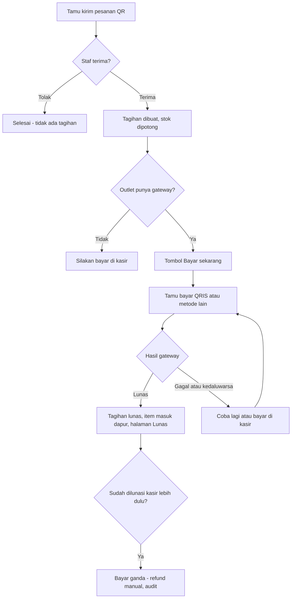
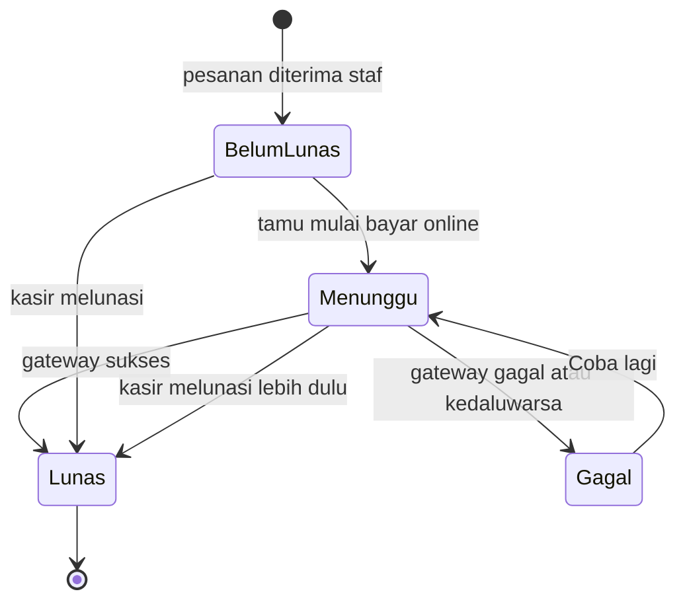

# REQ-005: Bayar online dari menu QR meja

- **Status:** ready
- **Owner:** @radityaaa43
- **Module:** module:dine-in
- **Updated:** 2026-11-26

## User stories

| # | Story | Journey | AC |
|---|---|---|---|
| US-1 | Sebagai **tamu dine-in**, saya ingin membayar pesanan dari HP saya di meja, agar tidak perlu antre di kasir dan pesanan langsung dibuat. | J1 | AC-01, AC-02, AC-03 |
| US-2 | Sebagai **tamu**, saya ingin mencoba lagi kalau pembayaran gagal atau kedaluwarsa, agar tetap bisa membayar tanpa memanggil pelayan. | J2 | AC-04 |
| US-3 | Sebagai **tamu dengan Bayar Belakangan**, saya ingin melunasi tagihan dari HP sebelum pergi, agar tidak perlu ke kasir. | J3 | AC-05 |
| US-4 | Sebagai **kasir**, saya ingin tagihan yang sudah dibayar online langsung lunas di POS, agar tidak menagih dua kali. | J1, J4 | AC-03, AC-06, AC-10 |
| US-5 | Sebagai **pemilik**, saya ingin pembayaran online tercatat benar per outlet dan per shift, agar uang dan laporan tetap akurat. | J1, J4, J5 | AC-06, AC-07, AC-08 |
| US-6 | Sebagai **staf dapur**, saya ingin pesanan yang dibayar online langsung masuk dapur, agar tidak ada yang menunggu konfirmasi manual. | J1 | AC-03 |

## Context

REQ-003 menetapkan bahwa *Bayar sekarang* bagi tamu QR berarti **membayar di kasir**. Pembayaran online
dari menu QR sengaja dikeluarkan dari cakupan (#262). Aplikasi sudah punya:
- gateway Midtrans dan Xendit per outlet (`PaymentSetting`, termasuk QRIS);
- tagihan dine-in yang dibuat saat pesanan diterima staf (#221);
- halaman status pesanan untuk tamu (`Public/DineOrderStatus`);
- hook "lunas" yang memasukkan item ke dapur (#236).

REQ ini menambahkan pembayaran online oleh tamu sendiri.

**Keputusan** (Business/PM, didelegasikan pemilik, 2026-11-26; urutan A → B → C → D disetujui pemilik):

1. **Bayar setelah pesanan diterima staf.** Tamu tetap mengirim pesanan dan staf tetap menerimanya.
   Stok dipotong saat diterima, seperti sekarang. Setelah itu halaman status tamu menampilkan tombol
   **Bayar sekarang**.
   - Ditolak: bayar saat mengirim pesanan, karena pesanan yang sudah dibayar lalu ditolak staf
     memerlukan refund.
2. **Hanya outlet yang mengaktifkan gateway.** Tombol hanya muncul kalau outlet punya Midtrans atau
   Xendit aktif. QRIS menjadi metode utama, dan metode lain yang diaktifkan outlet di gateway itu ikut
   tersedia.
3. **Bayar penuh saja.** Tidak ada split, cicilan, atau biaya tambahan untuk tamu. Biaya gateway
   ditanggung toko, sama seperti di kasir.
4. **Dapur mulai setelah lunas**, lewat hook lunas yang sudah ada (REQ-003 AC-02). Tagihan Bayar
   Belakangan tamu (REQ-003, #279) yang sudah ada di dapur juga bisa dilunasi dengan cara ini.
5. **Tidak pernah tertagih dua kali.** Kalau kasir menerima pembayaran pada saat yang sama, pembayaran
   pertama yang berlaku. Pembayaran gateway yang datang terlambat ditandai **Bayar ganda — refund
   manual** (#262).
6. **Shift:** pembayaran online tercatat di shift pemilik tagihan, yaitu shift yang menerima pesanan
   (REQ-003 AC-27).
   - Kalau shift itu **masih buka**, pembayaran masuk rekap non-tunai shift itu.
   - Kalau shift itu **sudah ditutup**, rekapnya tidak pernah diubah. Penjualan tetap lunas, ditandai
     **Dibayar setelah shift ditutup**, dan tampil sebagai baris sendiri di laporan penjualan untuk
     periode itu.
   - Ditolak: memindahkan pembayaran ke shift lain yang sedang buka (usulan teknis awal). Kalau ada
     beberapa kasir yang buka, tidak jelas shift mana yang benar, dan rekap kasir lain akan berisi uang
     yang tidak ia terima. Pembayaran online juga tidak masuk laci kas, jadi tidak ada uang yang perlu
     dicocokkan di shift lain.
7. **Gagal atau kedaluwarsa bisa dicoba lagi** dari halaman yang sama, dengan perlakuan sama seperti
   coba lagi di kasir (#262).
8. **Tanpa refund online.** Pengembalian dana tetap manual dan di luar cakupan.

## Process

**Sekarang (as-is).**
1. Tamu memesan lewat QR, staf menerima pesanan, lalu tamu harus ke kasir untuk membayar.
2. Kasir bisa sibuk, tamu menunggu, dan dapur baru mulai setelah lunas.

**Tujuan (to-be).**
1. Tamu memesan lewat QR dan staf menerima pesanan.
2. Halaman status tamu menampilkan total dan tombol **Bayar sekarang**.
3. Tamu membayar dengan QRIS atau metode gateway lain, langsung dari HP.
4. Begitu gateway mengonfirmasi, tagihan lunas, item masuk dapur, dan halaman tamu menampilkan
   **Lunas**.
5. Kasir tidak perlu menagih tamu itu lagi.

## User journey and flow

### Perjalanan per peran

**J1. Tamu membayar online setelah pesanan diterima** (tamu, staf, dapur)

| # | Langkah | Aktor | Yang dilihat atau dilakukan | AC | Titik rawan |
|---|---|---|---|---|---|
| 1 | Memindai QR meja, memilih menu, mengirim pesanan dengan *Bayar sekarang* | Tamu | Halaman status: **Menunggu diterima** | — | Outlet tanpa gateway: J5 |
| 2 | Menerima pesanan | Staf | Tagihan dibuat dan stok dipotong (#221) | — | Pesanan ditolak: tidak ada tombol bayar |
| 3 | Halaman status memperbarui diri | Tamu | Total dan tombol **Bayar sekarang** | AC-01 | Tamu tidak sedang membuka halaman: tombol muncul saat dibuka lagi |
| 4 | Menekan **Bayar sekarang**, memilih QRIS atau metode lain | Tamu | Gambar QRIS di halaman status, atau tautan ke halaman gateway untuk membuka e-wallet. Jumlahnya dari server | AC-02 | Jumlah tidak bisa diubah dari HP. Menekan dua kali membatalkan tagihan lama |
| 5 | Membayar di aplikasi bank atau e-wallet | Tamu | — | — | Pembayaran gagal atau kedaluwarsa: J2 |
| 6 | Gateway mengonfirmasi | Sistem | Tagihan **Lunas**, item masuk dapur, halaman tamu menampilkan **Lunas** | AC-03 | Webhook terlambat: halaman tetap *Menunggu pembayaran* sampai lunas |
| 7 | Memasak dan menyerahkan | Dapur, pelayan | Alur REQ-003 | — | — |

**J2. Pembayaran gagal atau kedaluwarsa**

| # | Langkah | Yang dilihat | AC |
|---|---|---|---|
| 1 | Gateway melaporkan gagal atau kedaluwarsa | Halaman tamu: **Pembayaran gagal** atau **Kedaluwarsa**, dengan tombol **Coba lagi** | AC-04 |
| 2 | Tamu menekan **Coba lagi** | Tagihan gateway baru dengan jumlah yang sama. Percobaan lama tidak bisa melunasi dua kali | AC-04, AC-06 |
| 3 | Tamu memilih bayar di kasir | Kasir melunasi lewat daftar **Belum Lunas** di POS (#262, #278) | — |

**J3. Tamu Bayar Belakangan melunasi sebelum pergi**

| # | Langkah | Yang dilihat | AC |
|---|---|---|---|
| 1 | Pesanan Bayar Belakangan (#279) sudah di dapur | Halaman status: **Belum lunas** dan tombol **Bayar sekarang** | AC-05 |
| 2 | Tamu membayar online | Tagihan lunas. Item tidak masuk dapur dua kali | AC-05 |

**J4. Tamu dan kasir membayar bersamaan**

| # | Langkah | Yang terjadi | AC |
|---|---|---|---|
| 1 | Kasir menerima tunai saat tamu sedang membayar QRIS | Pembayaran pertama yang berlaku | AC-06 |
| 2 | Pembayaran gateway datang setelah tagihan lunas | Tidak dicatat sebagai pembayaran kedua. Ditandai **Bayar ganda — refund manual** dan masuk audit log | AC-06 |

**J5. Outlet tanpa gateway atau setelah shift ditutup**

| # | Kejadian | Yang terjadi | AC |
|---|---|---|---|
| 1 | Outlet tidak mengaktifkan Midtrans atau Xendit | Tidak ada tombol **Bayar sekarang**. Halaman menampilkan **Silakan bayar di kasir** | AC-07 |
| 2 | Pembayaran online masuk setelah shift pemilik tagihan ditutup | Penjualan lunas. Rekap shift yang ditutup tidak berubah. Riwayat menampilkan **Dibayar setelah shift ditutup** | AC-08 |

### Alur

### Status pembayaran tagihan

## Stakeholders

| Pihak | Peran dalam alur | Kepentingan | Yang memutuskan |
|---|---|---|---|
| Pemilik usaha | Mengaktifkan gateway per outlet | Uang masuk benar, tidak ada bayar ganda | Gateway mana yang aktif |
| Tamu | Membayar dari HP | Cepat, tidak antre | Cara bayar |
| Kasir | Melunasi kalau tamu tidak bayar online | Tidak menagih dua kali | — |
| Staf dapur | Membuat pesanan | Pesanan langsung masuk setelah lunas | — |

## Acceptance criteria

### Membayar

- **AC-01:** Given pesanan QR yang sudah diterima staf dan belum lunas, di outlet yang mengaktifkan
  gateway, when tamu membuka halaman status pesanan, then terlihat total tagihan dan tombol **Bayar
  sekarang**.
- **AC-02:** Given tamu menekan **Bayar sekarang**, when memilih QRIS atau metode lain yang diaktifkan
  outlet, then pembayaran dibuat untuk jumlah penuh tagihan yang dihitung server. Jumlah dari HP tamu
  tidak pernah dipakai.
- **AC-03:** Given gateway mengonfirmasi pembayaran, when tagihan menjadi lunas, then halaman tamu
  menampilkan **Lunas** tanpa dimuat ulang, item yang perlu dibuat masuk dapur (REQ-003 AC-02), dan
  tagihan hilang dari daftar **Belum Lunas** di POS.
- **AC-04:** Given pembayaran gagal atau kedaluwarsa, when tamu melihat halaman status, then tampil
  **Pembayaran gagal** atau **Kedaluwarsa** dengan tombol **Coba lagi** yang membuat pembayaran baru
  untuk jumlah yang sama.
- **AC-05:** Given tagihan Bayar Belakangan tamu QR (REQ-003 #279) yang belum lunas, when tamu membayar
  online, then tagihan lunas dan item tidak masuk dapur dua kali.

### Uang, shift, dan batasan

- **AC-06:** Given tagihan yang dilunasi kasir dan gateway hampir bersamaan, when keduanya diproses,
  then hanya yang pertama tercatat sebagai pembayaran. Pembayaran gateway yang terlambat ditandai
  **Bayar ganda — refund manual** dan dicatat di audit log (#262).
- **AC-07:** Given outlet tanpa Midtrans atau Xendit aktif, when tamu membuka halaman status pesanan
  yang diterima, then tidak ada tombol bayar, dan tampil **Silakan bayar di kasir**.
- **AC-08:** Given pembayaran online yang masuk setelah shift pemilik tagihan ditutup, when tagihan
  menjadi lunas, then penjualan tercatat lunas, rekap shift yang ditutup tidak berubah, riwayat
  transaksi menandainya **Dibayar setelah shift ditutup**, dan laporan penjualan menampilkannya
  sebagai baris sendiri untuk periode itu. Kalau shift pemilik masih buka, pembayaran masuk rekap
  non-tunai shift itu.
- **AC-09:** Given halaman pembayaran tamu, when diakses tanpa token pesanan yang benar, lebih dari 5
  kali per menit, sebelum pesanan diterima, atau setelah lunas, then permintaan ditolak tanpa membuat
  pembayaran. Tamu melihat **Belum bisa dibayar** atau **Sudah lunas**.
- **AC-10:** Given tamu sedang membayar online (status *Menunggu*), when kasir membuka daftar
  **Belum Lunas** di POS, then tagihan itu bertanda **Menunggu pembayaran online**, agar kasir tidak
  langsung menagih tamu.

<!-- Edge cases:
     - offline: n/a. Pembayaran online butuh koneksi, dan HP tamu tanpa koneksi tetap bisa bayar di kasir.
     - split: di luar cakupan (bayar penuh saja).
     - stok tidak cukup: n/a, stok dipotong saat diterima (#221).
     - batal sebelum bayar: pesanan ditolak, jadi tidak ada tagihan (J1.2).
     - refund setelah bayar: manual, di luar cakupan.
     - tutup shift: AC-08.
     - gagal atau kedaluwarsa: AC-04.
     - akses ditolak: AC-09.
     - bersamaan: AC-06.
     - data lama: tagihan yang sudah ada bisa dibayar online setelah rilis. -->

## Business rules

- **Uang:**
  - jumlah penuh dari server;
  - tanpa biaya tambahan untuk tamu;
  - satu pembayaran per tagihan;
  - pembayaran terlambat ditandai, tidak dicatat dua kali.
- **Stok:** tidak berubah, karena stok sudah dipotong saat diterima.
- **Izin:** tamu memakai token pesanan, tanpa login. Tidak ada izin staf baru.
- **Pengaturan:** memakai pengaturan gateway outlet yang sudah ada. Tidak ada pengaturan baru.
- **Dapur:** mulai setelah lunas, lewat hook yang sudah ada.
- **Keputusan saat build (Business/PM, 2026-11-28):** bila charge kasir gagal atau kedaluwarsa, pembayaran tamu yang tertandai selama charge itu menunggu diperiksa ulang dan dicatat bila tagihan belum lunas dan jumlahnya cocok (#358 BR-4). Pesanan Bayar Belakangan tidak menampilkan langkah Menunggu Pembayaran di halaman status (#427 BR-5). Coba bayar ulang setelah retur hanya menagih sisa tagihan (#405 BR-5).

## Non-functional requirements

- **Kecepatan:** halaman tamu menampilkan **Lunas** paling lambat 10 detik setelah gateway
  mengonfirmasi.
- **Keandalan:** webhook yang dikirim ulang tidak melunasi dua kali. Kalau gateway sedang gangguan,
  tamu melihat pesan jelas dan tetap bisa membayar di kasir.
- **Keamanan:**
  - token pesanan wajib;
  - batas jumlah permintaan;
  - jumlah dihitung server;
  - tidak ada data kartu atau rekening yang disimpan;
  - halaman tamu tidak menampilkan data pelanggan lain.
- **Audit:** pembayaran ganda tercatat di audit log.
- **Bahasa dan aksesibilitas:** Indonesia dan Inggris. Tombol cukup besar untuk HP.

## Data and integrations

- **Data:** tagihan dine-in (#221), status pembayaran, dan penanda pembayaran terlambat (#262).
  Pembayaran setelah shift ditutup ditandai sehingga bisa disaring di riwayat.
- **Integrasi:** Midtrans dan Xendit yang sudah ada (QRIS dan metode lain), dengan webhook yang sudah
  ada. Tidak ada gateway baru.

## Success metrics

- **Antrean kasir:** di outlet dengan gateway aktif, persentase tagihan QR yang dibayar online. Bulan
  pertama menjadi baseline. Sumber: metode bayar tagihan dine-in.
- **Waktu sampai dapur:** median waktu dari pesanan diterima sampai lunas, untuk bayar online
  dibanding bayar di kasir. Sumber: waktu diterima dan waktu lunas.
- **Bayar ganda:** jumlah tagihan bertanda *Bayar ganda — refund manual*, dengan target mendekati 0.

## Out of scope

- Membayar saat mengirim pesanan, sebelum staf menerima.
- Split atau cicilan, dan tip.
- Refund online.
- Gateway baru selain Midtrans dan Xendit.
- Bukti bayar digital terpisah untuk tamu. Status **Lunas** di halaman cukup.

## Risks and assumptions

| Risiko | Dampak | Mitigasi |
|---|---|---|
| Tamu pergi setelah bayar tetapi webhook terlambat | Kasir mengira belum lunas | AC-10: daftar *Belum Lunas* menampilkan **Menunggu pembayaran online** |
| Bayar ganda (kasir dan online) | Uang tamu terpotong dua kali | AC-06: penanda refund manual dan audit |
| Halaman tamu disalahgunakan | Banyak tagihan gateway dibuat | AC-09: token dan batas jumlah permintaan |

- [asumsi] Gateway outlet sudah dikonfigurasi dengan benar (kunci dan webhook) di Settings → Payment.
- Kelayakan dicek Tech Lead (2026-11-26), dan keempatnya bisa dikerjakan:
  - gateway dipanggil dari halaman tamu memakai token pesanan, jumlah dari server, maksimal 5 kali per
    menit;
  - QRIS ditampilkan sebagai gambar, dengan tautan ke halaman gateway sebagai cadangan;
  - halaman tamu sudah memperbarui diri setiap 5 detik;
  - webhook sudah bisa melunasi tagihan dine-in dan mengabaikan percobaan yang sudah digantikan.

## Open questions

- Semua terjawab 2026-11-26:
  - kelayakan teknis dari Tech Lead;
  - bayar penuh saja (keputusan 3);
  - tanpa tip (Out of scope);
  - refund manual (keputusan 8);
  - shift (keputusan 6).

## Delivered by

<!-- Issues and PRs, filled in as work ships. -->

- AC-02, AC-09 (endpoint bayar tamu, batas permintaan): #356 · PR #367.
- AC-06, AC-08, AC-10 (kasir dan gateway bersamaan, shift ditutup, label POS): #357 · PR #379, #327 · PR #384.
- AC-01, AC-03, AC-04, AC-07 (panel bayar di halaman status, tombol menu): #325.
- AC-05 (Bayar Belakangan dari halaman tamu): #328.
- Bukti e2e per AC (`tests/e2e/features/80-dine-online-payment/`): AC-02 `01` · AC-09 `02` · AC-06 `03` ·
  AC-08 `04` · AC-10 `05` · AC-01 `06` · AC-03 `07` · AC-04 `08` · AC-07 `09` · AC-05 `10`.
