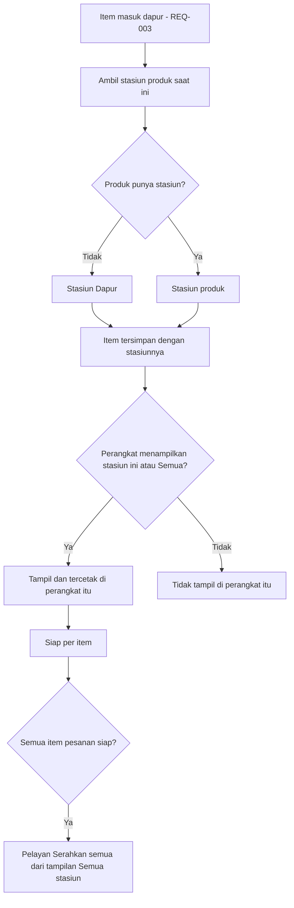

# REQ-006: Stasiun dapur terpisah (bar, dapur panas, dan lainnya)

- **Status:** ready
- **Owner:** @radityaaa43
- **Module:** module:sales
- **Updated:** 2026-11-26

## User stories

| # | Story | Journey | AC |
|---|---|---|---|
| US-1 | Sebagai **barista**, saya ingin Layar Dapur dan printer saya hanya menampilkan minuman, agar tidak memilah pesanan makanan yang bukan tugas saya. | J2, J3 | AC-04, AC-05, AC-07 |
| US-2 | Sebagai **juru masak**, saya ingin hanya melihat menu dapur panas, agar antrean saya pendek dan jelas. | J2 | AC-04, AC-05 |
| US-3 | Sebagai **pelayan**, saya ingin melihat satu pesanan utuh dari semua stasiun, agar saya menyerahkan pesanan lengkap ke meja. | J4 | AC-06 |
| US-4 | Sebagai **pemilik**, saya ingin mengatur stasiun dan menu mana yang dibuat di mana, agar alur dapur sesuai tata letak kedai saya. | J1 | AC-01, AC-02, AC-03 |
| US-5 | Sebagai **pemilik**, saya ingin melihat kecepatan per stasiun, agar tahu stasiun mana yang lambat. | J5 | AC-08 |

## Context

REQ-003 menaruh semua item dapur dalam **satu antrean per outlet**. REQ-004 menambah printer per
perangkat. Kedai yang punya **bar** (minuman) terpisah dari **dapur panas** (makanan) harus memilah
pesanan secara manual: barista melihat makanan, dan juru masak melihat minuman. REQ-003 menaruh
stasiun terpisah di luar cakupan. REQ ini menambahkannya.

**Keputusan** (Business/PM, didelegasikan pemilik, 2026-11-26; urutan A → B → C → D):

1. **Stasiun adalah daftar milik toko**, misalnya "Dapur", "Bar", "Pastry". Pemilik bisa menambah,
   mengganti nama, dan menghapus stasiun. Setiap outlet memakai daftar yang sama.
   - Ditolak: daftar stasiun per outlet. Produk berlaku di semua outlet, jadi stasiun per outlet akan
     membuat produk harus dipetakan berkali-kali.
2. **Setiap produk *Perlu dibuat di dapur* masuk tepat satu stasiun.** Produk yang belum dipetakan
   masuk stasiun bawaan **Dapur**.
3. **Stasiun dibaca saat item masuk dapur** (seperti penanda REQ-003). Memindahkan produk ke stasiun
   lain tidak mengubah item yang sudah di dapur.
4. **Layar Dapur memilih stasiun yang ditampilkan.** Satu perangkat bisa menampilkan satu stasiun,
   beberapa stasiun, atau **Semua stasiun** (bawaan). Pilihan disimpan di perangkat.
5. **Printer (REQ-004) mengikuti pilihan stasiun perangkatnya.** Tiket hanya berisi item stasiun itu,
   dengan judul nama stasiun. Pesanan yang punya item di dua stasiun menghasilkan dua tiket di dua
   printer.
6. **Serah terima melihat pesanan utuh.** Tampilan **Semua stasiun** menunjukkan setiap pesanan lengkap
   dengan status per item dari tiap stasiun, sehingga pelayan tahu kapan semuanya siap.
7. **Pesanan selesai tetap mengikuti aturan REQ-003**: semua item diserahkan dan lunas, apa pun
   stasiunnya.
8. **Saat rilis**, ada satu stasiun **Dapur** yang memuat semua produk dapur, dan semua perangkat
   menampilkan **Semua stasiun**. Jadi tidak ada yang berubah sampai pemilik membuat stasiun kedua.
9. **Istilah.** *Stasiun dapur* adalah area kerja (Dapur, Bar, Pastry). Perangkat yang mencetak
   disebut **perangkat cetak** (REQ-004). Perangkat cetak menyimpan di server stasiun dapur mana yang
   dilayaninya. Catatan "sudah dicetak" tetap per perangkat cetak dan per item, karena setiap item
   hanya punya satu stasiun.
10. **Menghapus stasiun = menonaktifkan.**
    - Stasiun yang dihapus disembunyikan, tetapi namanya tetap terlihat pada item lama dan di laporan.
    - Produknya pindah ke **Dapur** sekaligus.
    - Mengganti nama tidak mengubah identitas stasiun.
11. **Peringatan "stasiun tanpa perangkat" ditunda.** Fitur ini butuh pendaftaran semua perangkat
    layar dan detak per perangkat, yang memperbesar cakupan.
    - Untuk v1, tampilan **Semua stasiun** selalu menampilkan semua item, sehingga tidak ada yang
      hilang.
    - Peringatannya menjadi REQ tersendiri kalau diperlukan.

## Process

**Sekarang (as-is).**
1. Semua item dapur muncul di satu antrean dan di satu jenis tiket.
2. Barista dan juru masak memilah sendiri.
3. Tiket printer berisi makanan dan minuman sekaligus.

**Tujuan (to-be).**
1. Pemilik membuat stasiun (misalnya **Bar**) dan memindahkan produk minuman ke Bar.
2. Tablet di bar memilih stasiun **Bar**, dan tablet di dapur memilih **Dapur**.
3. Pesanan berisi kopi dan nasi goreng: kopi tampil dan tercetak di Bar, nasi goreng di Dapur.
4. Pelayan memakai tampilan **Semua stasiun** dan menyerahkan pesanan lengkap.

## User journey and flow

### Perjalanan per peran

**J1. Menyiapkan stasiun** (pemilik, sekali)

| # | Langkah | Yang dilihat atau dilakukan | AC | Titik rawan |
|---|---|---|---|---|
| 1 | Buka **Pengaturan → Stasiun dapur** | Daftar stasiun, yang saat rilis hanya **Dapur** | AC-01 | Hanya pemilik atau peran berizin |
| 2 | Tambah stasiun **Bar** | Stasiun baru di daftar | AC-01 | Nama ganda ditolak |
| 3 | Di form produk, pilih stasiun untuk produk minuman | Pilihan stasiun, hanya untuk produk *Perlu dibuat di dapur* | AC-02 | Produk tanpa pilihan masuk **Dapur** |
| 4 | Hapus stasiun yang tidak dipakai | Produknya kembali ke **Dapur**, dan item yang sudah di dapur tidak berubah | AC-03 | Stasiun **Dapur** tidak bisa dihapus |

**J2. Pesanan berisi dua stasiun** (tamu, barista, juru masak)

| # | Langkah | Aktor | Yang terjadi | AC |
|---|---|---|---|---|
| 1 | Pesanan kopi dan nasi goreng masuk dapur (REQ-003) | Sistem | Setiap item mendapat stasiun produknya saat itu | AC-04 |
| 2 | Tablet Bar dan tablet Dapur memperbarui diri | Stasiun | Kopi hanya tampil di Bar, nasi goreng hanya di Dapur | AC-05 |
| 3 | Barista menekan *Siap* untuk kopi | Barista | Hanya item kopi yang berubah | REQ-003 AC-08 |

**J3. Tiket printer per stasiun** (REQ-004)

| # | Langkah | Yang tercetak | AC |
|---|---|---|---|
| 1 | Pesanan dua stasiun masuk | Perangkat cetak Bar mencetak tiket **BAR** berisi kopi, printer Dapur mencetak tiket **DAPUR** berisi nasi goreng | AC-07 |
| 2 | Pesanan tambahan hanya minuman | Hanya printer Bar yang mencetak tiket TAMBAHAN | AC-07 |

**J4. Serah terima pesanan utuh** (pelayan)

| # | Langkah | Yang dilihat | AC |
|---|---|---|---|
| 1 | Membuka Layar Dapur dengan pilihan **Semua stasiun** | Setiap pesanan lengkap, dengan nama stasiun dan status per item | AC-06 |
| 2 | Kopi siap, nasi goreng belum | Pesanan menunjukkan **1 dari 2 siap** | AC-06 |
| 3 | Semua siap, lalu *Serahkan semua* | Pesanan selesai kalau lunas (REQ-003) | AC-06 |

**J5. Kecepatan per stasiun** (pemilik)

| # | Langkah | Yang dilihat | AC |
|---|---|---|---|
| 1 | Membuka laporan kecepatan dapur (REQ-003) | Saringan **Stasiun**, dan per menu kolom stasiunnya | AC-08 |

### Alur

### Status

Status item tidak berubah dari REQ-003 (accepted → preparing → ready → served, atau cancelled).
Stasiun hanya menentukan **di mana** item tampil dan tercetak, bukan statusnya. Stasiun sendiri tidak
punya status, karena hanya bisa ada atau dihapus.

## Stakeholders

| Pihak | Peran dalam alur | Kepentingan | Yang memutuskan |
|---|---|---|---|
| Pemilik usaha | Membuat stasiun dan memetakan produk | Alur sesuai tata letak kedai | Daftar stasiun dan pemetaan |
| Barista dan juru masak | Membuat menu di stasiunnya | Antrean bersih | Stasiun yang ditampilkan di perangkatnya |
| Pelayan | Menyerahkan pesanan | Pesanan lengkap | — |

## Acceptance criteria

### Pengaturan

- **AC-01:** Given pengguna yang boleh mengubah produk, when membuka **Stasiun dapur**, then bisa
  menambah, mengganti nama, dan menghapus stasiun. Nama stasiun unik, dan **Dapur** selalu ada serta
  tidak bisa dihapus.
- **AC-02:** Given produk *Perlu dibuat di dapur*, when pengguna membuka form produk, then bisa memilih
  tepat satu stasiun. Produk tanpa pilihan masuk **Dapur**.
- **AC-03:** Given stasiun yang dihapus, when penghapusan disimpan, then produknya kembali ke **Dapur**,
  dan item yang sudah di dapur tetap di stasiun lamanya sampai selesai.

### Antrean dan tiket

- **AC-04:** Given item masuk dapur, when item dibuat, then item menyimpan stasiun produknya saat itu.
  Perubahan produk sesudahnya tidak mengubah item itu.
- **AC-05:** Given Layar Dapur dengan pilihan satu atau beberapa stasiun, when antrean ditampilkan, then
  hanya item stasiun itu yang tampil. Pilihan disimpan di perangkat, dan bawaannya **Semua stasiun**.
- **AC-06:** Given pilihan **Semua stasiun**, when pesanan punya item di beberapa stasiun, then pesanan
  tampil utuh dengan nama stasiun dan status tiap item, serta penanda **x dari y siap**.
- **AC-07:** Given perangkat cetak (REQ-004) dengan pilihan stasiun, when item masuk dapur,
  then tiketnya hanya berisi item dari stasiun dapur yang dilayani perangkat itu, dengan judul nama stasiun. Pesanan tambahan dan
  pembatalan mengikuti aturan yang sama.
- **AC-08:** Given laporan kecepatan dapur (REQ-003), when pemilik memilih saringan **Stasiun**, then
  angka per menu hanya menghitung item stasiun itu.

### Rilis

- **AC-09:** Given data sebelum rilis, when fitur rilis, then ada satu stasiun **Dapur** berisi semua
  produk dapur, item lama tercatat di **Dapur**, dan semua perangkat menampilkan **Semua stasiun**.

<!-- Edge cases:
     - offline: n/a (alur REQ-003/004).
     - split payment: n/a (hanya tampilan dapur).
     - stok tidak cukup: n/a.
     - batal sebelum atau sesudah bayar: tiket DIBATALKAN per stasiun (AC-07).
     - tutup shift: n/a (aturan REQ-003 tidak berubah).
     - gagal bayar: n/a.
     - akses ditolak: AC-01 (izin ubah produk).
     - bersamaan: produk dipindah saat pesanan masuk, item memakai stasiun saat dibuat (AC-04).
     - data lama: AC-09. -->

## Business rules

- **Uang dan stok:** tidak berubah. Stasiun hanya mengatur tampilan dan cetak.
- **Izin:** mengatur stasiun dan pemetaan produk memakai izin ubah produk. Memilih stasiun di perangkat
  memakai izin Layar Dapur. Tidak ada izin baru.
- **Pengaturan:** daftar stasiun berlaku untuk seluruh toko. Pilihan stasiun berlaku per perangkat.
- **Stasiun Dapur** wajib ada dan menjadi stasiun cadangan.
- **Pesanan siap di layar stasiun (keputusan pemilik, 2026-11-28, #361):** di layar yang disaring per
  stasiun, pesanan yang semua item stasiun itu sudah **Siap** pindah ke bagian **Siap diambil** di
  bawah area kerja. Yang tampil 10 pesanan yang paling lama menunggu sejak siap; **Lihat semua (n)**
  membuka semuanya. Item yang belum dibuat tidak pernah disembunyikan. **Semua stasiun** tidak
  berubah (keputusan 6).

## Non-functional requirements

- **Kecepatan:** saringan stasiun tidak memperlambat Layar Dapur. Pesanan tetap tampil dalam 10 detik
  (REQ-003 AC-24).
- **Keandalan:** menghapus stasiun tidak pernah membuat item hilang dari antrean.
- **Keamanan:** server memeriksa izin untuk pengaturan stasiun.
- **Audit:** membuat, mengganti nama, dan menghapus stasiun tercatat di audit log.
- **Bahasa dan aksesibilitas:** Indonesia dan Inggris. Nama stasiun ditulis bebas oleh pemilik.

## Data and integrations

- **Data:**
  - daftar stasiun (baru);
  - stasiun pada produk (baru);
  - stasiun pada item dapur (baru, disimpan saat masuk);
  - pilihan stasiun per perangkat (disimpan di perangkat).
- **Integrasi:** tidak ada.

## Success metrics

- **Antrean bersih:** di toko dengan dua stasiun atau lebih, 0 item yang tampil di stasiun yang salah.
  Diukur dari uji manual per rilis.
- **Kecepatan per stasiun:** median waktu buat per stasiun dari laporan REQ-003. Bulan pertama menjadi
  baseline.

## Out of scope

- Satu produk dibuat di dua stasiun, misalnya paket berisi minuman dan makanan. Produk komposit tetap
  satu stasiun. Kalau diperlukan, dibuat REQ tersendiri.
- Stasiun yang berbeda per outlet.
- Mengarahkan item ke stasiun berdasarkan jam atau beban kerja.
- Peringatan otomatis "stasiun tanpa perangkat" (keputusan 11).

## Risks and assumptions

| Risiko | Dampak | Mitigasi |
|---|---|---|
| Produk salah dipetakan | Minuman muncul di dapur | Pemilik bisa memindahkan kapan saja. Item yang terlanjur masuk tetap di stasiun lama sampai selesai |
| Tidak ada perangkat yang menampilkan stasiun tertentu | Item stasiun itu tidak terlihat di stasiunnya | Tampilan **Semua stasiun** selalu menampilkannya. Peringatan otomatis ditunda (keputusan 11) |
| Paket (produk komposit) berisi minuman dan makanan | Hanya satu stasiun yang melihatnya | Diterima untuk v1, dan dicatat di Out of scope |

- Kelayakan dicek Tech Lead (2026-11-26):
  - tabel stasiun untuk seluruh toko, ditambah stasiun pada produk dan pada item dapur (disimpan saat
    masuk);
  - hapus = nonaktifkan, tanpa masalah relasi data;
  - penanda "x dari y siap" dihitung dari data yang sudah dimuat layar, tanpa query tambahan.

## Open questions

- Semua terjawab 2026-11-26 (keputusan 9–11).

## Delivered by

<!-- Issues and PRs, filled in as work ships. -->
