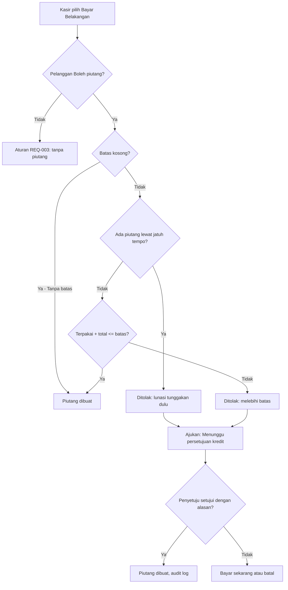

# REQ-007: Batas piutang pelanggan

- **Status:** ready
- **Owner:** @radityaaa43
- **Module:** module:pricing-crm
- **Updated:** 2026-11-26

## User stories

| # | Story | Journey | AC |
|---|---|---|---|
| US-1 | Sebagai **pemilik**, saya ingin menetapkan batas nominal piutang per pelanggan, agar piutang tidak membengkak tanpa terkendali. | J1 | AC-01, AC-02 |
| US-2 | Sebagai **kasir**, saya ingin langsung tahu sisa batas piutang pelanggan saat checkout, agar tidak membuat piutang yang melebihi batas. | J2 | AC-03, AC-04 |
| US-3 | Sebagai **pemilik**, saya ingin pelanggan berbatas yang punya piutang lewat jatuh tempo tidak bisa menambah piutang baru, agar tagihan lama dilunasi dulu. | J3 | AC-05 |
| US-4 | Sebagai **manajer**, saya ingin bisa memberi pengecualian dengan alasan yang tercatat, agar pelanggan penting tetap terlayani tanpa menghilangkan kontrol. | J4 | AC-06 |
| US-5 | Sebagai **pemilik**, saya ingin melihat pelanggan yang mendekati atau melewati batas, agar bisa menagih lebih awal. | J5 | AC-07 |

## Context

REQ-003 memberi pelanggan terdaftar penanda **Boleh piutang** (#239). Bayar Belakangan untuk pelanggan
itu menjadi piutang dengan jatuh tempo (#240). Sekarang tidak ada batas nominal: pelanggan dengan izin
piutang bisa terus berutang tanpa batas, termasuk saat piutang lamanya sudah lewat jatuh tempo. REQ-003
menaruh batas piutang di luar cakupan. REQ ini menambahkannya. Data piutang sudah ada (`receivables`:
total, terbayar, sisa, jatuh tempo, status).

**Keputusan** (Business/PM, didelegasikan pemilik, 2026-11-26; urutan A → B → C → D):

1. **Batas per pelanggan, dalam rupiah.** Batas hanya berlaku untuk pelanggan dengan *Boleh piutang*.
   Batas kosong berarti **Tanpa batas**.
2. **Saat rilis, semua pelanggan *Boleh piutang* tetap Tanpa batas**, sehingga penjualan kredit yang
   berjalan tidak tiba-tiba ditolak. Pelanggan Tanpa batas diberi penanda supaya pemilik bisa
   menetapkan batasnya.
   - Ditolak: memberi batas bawaan untuk semua pelanggan saat rilis. Pelanggan langganan bisa tertolak
     di kasir tanpa pemberitahuan.
3. **Pemakaian piutang** adalah jumlah sisa semua piutang pelanggan yang belum lunas, di semua outlet.
4. **Bayar Belakangan ditolak** kalau pemakaian ditambah transaksi baru melebihi batas. Kasir melihat
   batas, pemakaian, dan sisa batasnya.
5. **Piutang lewat jatuh tempo memblokir piutang baru untuk pelanggan berbatas.** Kalau pelanggan yang
   punya batas mempunyai piutang yang lewat jatuh tempo dan belum lunas, Bayar Belakangan ditolak,
   walaupun batasnya masih cukup.
   - Pelanggan **Tanpa batas** tidak diblokir. Kasir tetap melihat **Ada piutang lewat jatuh tempo**
     di panel sebagai peringatan. Pemilik mengaktifkan blokir dengan menetapkan batas.
   - Diputuskan 2026-11-26 (Business/PM, didelegasikan pemilik; #349 Q1). Pengendalian kredit hanya
     berlaku untuk pelanggan yang punya profil kredit (batas), seperti praktik umum manajemen kredit.
     Ini sejalan dengan keputusan 2, yaitu saat rilis tidak ada penjualan kredit berjalan yang tiba-tiba
     ditolak.
   - Ditolak: blokir tunggakan untuk semua pelanggan. Pada hari rilis, pelanggan langganan yang punya
     tunggakan lama langsung tertolak di kasir tanpa pemberitahuan, risiko yang sama dengan yang
     ditolak di keputusan 2.
6. **Pengecualian lewat antrean persetujuan**, sama dengan persetujuan diskon yang sudah ada.
   - Transaksi yang ditolak bisa diajukan, lalu ditahan sebagai **Menunggu persetujuan kredit**.
   - Pengguna dengan izin `customers-credit-approve` di outlet itu menyetujui atau menolaknya dari
     daftar persetujuan. Alasan wajib diisi dan dicatat di audit log.
   - Kalau disetujui, satu transaksi itu menjadi piutang, dan batas tidak berubah. Pesanan baru masuk
     dapur setelah disetujui.
   - Kalau ditolak, kasir meminta bayar sekarang atau membatalkan.
   - Ditolak: kasir menaikkan batas sendiri, karena batas adalah keputusan uang pemilik.
   - Ditolak: login penyetuju di perangkat kasir, karena itu mekanisme baru. Antrean yang sudah ada
     lebih cepat dibangun dan sudah teruji.
7. **Hanya izin `customers-credit-approve`** yang bisa mengubah batas. Ini izin yang sama dengan
   penanda *Boleh piutang* (#239). Setiap perubahan tercatat di audit log.
8. **API (aplikasi mobile)** menerapkan aturan yang sama. Penolakan dikembalikan sebagai error yang
   jelas (`credit_limit_exceeded` atau `credit_overdue`). Pengajuan persetujuan hanya lewat aplikasi
   web.

## Process

**Sekarang (as-is).**
1. Kasir memilih Bayar Belakangan untuk pelanggan *Boleh piutang*.
2. Piutang langsung dibuat, berapa pun jumlah utang pelanggan saat itu dan walaupun ada tagihan yang
   menunggak.

**Tujuan (to-be).**
1. Pemilik menetapkan batas per pelanggan.
2. Saat kasir memilih Bayar Belakangan, sistem mengecek pemakaian, batas, dan tunggakan.
3. Kalau aman, piutang dibuat. Kalau tidak, kasir melihat alasannya. Kasir lalu meminta pelanggan
   membayar sekarang, atau meminta pengecualian dari manajer yang berizin.
4. Pemilik melihat daftar pelanggan yang mendekati atau melewati batas.

## User journey and flow

### Perjalanan per peran

**J1. Menetapkan batas** (pemilik)

| # | Langkah | Yang dilihat atau dilakukan | AC | Titik rawan |
|---|---|---|---|---|
| 1 | Buka detail pelanggan *Boleh piutang* | **Batas piutang: Tanpa batas**, pemakaian sekarang, dan tombol ubah | AC-01 | Tanpa izin: hanya bisa melihat |
| 2 | Isi batas, misalnya Rp 2.000.000, lalu simpan | Batas tersimpan dan tercatat di audit log | AC-01, AC-02 | Batas di bawah pemakaian sekarang tetap diterima, dan pelanggan langsung tidak bisa berutang lagi |
| 3 | Kosongkan batas | Kembali ke **Tanpa batas** | AC-01 | — |

**J2. Checkout Bayar Belakangan** (kasir)

| # | Langkah | Yang terjadi | AC |
|---|---|---|---|
| 1 | Memilih pelanggan *Boleh piutang* | Panel pelanggan menampilkan **Batas, Terpakai, Sisa** | AC-03 |
| 2 | Memilih Bayar Belakangan, total masih dalam sisa batas | Piutang dibuat seperti sekarang (#240) | AC-04 |
| 3 | Total melebihi sisa batas | Ditolak dengan **Melebihi batas piutang — sisa Rp X**. Kasir bisa bayar sekarang atau minta pengecualian | AC-04 |

**J3. Pelanggan menunggak**

| # | Langkah | Yang terjadi | AC |
|---|---|---|---|
| 1 | Pelanggan punya piutang lewat jatuh tempo | Panel menampilkan **Ada piutang lewat jatuh tempo** (juga untuk pelanggan Tanpa batas, sebagai peringatan) | AC-03, AC-05 |
| 2 | Kasir memilih Bayar Belakangan | Pelanggan berbatas: ditolak dengan **Lunasi piutang yang lewat jatuh tempo dulu**, walaupun sisa batas cukup. Pelanggan Tanpa batas: piutang dibuat seperti sekarang | AC-05 |

**J4. Pengecualian oleh manajer**

| # | Langkah | Yang terjadi | AC |
|---|---|---|---|
| 1 | Kasir mengajukan pengecualian | Transaksi ditahan sebagai **Menunggu persetujuan kredit** dan muncul di daftar persetujuan outlet | AC-06 |
| 2 | Pengguna dengan `customers-credit-approve` menyetujui dengan alasan | Transaksi menjadi piutang dan masuk dapur. Batas tidak berubah. Audit log mencatat siapa, alasan, dan jumlahnya | AC-06 |
| 2b | Ditolak | Kasir melihat penolakannya, lalu meminta bayar sekarang atau membatalkan | AC-06 |
| 3 | Pengguna tanpa izin mencoba menyetujui | Ditolak oleh server | AC-06 |

**J5. Memantau piutang** (pemilik)

| # | Langkah | Yang dilihat | AC |
|---|---|---|---|
| 1 | Membuka daftar Piutang | Kolom **Batas** dan **Terpakai %**, plus saringan **Mendekati batas (≥ 80%)**, **Melewati batas**, **Tanpa batas** | AC-07 |

### Alur

### Status

Batas tidak punya status. Status piutang tidak berubah (belum lunas, sebagian, lunas). Tunggakan
dibaca dari jatuh tempo, sehingga tidak perlu diagram state baru.

## Stakeholders

| Pihak | Peran dalam alur | Kepentingan | Yang memutuskan |
|---|---|---|---|
| Pemilik usaha | Menetapkan batas dan memantau | Uang tidak macet | Batas per pelanggan |
| Manajer | Memberi pengecualian | Melayani pelanggan penting | Pengecualian per transaksi |
| Kasir | Checkout | Tahu cepat boleh atau tidak | — |
| Pelanggan kredit | Berbelanja dengan kredit | Tetap bisa berbelanja | — |

## Acceptance criteria

### Batas

- **AC-01:** Given pengguna dengan `customers-credit-approve`, when membuka pelanggan *Boleh piutang*,
  then bisa mengisi atau mengosongkan **Batas piutang** dalam rupiah (≥ 0). Kosong berarti **Tanpa
  batas**. Pengguna lain hanya melihat, dan server menolak perubahan dari mereka.
- **AC-02:** Given perubahan batas, when disimpan, then audit log mencatat siapa, kapan, nilai lama,
  dan nilai baru.

### Checkout

- **AC-03:** Given pelanggan *Boleh piutang* dipilih di POS, when panel pelanggan tampil, then terlihat
  **Batas**, **Terpakai** (sisa semua piutang yang belum lunas di semua outlet), dan **Sisa**, atau
  **Tanpa batas**.
- **AC-04:** Given Bayar Belakangan untuk pelanggan berbatas, when *Terpakai + total* melebihi batas,
  then transaksi ditolak dengan **Melebihi batas piutang — sisa Rp X**. Kalau tidak melebihi, piutang
  dibuat seperti sekarang (#240).
- **AC-05:** Given pelanggan **berbatas** dengan piutang lewat jatuh tempo yang belum lunas, when kasir
  memilih Bayar Belakangan, then transaksi ditolak dengan **Lunasi piutang yang lewat jatuh tempo dulu**,
  apa pun sisa batasnya. Pelanggan **Tanpa batas** dengan tunggakan tidak ditolak (keputusan 5).
- **AC-06:** Given transaksi yang ditolak karena AC-04 atau AC-05, when kasir mengajukannya, then
  transaksi ditahan sebagai **Menunggu persetujuan kredit**. Pengguna dengan `customers-credit-approve`
  di outlet itu bisa menyetujui (alasan wajib) atau menolak. Kalau disetujui, transaksi menjadi
  piutang dan masuk dapur, batas tidak berubah, dan audit log mencatat penyetuju, alasan, jumlah, dan
  pelanggan. Server menolak persetujuan dari pengguna tanpa izin.
- **AC-09:** Given checkout lewat API, when Bayar Belakangan melanggar AC-04 atau AC-05, then API
  menolak dengan error `credit_limit_exceeded` atau `credit_overdue` beserta sisa batasnya.

### Pemantauan dan rilis

- **AC-07:** Given daftar Piutang, when pemilik membukanya, then terlihat kolom **Batas** dan
  **Terpakai %**, serta saringan **Mendekati batas (≥ 80%)**, **Melewati batas**, dan **Tanpa batas**.
- **AC-08:** Given data sebelum rilis, when fitur rilis, then semua pelanggan *Boleh piutang* tercatat
  **Tanpa batas**, dan tidak ada penjualan kredit yang berjalan yang tertolak.

<!-- Edge cases:
     - offline: n/a. Bayar Belakangan tidak tersedia saat offline (REQ-003, #240).
     - split: Bayar Belakangan tidak digabung dengan metode lain (tetap seperti sekarang).
     - stok tidak cukup: n/a.
     - batal atau retur: retur piutang menurunkan Terpakai (#213, #219).
     - tutup shift: n/a.
     - gagal bayar: n/a.
     - akses ditolak: AC-01, AC-06.
     - bersamaan: dua kasir membuat piutang untuk pelanggan yang sama hampir bersamaan, dan pengecekan
       batas harus tetap benar (lihat NFR).
     - data lama: AC-08. -->

## Business rules

- **Uang:**
  - Terpakai adalah jumlah sisa piutang yang belum lunas di semua outlet.
  - Batas dicek terhadap *Terpakai + total transaksi*.
  - Pengecualian hanya untuk satu transaksi dan tidak mengubah batas.
- **Izin:** `customers-credit-approve` untuk batas dan pengecualian. Tidak ada izin baru.
- **Pengaturan:** batas per pelanggan. Tidak ada pengaturan outlet baru.
- **Tunggakan:** piutang dengan jatuh tempo sebelum hari ini dan sisa di atas 0. Tunggakan memblokir
  piutang baru hanya untuk pelanggan berbatas (keputusan 5).
- **Keputusan saat build (Business/PM, 2026-11-28):** batas di bawah pemakaian diterima saat disimpan (#348); penolakan kredit barunya dibangun di #349 (BR-9).

## Non-functional requirements

- **Kecepatan:** pengecekan batas tidak menambah waktu checkout yang terasa (< 300 ms).
- **Keandalan:** dua kasir yang membuat piutang untuk pelanggan yang sama hampir bersamaan tidak bisa
  bersama-sama melewati batas. Pengecekan dan pembuatan piutang terjadi dalam satu langkah yang
  terkunci per pelanggan.
- **Keamanan:** server memeriksa izin untuk perubahan batas dan pengecualian.
- **Audit:** perubahan batas dan setiap pengecualian tercatat di audit log.
- **Bahasa:** Indonesia dan Inggris. Jumlah dalam format rupiah.

## Data and integrations

- **Data:** batas piutang pada pelanggan (baru, boleh kosong). Piutang yang sudah ada. Catatan
  pengecualian di audit log.
- **Integrasi:** tidak ada. Pengingat penagihan CRM yang sudah ada tetap berjalan.

## Success metrics

- **Piutang macet:** total piutang lewat jatuh tempo per bulan, dibandingkan sebelum rilis. Sumber:
  laporan aging.
- **Pengecualian:** jumlah pengecualian per bulan. Kalau tinggi, batas kemungkinan terlalu rendah.
  Sumber: audit log.

## Out of scope

- Batas per outlet.
- Batas otomatis dari riwayat belanja.
- Bunga atau denda keterlambatan.
- Menampilkan batas di portal pelanggan.

## Risks and assumptions

| Risiko | Dampak | Mitigasi |
|---|---|---|
| Pelanggan langganan tertolak karena tunggakan kecil | Pelanggan kecewa | Pengecualian manajer (AC-06), dan kasir melihat alasannya dengan jelas |
| Pengecualian disalahgunakan | Batas tidak bermakna | Izin terpisah, alasan wajib, audit log, dan metrik pengecualian |
| Pemilik tidak pernah menetapkan batas | Fitur tidak terpakai | Saringan **Tanpa batas** di daftar Piutang (AC-07) |

- Kelayakan dicek Tech Lead (2026-11-26):
  - penguncian baris pelanggan di dalam transaksi checkout mencegah dua kasir bersama-sama melewati
    batas;
  - Terpakai dihitung dengan satu query yang terindeks;
  - aturannya ada di layanan checkout yang sama untuk web dan API;
  - antrean persetujuan diskon dipakai ulang.

## Open questions

- Semua terjawab 2026-11-26 (keputusan 6–8; cakupan blokir tunggakan: keputusan 5, #349 Q1).

## Delivered by

<!-- Issues and PRs, filled in as work ships. -->
