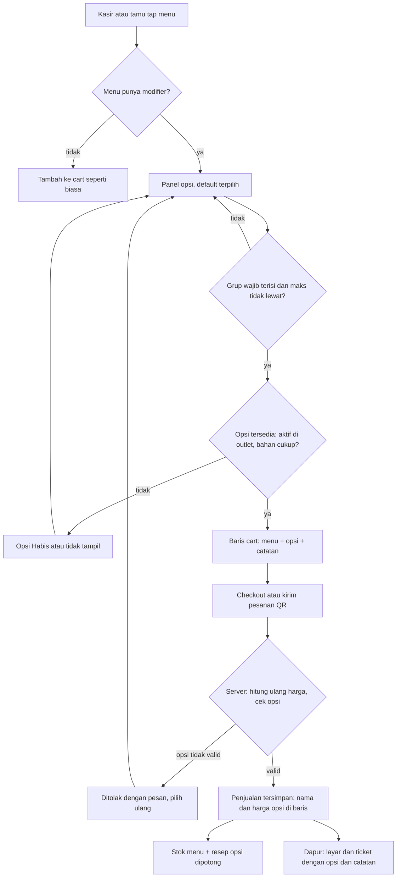

# REQ-008: Menu modifier (pilihan dan catatan per item)

- **Status:** draft
- **Owner:** @radityaaa43
- **Module:** module:sales
- **Updated:** 2026-11-28

## User stories

| # | Story | Journey | AC |
|---|---|---|---|
| US-1 | Sebagai **pemilik atau manajer** (izin `modifiers-manage`), saya ingin membuat grup pilihan (Size, Level gula, Topping) dengan harga dan resep per opsi lalu memasangnya ke banyak menu, agar satu menu tidak perlu dibuat berkali-kali untuk setiap variasi. | J1 | AC-01, AC-02, AC-03, AC-04, AC-05 |
| US-2 | Sebagai **kasir**, saya ingin memilih opsi dan menulis catatan saat menambah menu ke cart, dengan opsi default sudah terpilih, agar pesanan cepat dan benar di jam ramai. | J2 | AC-06, AC-07, AC-08, AC-09, AC-10, AC-11, AC-12, AC-13, AC-14 |
| US-3 | Sebagai **tamu dine-in**, saya ingin memilih opsi dan menulis catatan sendiri di QR menu, agar pesanan saya sesuai selera tanpa memanggil pelayan. | J3 | AC-15, AC-16 |
| US-4 | Sebagai **staf dapur**, saya ingin melihat opsi dan catatan setiap item di layar dan ticket dapur, agar yang dibuat sesuai pesanan. | J4 | AC-17, AC-18 |
| US-5 | Sebagai **pemilik**, saya ingin melihat berapa kali tiap opsi terjual dan omzetnya, agar tahu opsi mana yang laku dan layak dipertahankan. | J5 | AC-19 |

## Context

Hari ini setiap variasi menu harus dibuat sebagai produk terpisah (Kopi Susu Regular, Kopi Susu Large, Kopi Susu Less Sugar, ...). Daftar produk membengkak, laporan terpecah, dan pilihan seperti level gula atau topping tidak bisa dicatat sama sekali. Catatan per item sudah ada untuk dine-in (`dine_order_items.note`, `kitchen_items.note`) tetapi belum ada di POS. Resep dan bahan baku ada sejak REQ-001; price list per outlet ada untuk harga menu.

**Decisions** (each dated, with who decided):

1. Modifier diatur sebagai **grup**: wajib atau opsional, pilih satu atau banyak, dengan minimum dan maksimum pilihan. Satu grup bisa dipasang ke banyak menu. (pemilik, 2026-11-28)
2. **Harga:** tiap opsi punya tambahan harga ≥ 0. Harga satu porsi = harga menu + total harga opsi yang dipilih. (pemilik, 2026-11-28)
3. **Stok:** opsi boleh punya resep sendiri (bahan baku dan jumlah) yang ikut dipotong saat terjual. Opsi tanpa resep tidak memotong apa pun. Mengganti bahan resep menu (oat milk menggantikan fresh milk) tidak termasuk. (pemilik, 2026-11-28)
4. **Channel versi pertama:** POS kasir, QR menu meja, layar dan ticket dapur, laporan penjualan per opsi. (pemilik, 2026-11-28)
5. **Promo, diskon, voucher** berlaku ke satu baris penuh (menu + opsi). Item gratis dari promo buy X get Y: menunya gratis, opsi berbayar tetap ditagih. (pemilik, 2026-11-28)
6. **Per outlet:** harga opsi sama di semua outlet; opsi bisa dinonaktifkan per outlet. (pemilik, 2026-11-28)
7. **Catatan bebas per item** (maks 100 karakter) di POS dan QR menu, tanpa harga dan tanpa stok, tampil di dapur. (pemilik, 2026-11-28)
8. **Opsi yang bahannya kurang** tampil **Habis** dan tidak bisa dipilih. Kalau semua opsi di grup wajib habis, menunya tidak bisa dipesan. (pemilik, 2026-11-28)
9. **Izin baru `modifiers-manage`** untuk membuat dan mengubah grup modifier, diatur per toko lewat role. (pemilik, 2026-11-28)
10. **Satu opsi default per grup wajib** (misal Regular, Normal sugar) yang sudah terpilih saat menu ditambahkan. (pemilik, 2026-11-28)
11. **Harga dan nama opsi disimpan di baris penjualan** saat checkout. Mengubah atau menghapus opsi nanti tidak mengubah penjualan lama. Alasan: praktik standar POS (struk dan laporan harus tetap sama dengan yang dibayar). Ditolak: membaca opsi dari master saat laporan dibuka, karena laporan lama akan berubah. (Business/PM, didelegasikan pemilik, 2026-11-28)
12. **Satu menu dengan opsi atau catatan berbeda = baris cart terpisah**; menu yang sama dengan opsi dan catatan sama digabung jadi qty. Alasan: dapur dan struk harus bisa membedakan setiap porsi. Ditolak: satu baris dengan campuran opsi per qty, karena tidak bisa ditampilkan dengan jelas di dapur. (Business/PM, 2026-11-28)
13. **Server selalu menghitung ulang harga opsi saat checkout** dari data terbaru, dari channel mana pun. Baris tanpa opsi dari channel yang belum mengenal modifier (mis. mobile POS API) mendapat opsi default grup wajib; kalau grup wajib tidak punya default yang tersedia, baris itu ditolak. Alasan: harga dari klien tidak dipercaya (sama seperti AC-02 REQ-005). Ditolak: menerima harga opsi dari klien. (Business/PM, 2026-11-28)
14. **Retur** mengembalikan satu baris utuh (menu + opsinya); retur opsi saja tidak ada. Stok bahan resep opsi dikembalikan dengan aturan yang sama seperti menunya (REQ-003 AC-11). (Business/PM, 2026-11-28)
15. **Pajak dan poin loyalty** dihitung dari nilai baris penuh, sama seperti harga menu. **Laporan kecepatan dapur** (REQ-003) tetap per menu; opsi tidak dipisah. (Business/PM, 2026-11-28)

## Process

**As-is.**
- Pemilik membuat satu produk untuk setiap variasi. Topping dan level gula tidak bisa diatur.
- Kasir mencari produk variasi yang tepat di daftar panjang; permintaan khusus disampaikan lisan ke dapur.
- Tamu QR hanya bisa menulis catatan; tidak ada pilihan dengan harga.
- Dapur tidak melihat permintaan khusus dari POS. Pemilik tidak tahu topping mana yang laku.

**To-be.**
- Pemilik membuat grup modifier sekali, memasangnya ke menu, dan mematikan opsi yang tidak tersedia di outlet tertentu.
- Kasir tap menu, opsi default sudah terpilih, ubah bila perlu, tulis catatan, lalu checkout seperti biasa.
- Tamu QR memilih opsi dan menulis catatan sendiri dengan aturan yang sama.
- Dapur melihat opsi dan catatan di layar dan ticket. Pemilik membuka laporan per opsi.

## User journey and flow

### Journeys per role

**J1. Mengatur grup modifier** (pemilik atau manajer dengan `modifiers-manage`, saat menyiapkan menu)

| # | Step | Actor | What they see or do | AC | Weak point |
|---|---|---|---|---|---|
| 1 | Buka **Modifier** di menu produk | Pemilik | Daftar grup modifier, tombol **Tambah grup** | AC-01 | Tanpa izin: menu tidak tampil, server menolak (AC-05) |
| 2 | Buat grup: nama, wajib/opsional, min, maks | Pemilik | Form grup | AC-01 | Min > maks, atau grup wajib dengan min 0: ditolak dengan pesan |
| 3 | Tambah opsi: nama, tambahan harga, resep (opsional), default | Pemilik | Daftar opsi dalam grup | AC-02 | Harga negatif ditolak; dua default dalam satu grup ditolak; grup wajib tanpa default ditolak |
| 4 | Pasang grup ke satu atau beberapa menu, atur urutan | Pemilik | Di form menu: bagian **Modifier** | AC-03 | Bahan baku (REQ-001) tidak bisa diberi modifier |
| 5 | Nonaktifkan opsi untuk outlet tertentu | Pemilik | Saklar aktif per outlet | AC-04 | — |
| 6 | Ubah harga atau hapus opsi yang pernah terjual | Pemilik | Perubahan berlaku untuk penjualan berikutnya | AC-14 | Penjualan lama tetap (keputusan 11) |

**J2. Menjual menu dengan modifier di POS** (kasir, saat melayani)

| # | Step | Actor | What they see or do | AC | Weak point |
|---|---|---|---|---|---|
| 1 | Tap menu yang punya modifier | Kasir | Panel pilihan terbuka, opsi default sudah terpilih, harga porsi terlihat | AC-06 | — |
| 2 | Ubah opsi, tulis catatan, tambah ke cart | Kasir | Baris cart: menu, opsi, catatan, harga | AC-07, AC-08 | Maks terlampaui: opsi lain terkunci; grup wajib kosong: tombol tambah nonaktif |
| 3 | Opsi bahannya kurang | Kasir | Opsi abu-abu bertanda **Habis** | AC-09 | Semua opsi grup wajib habis: menu tidak bisa dipesan |
| 4 | Menu yang sama dengan opsi berbeda | Kasir | Baris cart terpisah | AC-10 | — |
| 5 | Promo atau diskon aktif | Kasir | Diskon dihitung dari baris penuh | AC-11 | Item gratis: opsi berbayar tetap ditagih |
| 6 | Checkout | Kasir | Struk menampilkan opsi dan catatan per item | AC-12 | Opsi dinonaktifkan atau harganya berubah saat di cart: server memakai data terbaru atau menolak (AC-13) |
| 7 | Offline | Kasir | Modifier tetap bisa dipilih dari cache; penjualan di-sync nanti | AC-12 | Opsi berubah saat offline: server menghitung ulang saat sync (AC-13) |
| 8 | Retur baris dengan opsi | Kasir | Satu baris utuh diretur | AC-14 | — |

**J3. Memesan dengan modifier di QR menu** (tamu dine-in, di meja)

| # | Step | Actor | What they see or do | AC | Weak point |
|---|---|---|---|---|---|
| 1 | Tap menu | Tamu | Pilihan opsi dengan default terpilih, harga porsi, kolom catatan | AC-15 | Opsi nonaktif di outlet ini tidak tampil |
| 2 | Kirim pesanan | Tamu | Pesanan masuk dengan opsi dan catatan | AC-15 | Opsi habis setelah halaman dibuka: ditolak dengan pesan, tamu memilih ulang (AC-16) |
| 3 | Pesanan tambahan (REQ-003 AC-21) | Tamu | Aturan modifier yang sama | AC-15 | — |

**J4. Membuat pesanan di dapur** (staf dapur)

| # | Step | Actor | What they see or do | AC | Weak point |
|---|---|---|---|---|---|
| 1 | Item masuk layar dapur | Dapur | Di bawah nama menu: opsi yang dipilih dan catatan | AC-17 | Opsi tanpa harga juga tampil (Less sugar) |
| 2 | Ticket dicetak (REQ-004) | Printer dapur | Ticket berisi opsi dan catatan, tanpa harga | AC-18 | Ticket TAMBAHAN, DIBATALKAN dan CETAK ULANG juga memuatnya |

**J5. Melihat penjualan per opsi** (pemilik)

| # | Step | Actor | What they see or do | AC | Weak point |
|---|---|---|---|---|---|
| 1 | Buka laporan penjualan per opsi, pilih outlet dan periode | Pemilik | Per opsi: grup, jumlah terjual, omzet opsi | AC-19 | Opsi yang sudah dihapus tetap muncul dengan nama saat terjual |
| 2 | Retur | Pemilik | Retur mengurangi jumlah dan omzet opsi | AC-19 | — |

### Flow

### States

n/a — modifier tidak menambah status baru. Grup dan opsi hanya aktif/nonaktif (per outlet untuk opsi). Status penjualan, item dapur dan pesanan dine-in tetap seperti REQ-003 dan REQ-005.

## Stakeholders

| Party | Role in the flow | What they care about | What they decide |
|---|---|---|---|
| Pemilik | Mengatur modifier, membaca laporan | Daftar menu rapi, harga dan HPP benar, opsi yang laku | Grup, opsi, harga, resep, aktif per outlet |
| Manajer outlet | Mengatur modifier bila diberi izin | Opsi yang tidak tersedia bisa dimatikan cepat | Aktif per outlet |
| Kasir | Memilih opsi di POS | Cepat di jam ramai | — |
| Tamu dine-in | Memilih opsi di QR menu | Pesanan sesuai selera, harga jelas | — |
| Staf dapur | Membuat pesanan | Opsi dan catatan terbaca jelas | — |

## Acceptance criteria

### Mengatur modifier

- **AC-01:** Given pengguna dengan `modifiers-manage`, when membuat grup dengan nama, wajib/opsional, minimum dan maksimum, then grup tersimpan; minimum > maksimum, maksimum < 1, atau grup wajib dengan minimum 0 ditolak dengan pesan.
- **AC-02:** Given sebuah grup, when menambah opsi dengan nama, tambahan harga ≥ 0, resep opsional (bahan baku dan jumlah) dan penanda default, then opsi tersimpan; harga negatif, nama ganda dalam satu grup, lebih dari satu default, atau grup wajib tanpa default ditolak dengan pesan.
- **AC-03:** Given menu jual (bukan bahan baku), when satu atau beberapa grup dipasang dengan urutan tampil, then menu itu menampilkan grup tersebut di POS dan QR menu dalam urutan itu; grup tidak bisa dipasang ke bahan baku.
- **AC-04:** Given opsi yang dinonaktifkan untuk outlet B, when POS atau QR menu outlet B dibuka, then opsi itu tidak tampil dan tidak diterima server; outlet lain tidak berubah.
- **AC-05:** Given pengguna tanpa `modifiers-manage`, when membuka atau mengirim perubahan modifier, then menu tidak tampil dan server menolak (403).

### Menjual di POS

- **AC-06:** Given menu dengan grup wajib yang punya opsi default, when kasir tap menu, then panel pilihan terbuka dengan opsi default terpilih dan harga porsi = harga menu + opsi terpilih.
- **AC-07:** Given panel pilihan, when kasir memilih melebihi maksimum grup atau grup wajib belum memenuhi minimum, then opsi tambahan terkunci atau tombol tambah ke cart nonaktif, dengan keterangan grup yang belum lengkap.
- **AC-08:** Given panel pilihan, when kasir menulis catatan (maks 100 karakter) lalu menambah ke cart, then baris cart menampilkan menu, opsi, catatan dan harga; catatan tidak mengubah harga atau stok.
- **AC-09:** Given opsi yang bahan resepnya kurang untuk satu porsi di gudang kasir, when panel pilihan dibuka, then opsi itu tampil **Habis** dan tidak bisa dipilih; kalau semua opsi di sebuah grup wajib habis, menu tidak bisa ditambahkan.
- **AC-10:** Given menu yang sama sudah ada di cart, when ditambahkan lagi dengan opsi atau catatan berbeda, then menjadi baris terpisah; dengan opsi dan catatan sama, qty baris yang ada bertambah.
- **AC-11:** Given promo, diskon atau voucher aktif, when baris dengan opsi dihitung, then diskon berlaku ke harga baris penuh (menu + opsi); untuk item gratis dari buy X get Y, hanya harga menu yang gratis dan opsi berbayar tetap ditagih.
- **AC-12:** Given checkout berhasil (online, atau offline lalu sync), when penjualan tersimpan, then setiap baris menyimpan nama dan harga opsi saat itu serta catatannya; struk menampilkannya per item; stok bahan menu dan bahan resep opsi berkurang dalam satu transaksi dengan penjualan.
- **AC-13:** Given opsi yang dinonaktifkan, dihapus, habis atau harganya berubah setelah masuk cart (termasuk antrean offline), when checkout atau sync, then server memakai harga terbaru, dan menolak baris dengan opsi yang sudah tidak tersedia dengan pesan yang menyebut menu dan opsinya; baris tanpa opsi dari channel yang belum mengenal modifier mendapat opsi default grup wajib.
- **AC-14:** Given penjualan lama berisi opsi, when opsi diubah atau dihapus, then struk, riwayat dan laporan penjualan lama tidak berubah; retur mengembalikan satu baris utuh beserta opsinya, dan stok bahan resep opsi dikembalikan dengan aturan yang sama seperti menunya.

### QR menu

- **AC-15:** Given tamu di QR menu (pesanan pertama atau pesanan tambahan), when memilih menu dengan modifier, then aturan AC-06 sampai AC-10 berlaku sama, termasuk catatan, dan pesanan yang diterima kasir membawa opsi dan catatan itu.
- **AC-16:** Given opsi menjadi habis atau nonaktif setelah halaman QR menu dibuka, when tamu mengirim pesanan, then pesanan ditolak dengan pesan yang menyebut menu dan opsinya, dan pilihan tamu yang lain tetap tersimpan di halaman.

### Dapur

- **AC-17:** Given item dengan opsi atau catatan, when tampil di layar dapur (semua stasiun dan stasiun terkait, REQ-006), then opsi yang dipilih (termasuk yang tanpa harga) dan catatan tampil di bawah nama menu.
- **AC-18:** Given ticket dapur (REQ-004), when dicetak sebagai ticket biasa, TAMBAHAN, DIBATALKAN atau CETAK ULANG, then ticket memuat opsi dan catatan per item, tanpa harga, dan tetap muat di kertas 58 mm dan 80 mm.

### Laporan

- **AC-19:** Given penjualan dengan opsi di satu outlet dan periode, when pemilik membuka laporan penjualan per opsi, then tiap opsi tampil dengan grup, jumlah terjual dan omzet opsi; retur mengurangi keduanya; opsi yang sudah dihapus tetap tampil dengan nama saat terjual.

### Teks

- **AC-20:** Given setiap teks baru modifier (form, panel pilihan, **Habis**, pesan tolak, laporan), when bahasa diubah, then tersedia dalam bahasa Indonesia dan English.

<!-- Edge cases:
     - offline (POS queued sale): AC-12, AC-13
     - split payment: n/a — modifier hanya mengubah harga baris; pembayaran tidak berubah
     - insufficient stock: AC-09, AC-13, AC-16
     - cancellation before payment: n/a — sama seperti penjualan biasa (REQ-003)
     - cancellation or refund after payment: AC-14
     - shift close with open work: n/a — tidak ada status baru
     - failed or expired payment: n/a — tidak berubah
     - permission denied (UI and server): AC-05
     - two users acting at the same time: AC-13 (opsi diubah saat ada di cart)
     - existing data on release: menu lama tanpa grup tetap terjual seperti hari ini; tidak ada backfill
     - an event that comes late or twice: AC-13 (sync offline memakai data terbaru)
     - master data deleted or renamed while in use: AC-13, AC-14, AC-19
     - the same action from another channel: AC-13 (API), AC-15 (QR)
     - what another outlet sees: AC-04
     - every new UI text, in Indonesian and English: AC-20 -->

## Business rules

- **Money:** harga baris = (harga menu dari price list outlet + total harga opsi) × qty, lalu diskon, promo dan voucher atas baris penuh (keputusan 5). Pajak dan poin loyalty dari nilai baris penuh. Harga opsi ≥ 0 dan sama di semua outlet. Server selalu menghitung ulang (keputusan 13).
- **Stok:** opsi dengan resep memotong bahannya di gudang yang sama dan pada saat yang sama dengan menunya (POS saat penjualan, dine-in saat accept). Retur mengembalikan dengan aturan menu (keputusan 14). Opsi tanpa resep tidak menyentuh stok.
- **Permissions:** `modifiers-manage` untuk grup, opsi, pemasangan ke menu dan aktif per outlet. Memilih opsi saat menjual tidak butuh izin baru (`transactions-access` seperti sekarang).
- **Settings:** aktif per outlet untuk opsi (default aktif). Tidak ada pengaturan lain.

## Non-functional requirements

- **Speed:** panel pilihan terbuka seketika dari data yang sudah dimuat POS (tanpa panggilan server per tap); menu dengan opsi default cukup satu tap tambahan untuk masuk cart.
- **Reliability:** modifier ikut tersimpan di cache offline POS bersama produk; perubahan modifier sampai ke POS yang terbuka paling lambat saat produk dimuat ulang.
- **Security:** server memvalidasi grup, opsi, minimum, maksimum, aktif per outlet dan stok; harga opsi dari klien diabaikan.
- **Audit:** membuat, mengubah, menghapus grup dan opsi, serta mengubah aktif per outlet dicatat di audit log (siapa, kapan, nilai lama, nilai baru).
- **Language and accessibility:** Indonesia dan English; target sentuh minimal 44 px di panel pilihan dan QR menu; status **Habis** berupa teks, bukan warna saja.

## Data and integrations

- **Data:** grup modifier, opsi (nama, harga, resep, default, aktif per outlet), pemasangan grup ke menu dengan urutan. Baris penjualan dan item pesanan dine-in menyimpan opsi terpilih (nama dan harga saat itu) dan catatan. Catatan POS baru; catatan dine-in sudah ada (`dine_order_items.note`) dan dipakai ulang. Item dapur menampilkan opsi dan catatan baris asalnya. Data lama: menu tanpa grup tidak berubah; tidak ada backfill.
- **Integrations:** none new. Mobile POS API tidak menerima modifier di versi ini; barisnya mendapat opsi default (keputusan 13).

## Success metrics

- **Pemakaian:** persentase baris penjualan menu ber-modifier yang punya minimal satu opsi berbayar, per outlet per bulan (WIB), dari baris penjualan. Baseline: 0 saat rilis.
- **Nilai baris:** rata-rata nilai baris menu ber-modifier, 30 hari sebelum vs 30 hari sesudah modifier dipasang, per outlet (WIB).

## Out of scope

- Opsi yang mengganti bahan resep menu (keputusan 3).
- Harga opsi per outlet (keputusan 6).
- Modifier bertingkat (opsi yang membuka grup lain) dan paket/combo.
- Diskon khusus per opsi, retur opsi saja.
- Modifier di mobile POS API (hanya default, keputusan 13) dan di portal pelanggan.

## Risks and assumptions

| Risk | Impact | Mitigation |
|---|---|---|
| Ticket dapur 58 mm terlalu panjang karena banyak opsi | Ticket sulit dibaca | AC-18: opsi per baris singkat, diuji di 58 mm |
| Opsi berubah saat POS offline | Harga di struk offline beda dengan server | AC-13: server menghitung ulang saat sync dan menolak opsi yang tidak tersedia |
| Grup wajib tanpa default yang tersedia di outlet | Menu tidak bisa dijual | AC-02 mewajibkan default; AC-09 menandai menu tidak bisa dipesan |

- [assumption] Satu menu jarang punya lebih dari 5 grup dan 20 opsi per grup.

## Open questions

- **Q1:** Feasibility read oleh tech-lead (struktur data, beban di cache offline dan QR menu, ukuran per ticket) — decides: tech-lead. `?` until answered.

## Delivered by

<!-- Issues and PRs, filled in as work ships. -->
