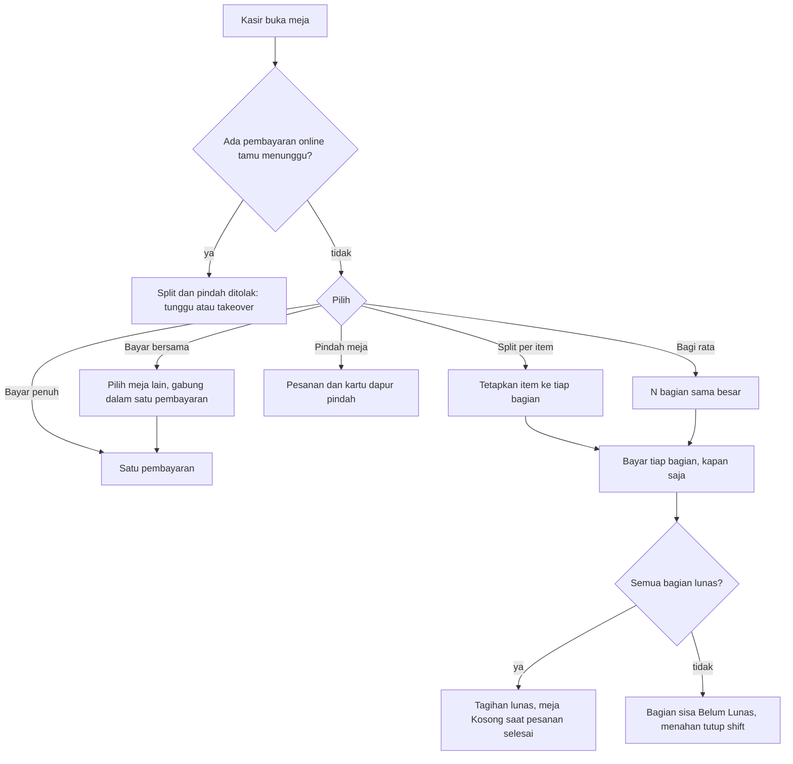
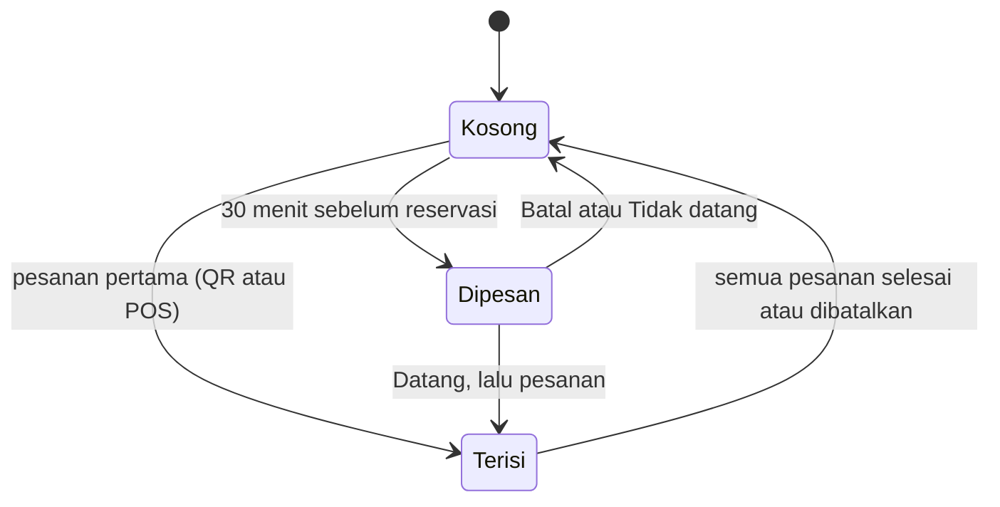
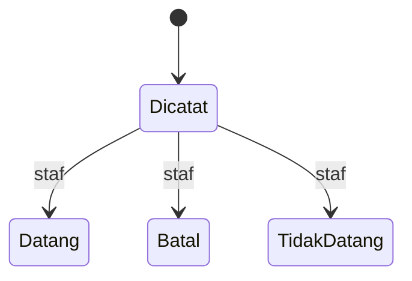
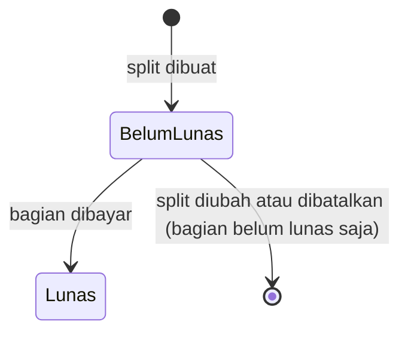

# REQ-009: Meja dan tagihan dine-in

- **Status:** ready
- **Owner:** @radityaaa43
- **Module:** module:dine-in
- **Updated:** 2026-11-28

## User stories

| # | Story | Journey | AC |
|---|---|---|---|
| US-1 | Sebagai **kasir atau pelayan**, saya ingin memasukkan pesanan untuk sebuah meja dari POS, agar tamu yang memesan langsung ke staf masuk ke tagihan meja yang sama dengan pesanan QR. | J1 | AC-01, AC-02, AC-03 |
| US-2 | Sebagai **kasir**, saya ingin melihat status setiap meja (Kosong, Terisi, Dipesan), agar tahu meja mana yang bisa dipakai. | J2 | AC-04, AC-05 |
| US-3 | Sebagai **kasir**, saya ingin membagi tagihan satu meja per item atau rata ke beberapa tamu, dan tiap bagian dibayar sendiri, agar rombongan bisa membayar masing-masing. | J3 | AC-06, AC-07, AC-08, AC-09, AC-10, AC-11, AC-12 |
| US-4 | Sebagai **kasir**, saya ingin memindahkan pesanan ke meja lain dan membayar beberapa meja sekaligus, agar tamu yang pindah atau rombongan di dua meja tetap terlayani. | J4 | AC-13, AC-14, AC-15 |
| US-5 | Sebagai **staf yang menerima booking**, saya ingin mencatat reservasi dan menandai tamu datang, batal, atau tidak datang, agar meja tidak dipakai orang lain saat tamu reservasi datang. | J5 | AC-16, AC-17, AC-18, AC-19 |
| US-6 | Sebagai **kasir**, saya ingin mengetik nama atau nomor pesanan saat checkout, agar pesanan takeaway bisa dipanggil saat siap. | J6 | AC-20 |

## Context

Hari ini pesanan meja hanya datang dari QR tamu (REQ-003, REQ-005). Satu meja bisa punya beberapa pesanan terpisah (beberapa HP, pesanan tambahan), dan masing-masing tagihan **Belum Lunas** dibayar sendiri. Split payment yang ada membagi satu pembayaran ke beberapa metode, bukan ke beberapa tamu. Meja belum punya status, belum bisa dipindah, dan tidak ada reservasi. Penjualan POS sudah punya `order_type` (in_store, takeaway, delivery) dan catatan, tetapi belum punya nama pesanan untuk memanggil pelanggan.

**Decisions** (each dated, with who decided):

1. **Split bill per item dan bagi rata.** Tiap bagian dibayar sendiri dengan metode bebas. (pemilik, 2026-11-28)
2. **Lingkup split: semua tagihan Belum Lunas meja itu**, lintas pesanan QR, pesanan POS, dan pesanan tambahan. (pemilik, 2026-11-28)
3. **Pindah meja** memindahkan pesanan (dan kartu dapurnya) ke meja lain. **Gabung bayar** membayar tagihan beberapa meja dalam satu kali bayar; catatan pesanan tetap per meja. (pemilik, 2026-11-28)
4. **Reservasi internal sederhana:** staf mencatat nama, nomor HP, jumlah tamu, jam, dan meja. Tanpa deposit, tanpa booking online oleh tamu. (pemilik, 2026-11-28)
5. **Nama pesanan diketik kasir** (nama pelanggan atau nomor buzzer), tidak ada nomor otomatis. (pemilik, 2026-11-28)
6. **Status meja Kosong, Terisi, Dipesan**, dihitung otomatis. (pemilik, 2026-11-28)
7. **Izin per langkah:** split dan bayar memakai izin bayar dine-in yang ada; pindah meja dan reservasi punya izin sendiri. Diatur per toko lewat role. (pemilik, 2026-11-28)
8. **Reservasi dilepas manual:** meja tetap Dipesan sampai staf menandai Datang, Batal, atau Tidak datang. (pemilik, 2026-11-28)
9. **Pesanan meja juga bisa dibuat dari POS** oleh kasir atau pelayan, dan masuk tagihan meja dan dapur seperti pesanan QR. (pemilik, 2026-11-28)
10. **Bagian split dibayar terpisah dan kapan saja;** tagihan meja lunas saat semua bagian lunas. Tiap pembayaran masuk shift yang menerimanya. Alasan: sama dengan aturan tagihan dine-in sekarang (REQ-003 AC-27). Ditolak: semua bagian wajib dibayar dalam satu transaksi, karena tamu sering membayar bergantian. (Business/PM, didelegasikan pemilik, 2026-11-28)
11. **Split per item membagi qty, bukan pecahan satu item.** Satu baris qty 2 bisa dibagi 1 dan 1; satu porsi yang dimakan berdua memakai bagi rata. Diskon tingkat tagihan dibagi proporsional ke tiap bagian; sisa pembulatan rupiah masuk bagian terakhir. Alasan: struk tiap tamu tetap berisi item utuh. Ditolak: membagi harga satu porsi per item, karena struk dan retur menjadi rumit. (Business/PM, 2026-11-28)
12. **Split dibatalkan atau diubah** hanya untuk bagian yang belum dibayar; bagian yang sudah lunas tidak berubah. (Business/PM, 2026-11-28)
13. **Tagihan dengan pembayaran online tamu yang masih menunggu** (REQ-005) tidak bisa di-split atau dipindah sampai pembayaran itu selesai, gagal, atau diambil alih kasir (takeover). Alasan: pembayaran pertama yang menang (REQ-005 keputusan 5); membagi tagihan yang sedang dibayar tamu bisa membuat uang masuk dua kali. (Business/PM, 2026-11-28)
14. **Bagian split dibayar sekarang,** tidak bisa dijadikan piutang di versi ini. Alasan: menjaga REQ-007 (batas piutang) tetap per tagihan. Ditolak: piutang per bagian, ditunda sampai ada kebutuhan nyata. (Business/PM, 2026-11-28)
15. **Pindah ke meja yang sudah Terisi** boleh; pesanan dari dua meja tidak digabung, tagihannya tetap terpisah di meja tujuan. Kartu dapur menampilkan meja baru; ticket yang sudah dicetak tidak dicetak ulang otomatis (staf memakai **Cetak ulang**, REQ-004). Pindah meja dicatat di audit log. (Business/PM, 2026-11-28)
16. **Reservasi:** meja tampil **Dipesan** mulai 30 menit sebelum jam reservasi. Satu meja tidak bisa punya dua reservasi yang jamnya kurang dari 2 jam berselisih. Meja Dipesan tetap bisa dipakai dengan peringatan (staf yang memutuskan). Nomor HP hanya terlihat oleh pemegang izin reservasi dan tidak tercetak di struk. (Business/PM, 2026-11-28)
17. **Nama pesanan** opsional, maks 20 karakter, untuk semua pesanan POS; tampil di struk, kartu layar dapur, dan ticket dapur. Pesanan meja tetap menampilkan nama meja. (Business/PM, 2026-11-28)
18. **Retur pada tagihan yang di-split** memakai alur retur yang ada pada penjualan asalnya; kasir memilih cara refund seperti sekarang, dan struk bagian yang sudah dicetak tidak berubah. Alasan: split hanya mengatur siapa membayar, bukan apa yang terjual. Ditolak: retur per struk bagian, karena bagi rata tidak punya item per bagian. (Business/PM, 2026-11-28)
19. **Meja yang Terisi atau Dipesan** tidak bisa dinonaktifkan atau dihapus; ditolak dengan pesan yang menyebut pesanan atau reservasinya. Alasan: tagihan dan reservasi tidak boleh kehilangan mejanya. (Business/PM, 2026-11-28)
20. **Satu metode bayar per bagian split** di versi ini; tamu yang butuh dua metode mengambil dua bagian. Alasan: setiap bagian punya satu struk dan satu pembayaran di ledger. Ditolak: split payment di dalam satu bagian, ditunda. (Business/PM, 2026-11-28, Q-A feasibility #422)
21. **Retur pada penjualan dengan split yang masih terbuka** ditolak sampai bagian yang belum lunas dibatalkan; setelah split selesai, alur retur yang ada berlaku (keputusan 18). Alasan: kalau tidak, jumlah bagian tidak lagi sama dengan tagihan. (Business/PM, 2026-11-28, Q-B)
22. **Pindah meja memindahkan pesanan asal beserta semua pesanan tambahannya** (REQ-003 AC-21), karena dapur menampilkannya sebagai satu kartu. (Business/PM, 2026-11-28, Q-C)
23. **Selama split terbuka, tamu tidak bisa membayar tagihan itu online** (REQ-005); halaman status meminta tamu membayar di kasir. Ini kebalikan dari keputusan 13, supaya tagihan tidak dibayar penuh oleh tamu sementara bagian dibayar di kasir. (Business/PM, 2026-11-28, dari feasibility #422)

## Process

**As-is.**
- Tamu yang memesan ke pelayan dicatat sebagai penjualan POS biasa tanpa meja, terpisah dari pesanan QR meja itu.
- Rombongan yang ingin bayar sendiri-sendiri: kasir menghitung manual lalu membayar satu tagihan dengan beberapa metode.
- Tamu pindah meja: pesanan tetap tercatat di meja lama.
- Reservasi dicatat di buku atau chat; meja bisa terpakai tamu lain.
- Pesanan takeaway dipanggil dengan menebak dari isi struk.

**To-be.**
- Kasir atau pelayan memilih meja di POS dan memasukkan pesanan; pesanan itu bergabung dengan tagihan meja.
- Kasir melihat status meja, membuka meja, lalu membayar penuh, split per item, atau bagi rata.
- Kasir memindahkan pesanan ke meja lain, atau memilih beberapa meja lalu membayarnya sekaligus.
- Staf mencatat reservasi; meja tampil Dipesan; staf menandai Datang, Batal, atau Tidak datang.
- Kasir mengetik nama pesanan saat checkout; dapur dan pelanggan melihatnya.

## User journey and flow

### Journeys per role

**J1. Pesanan meja dari POS** (kasir atau pelayan)

| # | Step | Actor | What they see or do | AC | Weak point |
|---|---|---|---|---|---|
| 1 | Pilih **Pesanan meja** dan pilih meja | Kasir | Daftar meja dengan status | AC-01 | Meja nonaktif tidak bisa dipilih |
| 2 | Masukkan item, kirim | Kasir | Pesanan masuk tagihan meja (Belum Lunas) dan ke dapur | AC-02 | Item yang perlu dibuat ikut aturan bayar meja (REQ-003) |
| 3 | Tambah lagi nanti | Kasir | Pesanan tambahan ke meja yang sama (REQ-003 AC-21) | AC-03 | — |

**J2. Melihat status meja** (kasir)

| # | Step | Actor | What they see or do | AC | Weak point |
|---|---|---|---|---|---|
| 1 | Buka daftar meja | Kasir | Tiap meja: **Kosong**, **Terisi**, atau **Dipesan**, dengan jumlah tagihan Belum Lunas | AC-04 | — |
| 2 | Status berubah | Sistem | Terisi saat ada pesanan yang belum selesai; Kosong saat semua selesai; Dipesan dari reservasi | AC-05 | Dua kasir membuka meja yang sama: keduanya melihat status yang sama setelah refresh |

**J3. Split bill** (kasir dengan izin bayar dine-in)

| # | Step | Actor | What they see or do | AC | Weak point |
|---|---|---|---|---|---|
| 1 | Buka meja, pilih **Bayar** | Kasir | Semua tagihan Belum Lunas meja itu dalam satu daftar | AC-06 | Pembayaran online tamu masih menunggu: split dan pindah ditolak (AC-12) |
| 2 | Pilih **Split per item**, tetapkan item ke tiap bagian | Kasir | Tiap bagian: item, subtotal, diskon proporsional, total | AC-07 | Item belum ditetapkan: tidak bisa lanjut |
| 3 | Atau **Bagi rata** ke N bagian | Kasir | N bagian sama besar; sisa pembulatan di bagian terakhir | AC-08 | — |
| 4 | Bayar satu bagian | Kasir | Metode bebas; struk untuk bagian itu | AC-09 | Gagal bayar gateway: bagian tetap belum lunas |
| 5 | Bagian lain dibayar nanti | Kasir | Bagian sisa tetap Belum Lunas; tiap pembayaran masuk shift penerimanya | AC-10 | Tutup shift dengan bagian belum lunas: ditahan seperti tagihan dine-in (REQ-003 AC-12) |
| 6 | Ubah atau batalkan split | Kasir | Hanya bagian belum lunas | AC-11 | — |

**J4. Pindah meja dan gabung bayar** (kasir)

| # | Step | Actor | What they see or do | AC | Weak point |
|---|---|---|---|---|---|
| 1 | Pilih pesanan, **Pindah meja**, pilih meja tujuan | Kasir (izin pindah meja) | Pesanan dan kartu dapurnya pindah; halaman status QR tamu ikut meja baru | AC-13 | Meja tujuan Terisi: tagihan tetap terpisah |
| 2 | Pilih beberapa meja, **Bayar bersama** | Kasir (izin bayar) | Tagihan semua meja terpilih dalam satu pembayaran, atau di-split | AC-14 | Meja lain dibuka kasir lain bersamaan: pembayaran kedua ditolak |
| 3 | Lihat riwayat | Pemilik | Audit log pindah meja | AC-15 | — |

**J5. Reservasi** (staf dengan izin reservasi)

| # | Step | Actor | What they see or do | AC | Weak point |
|---|---|---|---|---|---|
| 1 | Catat reservasi: nama, HP, jumlah tamu, jam, meja, catatan | Staf | Reservasi tersimpan | AC-16 | Jam bentrok di meja yang sama (< 2 jam): ditolak |
| 2 | 30 menit sebelum jam | Sistem | Meja tampil Dipesan dengan nama tamu | AC-17 | Meja Dipesan dipakai tamu lain: peringatan, staf memutuskan |
| 3 | Tamu datang | Staf | **Datang**: meja bisa menerima pesanan seperti biasa | AC-18 | — |
| 4 | Tamu batal atau tidak datang | Staf | **Batal** atau **Tidak datang**: meja kembali sesuai pesanannya | AC-18 | Tidak pernah ditandai: tetap Dipesan (keputusan 8) |
| 5 | Lihat daftar reservasi hari ini | Staf | Per outlet, per hari, dengan status | AC-19 | Nomor HP hanya untuk pemegang izin |

**J6. Nama pesanan** (kasir)

| # | Step | Actor | What they see or do | AC | Weak point |
|---|---|---|---|---|---|
| 1 | Ketik nama atau nomor saat checkout | Kasir | Kolom **Nama pesanan** (opsional) | AC-20 | Lebih dari 20 karakter: dipotong dengan peringatan |
| 2 | Pesanan tampil | Dapur, pelanggan | Nama di struk, kartu dapur, dan ticket dapur | AC-20 | — |

### Flow

### States

## Stakeholders

| Party | Role in the flow | What they care about | What they decide |
|---|---|---|---|
| Pemilik | Mengatur izin, membaca audit | Uang tiap bagian benar, tidak ada tagihan hilang | Siapa memegang izin |
| Kasir | Membuka meja, split, bayar, pindah | Cepat dan tidak salah hitung | — |
| Pelayan | Memasukkan pesanan meja | Pesanan masuk ke meja yang benar | — |
| Staf booking | Mencatat reservasi | Meja tamu reservasi tidak terpakai | Datang, Batal, Tidak datang |
| Tamu | Membayar bagiannya | Struk sendiri, bayar dengan cara sendiri | — |
| Dapur | Membuat pesanan | Meja dan nama pesanan yang benar | — |

## Acceptance criteria

### Pesanan meja dari POS

- **AC-01:** Given kasir dengan akses POS, when memilih **Pesanan meja**, then daftar meja aktif outlet itu tampil dengan statusnya, dan pesanan berikutnya terikat ke meja yang dipilih.
- **AC-02:** Given pesanan meja dari POS, when dikirim, then pesanan masuk tagihan Belum Lunas meja itu dan ke dapur dengan aturan bayar dan stok yang sama seperti pesanan QR meja yang diterima (REQ-003, REQ-005).
- **AC-03:** Given meja dengan pesanan berjalan, when kasir menambah item dari POS, then aturan pesanan tambahan REQ-003 AC-21 berlaku sama seperti dari QR.

### Status meja

- **AC-04:** Given daftar meja, when dibuka, then tiap meja menampilkan **Kosong**, **Terisi**, atau **Dipesan** dan jumlah tagihan Belum Lunas-nya.
- **AC-05:** Given meja dengan pesanan yang belum selesai, when pesanan terakhir selesai atau dibatalkan, then meja menjadi Kosong (atau Dipesan bila ada reservasi dalam 30 menit), tanpa diubah manual.

### Split bill

- **AC-06:** Given kasir dengan izin bayar dine-in membuka meja, when memilih **Bayar**, then semua tagihan Belum Lunas meja itu tampil dalam satu daftar, dari QR, POS, dan pesanan tambahan.
- **AC-07:** Given **Split per item**, when kasir menetapkan item (per qty utuh) ke tiap bagian, then tiap bagian menampilkan item, subtotal, diskon tagihan yang dibagi proporsional, dan total; semua item harus ditetapkan sebelum lanjut.
- **AC-08:** Given **Bagi rata** ke N bagian (2 sampai 20), when dihitung, then N bagian sama besar dalam rupiah dan sisa pembulatan masuk bagian terakhir; jumlah semua bagian sama dengan total tagihan.
- **AC-09:** Given sebuah bagian, when dibayar dengan satu metode yang tersedia di bayar dine-in (keputusan 20), then bagian itu lunas dan struk bagian itu tercetak dengan item (split per item) atau porsi (bagi rata) dan totalnya.
- **AC-10:** Given bagian lunas dan bagian belum lunas, when waktu berjalan, then bagian sisa tetap Belum Lunas dan menahan tutup shift seperti tagihan dine-in; tiap pembayaran masuk shift yang menerimanya; tagihan meja lunas saat semua bagian lunas.
- **AC-11:** Given split dengan sebagian bagian lunas, when kasir mengubah atau membatalkan split, then hanya bagian belum lunas yang berubah, dan bagian lunas beserta pembayarannya tetap.
- **AC-12:** Given tagihan meja dengan pembayaran online tamu yang masih menunggu (REQ-005), when kasir mencoba split atau pindah meja, then ditolak dengan pesan untuk menunggu atau mengambil alih pembayaran (takeover); sebaliknya, selama split terbuka, pembayaran online tamu untuk tagihan itu ditolak dan halaman status meminta tamu membayar di kasir (keputusan 23).

### Pindah meja dan bayar bersama

- **AC-13:** Given kasir dengan izin pindah meja, when memindahkan pesanan ke meja lain (Kosong atau Terisi), then pesanan, tagihannya, kartu dapurnya, dan halaman status QR tamu menunjukkan meja baru; tagihan di meja tujuan tidak digabung.
- **AC-14:** Given beberapa meja dengan tagihan Belum Lunas, when kasir memilih **Bayar bersama**, then semua tagihannya dibayar dalam satu pembayaran (atau di-split dengan aturan AC-07 sampai AC-11), dan catatan pesanan tetap per meja; pembayaran kedua untuk tagihan yang sama ditolak.
- **AC-15:** Given pindah meja, when terjadi, then audit log mencatat siapa, kapan, pesanan, meja asal, dan meja tujuan.

### Reservasi

- **AC-16:** Given staf dengan izin reservasi, when mencatat nama, nomor HP, jumlah tamu, tanggal dan jam, meja, dan catatan, then reservasi tersimpan; reservasi kedua di meja yang sama dengan selisih jam kurang dari 2 jam ditolak dengan pesan.
- **AC-17:** Given reservasi, when 30 menit sebelum jamnya, then meja tampil **Dipesan** dengan nama tamu; memakai meja itu untuk pesanan lain menampilkan peringatan dan tetap boleh.
- **AC-18:** Given reservasi, when staf menandai **Datang**, **Batal**, atau **Tidak datang**, then status reservasi berubah dan meja mengikuti pesanannya; tanpa tanda itu meja tetap Dipesan.
- **AC-19:** Given daftar reservasi, when dibuka per outlet dan tanggal, then tampil dengan status; nomor HP hanya terlihat oleh pemegang izin reservasi dan tidak tercetak di struk mana pun.

### Nama pesanan

- **AC-20:** Given checkout POS, when kasir mengetik **Nama pesanan** (opsional, maks 20 karakter), then nama itu tampil di struk, kartu layar dapur, dan ticket dapur; pesanan meja tetap menampilkan nama meja.

### Izin dan teks

- **AC-21:** Given pengguna tanpa `dine-orders-move` atau `dine-reservations-manage`, when membuka atau mengirim aksinya, then tombol tidak tampil dan server menolak (403); split dan bayar memakai izin bayar dine-in yang ada; saat POS offline, pesanan meja, split, pindah, dan bayar bersama ditolak dengan pesan bahwa fitur itu butuh koneksi.
- **AC-23:** Given meja yang Terisi atau Dipesan, when dinonaktifkan atau dihapus, then ditolak dengan pesan yang menyebut pesanan atau reservasinya (keputusan 19).
- **AC-22:** Given setiap teks baru (status meja, split, pindah, reservasi, nama pesanan, pesan tolak), when bahasa diubah, then tersedia dalam bahasa Indonesia dan English.

<!-- Edge cases:
     - offline (POS queued sale): ditolak dengan pesan (Q2), AC-21
     - split payment: keputusan 20 (satu metode per bagian)
     - insufficient stock: AC-02 (aturan stok pesanan meja)
     - cancellation before payment: AC-05, AC-11
     - cancellation or refund after payment: keputusan 18 (alur retur yang ada)
     - shift close with open work: AC-10
     - failed or expired payment: AC-09 (bagian tetap belum lunas)
     - permission denied (UI and server): AC-21
     - two users acting at the same time: AC-14 (pembayaran kedua ditolak), AC-12
     - existing data on release: meja lama mulai Kosong/Terisi dari pesanan yang ada; tidak ada backfill reservasi
     - an event that comes late or twice: AC-12 (pembayaran online tamu), webhook mengikuti REQ-005
     - master data deleted or renamed while in use: AC-23
     - the same action from another channel: AC-02, AC-03 (POS dan QR)
     - what another outlet sees: meja dan reservasi per outlet
     - every new UI text, in Indonesian and English: AC-22 -->

## Business rules

- **Money:** jumlah semua bagian = total tagihan; diskon tagihan dibagi proporsional; sisa pembulatan rupiah ke bagian terakhir. Bagian dibayar sekarang, tidak jadi piutang (keputusan 14). Tiap pembayaran masuk shift penerimanya.
- **Stock:** tidak berubah; pesanan meja dari POS memotong stok seperti pesanan meja QR (saat diterima).
- **Permissions:** pesanan meja dari POS memakai akses POS; split dan bayar memakai izin bayar dine-in yang ada; izin baru untuk pindah meja dan untuk reservasi.
- **Settings:** tidak ada pengaturan baru. Jendela Dipesan 30 menit dan selisih reservasi 2 jam tetap di versi ini.
- **Keputusan saat build (Business/PM, 2026-11-28):** setelah split dibatalkan dengan bagian lunas, split per item ulang boleh untuk item yang belum ada di bagian lunas bila semua bagian lunas per item; baris diskon tagihan hanya tampil bila bukan Rp 0 (#428 BR-3, BR-4). Meja dengan reservasi yang belum ditandai tidak bisa dihapus atau dinonaktifkan (#431 BR-3). Bagian transfer ikut #429; nama pesanan menjadi #445; status Dipesan menjadi #443.
- **Keputusan saat build (Business/PM, 2026-11-28, lanjutan):** penolakan karena reservasi outlet lain menyebut outlet dan jam, tidak pernah nama tamu; audit log tidak menyimpan nama atau nomor HP tamu (#431 BR-4, BR-5). Nama pesanan tampil di semua layar staf termasuk daftar Belum Lunas dan tab Invoice, tidak di dokumen pelanggan; setelah penjualan offline, catatan, tipe pesanan dan nama pesanan dikosongkan (#445 BR-3..BR-6).

## Non-functional requirements

- **Speed:** daftar meja dengan status terbuka dalam 2 detik untuk 100 meja; split per item terasa langsung di layar.
- **Reliability:** dua kasir yang membayar tagihan atau bagian yang sama: hanya yang pertama tercatat, yang kedua ditolak.
- **Security:** semua aksi diperiksa izinnya di server; meja dan reservasi hanya untuk outlet pengguna; nomor HP reservasi data pribadi, hanya untuk pemegang izin.
- **Audit:** pindah meja, split dibuat atau diubah, reservasi dibuat atau diubah statusnya.
- **Language and accessibility:** Indonesia dan English; target sentuh 44 px; status meja berupa teks, bukan warna saja.

## Data and integrations

- **Data:** pesanan meja dari POS memakai struktur pesanan dine-in yang ada; bagian split dengan item atau porsi dan pembayarannya; reservasi (nama, HP, jumlah tamu, jam, meja, catatan, status); nama pesanan di penjualan. Status meja dihitung, tidak disimpan. Data lama: meja tanpa reservasi; status dihitung dari pesanan yang ada.
- **Integrations:** none new. Pembayaran gateway per bagian memakai alur bayar dine-in yang ada.

## Success metrics

- **Split bill:** persentase tagihan meja yang dibayar dengan split, per outlet per bulan (WIB). Baseline 0.
- **Reservasi:** persentase reservasi yang berakhir Tidak datang, per outlet per bulan (WIB).

## Out of scope

- Booking online oleh tamu, deposit reservasi, pengingat WhatsApp.
- Denah meja visual (drag and drop); versi ini daftar meja.
- Nomor antrian otomatis (keputusan 5).
- Piutang per bagian split (keputusan 14); membagi harga satu porsi (keputusan 11).
- Gabung meja permanen (keputusan 3).

## Risks and assumptions

| Risk | Impact | Mitigation |
|---|---|---|
| Split pada tagihan yang sedang dibayar tamu online | Uang masuk dua kali | AC-12 menolak sampai pembayaran selesai atau takeover |
| Dua kasir membuka meja yang sama | Bagian dibayar dua kali | AC-14: pembayaran kedua ditolak |
| Reservasi lupa dilepas | Meja tampil Dipesan terus | AC-17: tetap bisa dipakai dengan peringatan |

- [assumption] Satu outlet punya paling banyak 100 meja aktif.

## Open questions

- **Q1:** Feasibility read — **answered** (#422, 2026-11-28): layak dengan satu struktur baru, **ledger pembayaran tagihan** (satu pembayaran bisa untuk satu bagian split atau beberapa tagihan sekaligus; recap shift menghitung pembayaran ledger di shift penerimanya). Penjualan tetap satu penjualan (item, stok, dapur, retur tidak berubah). Izin baru: `dine-orders-move` dan `dine-reservations-manage`. Nomor HP reservasi tidak tercatat terbuka di audit log. Dipotong menjadi enam ticket: T1 J1 + J2 + J6 (±1.300 baris), T2 ledger + bagi rata + bagian tunai/transfer/EDC + recap + guard AC-12 (±1.300), T3 split per item (±800), T4 bagian lewat gateway (±900), T5 J4 pindah meja + bayar bersama (±900), T6 J5 reservasi (±1.100). Urutan: T1 ∥ T6, lalu T2, lalu T3, T4, T5 paralel. Q-A..Q-C menjadi keputusan 20-22.
- **Q2:** POS offline — **answered**: pesanan meja, split, pindah, dan bayar bersama ditolak saat offline dengan pesan bahwa fitur itu butuh koneksi; tidak ada yang masuk antrean offline.
- **Q3:** Retur pada tagihan yang di-split — **answered** (keputusan 18).
- **Q4:** Meja dinonaktifkan atau dihapus saat Terisi atau Dipesan — **answered** (keputusan 19).

## Delivered by

<!-- Issues and PRs, filled in as work ships. -->
