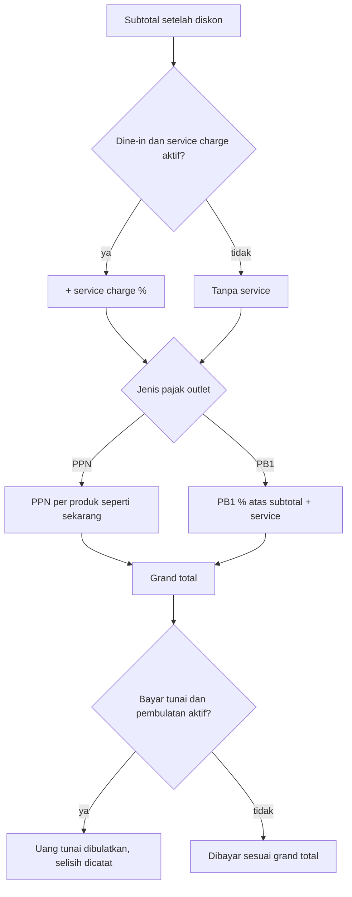

# REQ-010: Aturan total tagihan (service charge, PB1, pembulatan tunai)

- **Status:** ready
- **Owner:** @radityaaa43
- **Module:** module:sales
- **Updated:** 2026-11-28

## User stories

| # | Story | Journey | AC |
|---|---|---|---|
| US-1 | Sebagai **pemilik**, saya ingin mengatur service charge, jenis pajak (PPN atau PB1), dan pembulatan tunai per outlet, agar setiap outlet menagih sesuai jenis usahanya. | J1 | AC-01, AC-02, AC-03, AC-04 |
| US-2 | Sebagai **kasir**, saya ingin total tagihan menghitung service charge, pajak, dan pembulatan secara otomatis, agar saya tidak menghitung manual dan struknya benar. | J2 | AC-05, AC-06, AC-07, AC-08, AC-09, AC-10 |
| US-3 | Sebagai **pemilik**, saya ingin laporan pajak per outlet per bulan dan rekap pembulatan di laporan shift, agar mudah melapor pajak dan mencocokkan kas. | J3 | AC-11, AC-12 |

## Context

Hari ini pajak hanya PPN per produk (exclusive atau inclusive, tarif per produk; `docs/features/tax-management.md`). Restoran di Indonesia umumnya memungut **PB1** (pajak daerah, biasanya 10%) atas seluruh tagihan, sering ditambah **service charge**. Tidak ada service charge dan tidak ada pembulatan tunai; kasir membulatkan manual sehingga kas selisih.

**Decisions** (each dated, with who decided):

1. **Service charge:** persen per outlet, default nonaktif, hanya untuk pesanan **dine-in**; takeaway dan delivery tidak kena. Tampil sebagai baris tersendiri di struk. (pemilik, 2026-11-28)
2. **Jenis pajak dipilih per outlet:** **PPN** per produk seperti sekarang, atau **PB1**: satu tarif per outlet (default 10%) atas seluruh tagihan. (pemilik, 2026-11-28)
3. **Dasar pajak:** subtotal setelah diskon ditambah service charge; pajak dihitung dari jumlah itu. (pemilik, 2026-11-28)
4. **Pembulatan hanya untuk pembayaran tunai,** per outlet: tanpa, ke 100, atau ke 500, ke kelipatan terdekat. Selisihnya tampil di struk dan direkap di laporan shift. (pemilik, 2026-11-28)
5. **"Dine-in"** = pesanan yang terikat ke meja (QR atau pesanan meja dari POS, REQ-009) dan penjualan POS bertipe makan di tempat (`order_type = in_store`). Alasan: tamu yang makan di tempat dilayani, takeaway tidak. Ditolak: hanya pesanan meja, karena outlet tanpa meja tetap melayani makan di tempat. (Business/PM, didelegasikan pemilik, 2026-11-28)
6. **PB1 dihitung exclusive** (ditambahkan di atas harga) di versi ini; di outlet PB1, pengaturan PPN per produk diabaikan. Alasan: praktik umum menu restoran (harga belum termasuk pajak). Ditolak: PB1 inclusive, ditunda sampai ada outlet yang membutuhkannya. (Business/PM, 2026-11-28)
7. **Pembulatan terdekat, setengah ke atas** (Rp 150 → 200 pada kelipatan 100; Rp 250 → 500 pada kelipatan 500). Pembulatan hanya mengubah uang tunai yang diterima, bukan nilai penjualan; selisihnya dicatat terpisah. Alasan: omzet dan pajak tetap sesuai penjualan. Ditolak: membulatkan grand total penjualan, karena pajak dan laporan akan bergeser. (Business/PM, 2026-11-28)
8. **Split bill dan split payment:** service charge dan pajak dibagi proporsional ke tiap bagian (REQ-009); pembulatan berlaku per pembayaran tunai, termasuk bagian tunai dari split payment. (Business/PM, 2026-11-28)
9. **Retur** mengembalikan service charge dan pajak proporsional dengan item yang diretur; pembulatan tidak dikembalikan. (Business/PM, 2026-11-28)
10. **Saat rilis tidak ada yang berubah:** semua outlet PPN seperti sekarang, service charge nonaktif, pembulatan tanpa. Hanya pemilik yang mengubahnya (izin pengaturan yang ada), dan setiap perubahan dicatat di audit log. Penjualan lama tidak dihitung ulang. (Business/PM, 2026-11-28)
11. **Dasar PPN tetap seperti sekarang** (per baris, sebelum voucher, poin, dan diskon manual); service charge ikut dikenai PPN dengan tarif efektifnya. Hanya PB1 memakai dasar keputusan 3. Alasan: outlet PPN tidak boleh berubah total saat rilis (AC-03). Ditolak: menerapkan keputusan 3 ke PPN, karena semua outlet PPN berubah totalnya. (Business/PM, 2026-11-28, Q-A feasibility #424)
12. **Pesanan QR/dine-in dikenai pajak sama seperti POS mulai rilis.** Hari ini tagihan dine-in tidak dikenai pajak sama sekali, padahal item yang sama di POS dikenai pajak; ini perbaikan, dan disebut di catatan rilis. Ditolak: QR tetap tanpa pajak di outlet PPN, karena pajak yang seharusnya dipungut tidak tercatat. (Business/PM, 2026-11-28, Q-B)
13. **Ongkir delivery tidak masuk dasar PB1;** outlet PPN tetap memajaki ongkir seperti sekarang. (Business/PM, 2026-11-28, Q-C)

## Process

**As-is.** Pemilik restoran memakai PPN per produk untuk meniru PB1; service charge ditambahkan manual atau tidak dipungut; kasir membulatkan kembalian sendiri sehingga laporan kas selisih.

**To-be.** Pemilik mengatur per outlet sekali; POS, QR menu, dan struk menghitung otomatis; laporan pajak dan rekap pembulatan siap dipakai.

## User journey and flow

### Journeys per role

**J1. Mengatur outlet** (pemilik)

| # | Step | Actor | What they see or do | AC | Weak point |
|---|---|---|---|---|---|
| 1 | Buka pengaturan outlet | Pemilik | Bagian **Tagihan**: service charge (%), jenis pajak (PPN/PB1) dan tarif PB1, pembulatan tunai | AC-01 | Tanpa izin pengaturan: tidak tampil, server menolak |
| 2 | Simpan | Pemilik | Berlaku untuk tagihan berikutnya; tagihan yang sudah dibuat tidak berubah | AC-02, AC-03 | Tarif di luar 0-100% ditolak |
| 3 | Lihat riwayat | Pemilik | Audit log perubahan | AC-04 | — |

**J2. Menagih** (kasir, tamu QR)

| # | Step | Actor | What they see or do | AC | Weak point |
|---|---|---|---|---|---|
| 1 | Pesanan dine-in di outlet dengan service charge | Kasir, tamu | Baris **Service charge** di checkout, halaman status QR, dan struk | AC-05 | Takeaway tidak kena |
| 2 | Outlet PB1 | Kasir, tamu | Baris **PB1** atas subtotal + service charge | AC-06, AC-07 | Produk dengan PPN di outlet PB1: PPN tidak dihitung |
| 3 | Bayar tunai di outlet dengan pembulatan | Kasir | Total tunai dibulatkan; baris **Pembulatan** di struk | AC-08 | Non-tunai: tidak dibulatkan |
| 4 | Split bill atau split payment | Kasir | Service, pajak dibagi proporsional; pembulatan per pembayaran tunai | AC-09 | — |
| 5 | Retur | Kasir | Service dan pajak proporsional dikembalikan; pembulatan tidak | AC-10 | — |

**J3. Laporan** (pemilik)

| # | Step | Actor | What they see or do | AC | Weak point |
|---|---|---|---|---|---|
| 1 | Laporan pajak per outlet dan bulan | Pemilik | Dasar pajak, service charge, pajak terkumpul, dipisah PPN dan PB1; retur mengurangi | AC-11 | — |
| 2 | Laporan shift | Pemilik, kasir | Total pembulatan; kas yang diharapkan memakai uang tunai setelah pembulatan | AC-12 | — |

### Flow

### States

n/a — tidak ada status baru; aturan ini hanya mengubah cara total dihitung.

## Stakeholders

| Party | Role in the flow | What they care about | What they decide |
|---|---|---|---|
| Pemilik | Mengatur per outlet, membaca laporan | Pajak benar, kas cocok | Service, jenis pajak, tarif, pembulatan |
| Kasir | Menagih | Total otomatis, struk benar | — |
| Tamu | Membayar | Rincian tagihan jelas | — |

## Acceptance criteria

### Pengaturan

- **AC-01:** Given pemilik dengan izin pengaturan, when membuka pengaturan outlet, then bagian **Tagihan** menampilkan service charge (0-100%, default nonaktif), jenis pajak (**PPN** atau **PB1** dengan tarif 0-100%, default PPN), dan pembulatan tunai (**Tanpa**, **100**, **500**, default Tanpa); nilai di luar batas ditolak.
- **AC-02:** Given pengaturan disimpan, when tagihan baru dibuat, then tagihan baru memakai pengaturan itu; tagihan yang sudah ada dan penjualan lama tidak dihitung ulang.
- **AC-03:** Given rilis, when belum ada yang diubah, then semua outlet menghitung seperti sebelum rilis (PPN per produk, tanpa service, tanpa pembulatan), kecuali pesanan QR/dine-in yang mulai dikenai pajak seperti POS (keputusan 12).
- **AC-04:** Given perubahan pengaturan tagihan, when disimpan, then audit log mencatat siapa, kapan, outlet, nilai lama, dan nilai baru.

### Menagih

- **AC-05:** Given outlet dengan service charge 5% dan pesanan dine-in (meja, atau POS makan di tempat), when dihitung, then baris **Service charge** = 5% × subtotal setelah diskon tampil di checkout, halaman status QR, dan struk; pesanan takeaway dan delivery tidak kena.
- **AC-06:** Given outlet PB1 10%, when tagihan dihitung, then baris **PB1** = 10% × (subtotal setelah diskon + service charge), dan PPN per produk tidak dihitung di outlet itu.
- **AC-07:** Given outlet PPN, when tagihan dihitung, then PPN per produk tetap seperti sekarang, dihitung dari dasar yang sudah ditambah service charge.
- **AC-08:** Given outlet dengan pembulatan 500, when pembayaran tunai Rp 47.250, then uang tunai yang diminta Rp 47.500, struk menampilkan baris **Pembulatan +250**; pembayaran non-tunai tidak dibulatkan; nilai penjualan dan pajak tetap Rp 47.250.
- **AC-09:** Given split bill (REQ-009) atau split payment, when dihitung, then service charge dan pajak dibagi proporsional ke tiap bagian dan jumlahnya sama dengan total tagihan; pembulatan berlaku per pembayaran tunai.
- **AC-10:** Given retur, when diproses, then service charge dan pajak dikembalikan proporsional dengan item yang diretur; pembulatan tidak dikembalikan.

### Laporan

- **AC-11:** Given penjualan satu outlet dalam satu bulan (WIB), when pemilik membuka **Laporan pajak**, then tampil dasar pajak, service charge, dan pajak terkumpul, dipisah PPN dan PB1, dikurangi retur.
- **AC-12:** Given shift dengan pembayaran tunai yang dibulatkan, when laporan shift dibuka atau dicetak, then tampil total pembulatan, dan kas yang diharapkan memakai uang tunai setelah pembulatan.

### Teks

- **AC-13:** Given setiap teks baru (pengaturan, baris struk, laporan), when bahasa diubah, then tersedia dalam bahasa Indonesia dan English.

<!-- Edge cases:
     - offline (POS queued sale): POS offline memakai pengaturan outlet dari cache; server menghitung ulang saat sync (seperti AC-02 REQ-005) — dikonfirmasi tech-lead (Q1)
     - split payment: AC-09
     - insufficient stock: n/a — tidak berubah
     - cancellation before payment: n/a — tidak berubah
     - cancellation or refund after payment: AC-10
     - shift close with open work: AC-12
     - failed or expired payment: n/a — total sama, hanya metode berubah; pembulatan hanya saat tunai benar-benar diterima
     - permission denied (UI and server): AC-01
     - two users acting at the same time: AC-02 (pengaturan berlaku untuk tagihan baru)
     - existing data on release: AC-03
     - an event that comes late or twice: n/a — tidak ada event baru
     - master data deleted or renamed while in use: n/a — pengaturan, bukan data master
     - the same action from another channel: AC-05 (QR), AC-02 (mobile API memakai aturan server)
     - what another outlet sees: pengaturan per outlet (AC-01)
     - every new UI text, in Indonesian and English: AC-13 -->

## Business rules

- **Money:** grand total = subtotal setelah diskon + service charge (dine-in) + pajak (PPN per produk atau PB1 atas subtotal + service). Pembulatan hanya pada uang tunai yang diterima, ke kelipatan terdekat setengah ke atas, dicatat terpisah dari penjualan. Split dan retur proporsional (keputusan 8, 9).
- **Stock:** tidak berubah.
- **Permissions:** izin pengaturan yang ada; tidak ada izin baru.
- **Settings:** per outlet: service charge %, jenis pajak dan tarif PB1, pembulatan tunai. Default sama dengan sebelum rilis.
- **Keputusan saat build (Business/PM, 2026-11-28):** saat offline tipe pesanan tetap bisa dipilih; total dihitung dari pengaturan outlet di cache dan dihitung ulang server saat sync (#450 BR-3). Retur mengembalikan PPN secara proporsional juga untuk penjualan sebelum rilis (#453 BR-2). Dasar PPN di laporan pajak adalah jumlah yang benar-benar dikenai PPN, disimpan per penjualan mulai rilis (#454 BR-2).
- **Keputusan saat build (Business/PM, 2026-11-28, lanjutan):** diskon manual yang ditolak menghitung ulang service charge, pajak, tax_base, dan piutang (#484, dirilis bersama #450). Sampai #418, tipe pesanan tidak bisa diubah saat offline di outlet dengan service charge (#450 BR-5); #418 mencabutnya. Poin loyalty dihitung dari tagihan penuh termasuk service charge dan PB1 (#450 BR-7).

## Non-functional requirements

- **Speed:** total di checkout langsung berubah saat item atau diskon berubah, tanpa jeda yang terasa.
- **Reliability:** server selalu menghitung ulang total dari pengaturan outlet; total dari klien tidak dipercaya.
- **Security:** pengaturan hanya untuk pemegang izin pengaturan; dicek di server.
- **Audit:** perubahan pengaturan tagihan per outlet.
- **Language and accessibility:** Indonesia dan English.

## Data and integrations

- **Data:** pengaturan per outlet (service charge %, jenis pajak, tarif PB1, pembulatan); per penjualan: service charge, jenis dan jumlah pajak, pembulatan per pembayaran tunai. Data lama tidak diubah.
- **Integrations:** none new. Gateway menerima grand total tanpa pembulatan (non-tunai).

## Success metrics

- **Selisih kas:** rata-rata selisih kas per shift di outlet dengan pembulatan, 30 hari sebelum vs sesudah diaktifkan (WIB).
- **Pemakaian:** jumlah outlet dengan service charge atau PB1 aktif.

## Out of scope

- PB1 inclusive (keputusan 6); service charge untuk takeaway atau per kategori produk.
- Pembulatan non-tunai; pembulatan ke 1.000.
- e-Faktur dan pelaporan pajak online.

## Risks and assumptions

| Risk | Impact | Mitigation |
|---|---|---|
| Urutan hitung beda dengan kebiasaan outlet | Tagihan tidak sesuai harapan tamu | Keputusan 3 tertulis dan tampil per baris di struk |
| Split dengan pembulatan | Selisih rupiah antar bagian | AC-09: jumlah bagian = total; pembulatan per pembayaran tunai |

- [assumption] Satu outlet memakai satu jenis pajak untuk semua produknya.

## Open questions

- **Q1:** Feasibility read — **answered** (#424, 2026-11-28): layak dengan satu `BillTotalService` yang dipakai checkout POS, API, sync, dan accept dine-in. Enam ticket: T1 pengaturan outlet (±700), T2 service charge + PB1 di POS (±1.300), T3 aturan yang sama di QR/dine-in (±900), T4 pembulatan tunai termasuk split dan recap (±1.100; bagian ledger menunggu #427), T5 retur (±600), T6 laporan pajak (±650). Urutan: T1, T2, lalu T3/T4/T5 paralel, lalu T6. Q-A..Q-C menjadi keputusan 11-13.

## Delivered by

<!-- Issues and PRs, filled in as work ships. -->
