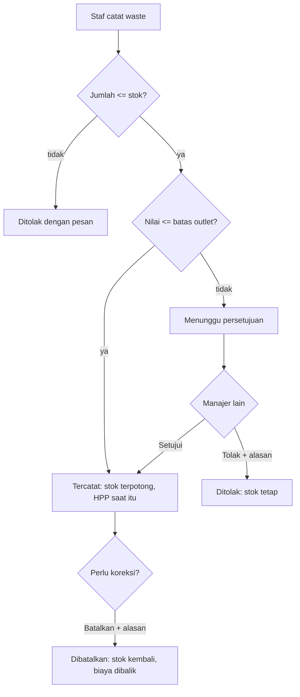
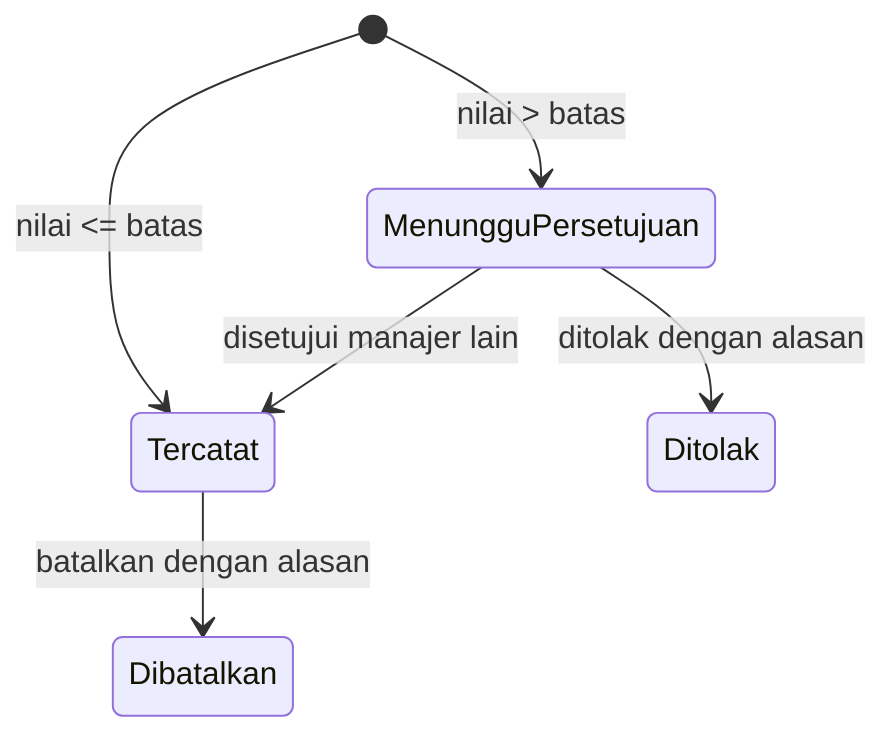

# REQ-011: Pencatatan waste bahan baku dan menu

- **Status:** ready
- **Owner:** @radityaaa43
- **Module:** module:inventory
- **Updated:** 2026-11-28

## User stories

| # | Story | Journey | AC |
|---|---|---|---|
| US-1 | Sebagai **staf dapur atau gudang**, saya ingin mencatat bahan atau menu yang dibuang beserta alasannya, agar stok di sistem sama dengan stok di rak. | J1 | AC-01, AC-02, AC-03, AC-04, AC-05 |
| US-2 | Sebagai **manajer**, saya ingin menyetujui waste yang nilainya besar sebelum stok terpotong, agar kerugian besar selalu diketahui dan tidak disalahgunakan. | J2 | AC-06, AC-07, AC-08, AC-09 |
| US-3 | Sebagai **pemilik**, saya ingin melihat biaya waste di laporan laba dan laporan waste per outlet, bahan, dan alasan, agar tahu kerugian dan penyebabnya. | J3 | AC-10, AC-11 |

## Context

Hari ini bahan yang rusak, kedaluwarsa, atau menu yang dibuang tidak punya pencatatan sendiri. Staf memakai stock opname (selisih tanpa alasan) atau tidak mencatat sama sekali, sehingga stok sistem lebih besar dari stok nyata dan HPP dari REQ-002 melenceng. Resep (REQ-001) dan HPP rata-rata per gudang (REQ-002, `InventoryCostService`) sudah ada.

**Decisions** (each dated, with who decided):

1. **Yang dicatat: bahan baku dan menu jadi.** Menu jadi yang dibuang memotong bahan resepnya. (pemilik, 2026-11-28)
2. **Alasan dari pilihan tetap** — Kedaluwarsa, Rusak, Salah buat, Tidak diambil, Lainnya — plus catatan opsional. (pemilik, 2026-11-28)
3. **Staf mencatat, manajer menyetujui di atas batas nilai.** Di bawah batas, stok langsung terpotong. (pemilik, 2026-11-28)
4. **Biaya waste** dinilai dengan HPP rata-rata saat dicatat dan tampil sebagai baris tersendiri di laporan laba, ditambah laporan waste per outlet, periode, bahan, dan alasan. (pemilik, 2026-11-28)
5. **Batas persetujuan per outlet,** default Rp 100.000 per catatan, diubah lewat izin pengaturan dan dicatat di audit log. Alasan: nilai bahan beda antar outlet. Ditolak: satu batas untuk semua outlet. (Business/PM, didelegasikan pemilik, 2026-11-28)
6. **Izin baru `stock-waste-create`** untuk mencatat dan **`stock-waste-approve`** untuk menyetujui atau menolak, mengikuti pola izin stok yang ada. Pemegang `stock-waste-approve` yang mencatat sendiri tetap perlu persetujuan orang lain untuk waste di atas batas. Alasan: empat mata untuk kerugian besar. (Business/PM, 2026-11-28)
7. **Waste menunggu persetujuan tidak memotong stok.** Disetujui: stok terpotong saat itu dengan HPP saat itu. Ditolak: tidak ada perubahan, alasan penolakan wajib. (Business/PM, 2026-11-28)
8. **Waste tidak bisa melebihi stok yang ada** di gudang itu; ditolak dengan pesan. Alasan: sama dengan aturan stok penjualan. (Business/PM, 2026-11-28)
9. **Waste yang sudah memotong stok tidak bisa diedit atau dihapus.** Koreksi dilakukan dengan **Batalkan waste** oleh pemegang `stock-waste-approve` dengan alasan wajib; stok dikembalikan dan biaya waste dibalik di periode pembatalan. Alasan: jejak tetap utuh. (Business/PM, 2026-11-28)
10. **Waste tidak masuk HPP penjualan;** biaya waste adalah baris tersendiri di laporan laba (keputusan 4), sehingga margin per menu tidak tercampur. (Business/PM, 2026-11-28)
11. **Penyetuju lain dari outlet mana pun** yang bisa diakses pengguna (termasuk pemilik) boleh menyetujui; tidak ada pengecualian persetujuan sendiri. Daftar menampilkan **Menunggu persetujuan orang lain**. Alasan: empat mata tetap berlaku di outlet yang hanya punya satu manajer. (Business/PM, 2026-11-28, Q-A feasibility #455)
12. **Pilihan item hanya bahan baku dan menu resep;** produk retail siap jual ditolak server dan tetap memakai stock opname. (Business/PM, 2026-11-28, Q-B; keputusan 1)
13. **Pembatalan mengembalikan nilai HPP yang keluar** (bukan sekadar menambah jumlah), supaya harga rata-rata tetap benar untuk penjualan berikutnya; produk yang punya catatan waste tidak bisa dihapus. (Business/PM, 2026-11-28, dari feasibility #455)

## Process

**As-is.** Bahan rusak dibuang tanpa catatan, atau dikoreksi lewat stock opname tanpa alasan. Pemilik tidak tahu berapa kerugian waste dan penyebabnya.

**To-be.** Staf mencatat waste saat membuang; waste besar menunggu manajer; stok dan HPP langsung benar; pemilik membaca biaya waste di laporan laba dan laporan waste.

## User journey and flow

### Journeys per role

**J1. Mencatat waste** (staf dengan `stock-waste-create`)

| # | Step | Actor | What they see or do | AC | Weak point |
|---|---|---|---|---|---|
| 1 | Buka **Waste**, pilih gudang, tambah item (bahan atau menu), jumlah, alasan, catatan | Staf | Nilai waste (HPP rata-rata × jumlah) terlihat sebelum simpan | AC-01, AC-02 | Jumlah melebihi stok: ditolak (AC-03) |
| 2 | Simpan, nilai di bawah batas | Staf | Status **Tercatat**, stok langsung terpotong | AC-04 | — |
| 3 | Simpan, nilai di atas batas | Staf | Status **Menunggu persetujuan**, stok belum terpotong | AC-05 | — |

**J2. Menyetujui waste** (manajer dengan `stock-waste-approve`)

| # | Step | Actor | What they see or do | AC | Weak point |
|---|---|---|---|---|---|
| 1 | Buka daftar **Menunggu persetujuan** | Manajer | Item, jumlah, nilai, alasan, pencatat | AC-06 | Waste yang dicatat sendiri tidak bisa disetujui sendiri (AC-07) |
| 2 | **Setujui** | Manajer | Stok terpotong dengan HPP saat itu; status Tercatat | AC-06 | Stok sudah tidak cukup saat disetujui: ditolak dengan pesan (AC-03) |
| 3 | **Tolak** dengan alasan | Manajer | Status **Ditolak**; stok tidak berubah | AC-08 | — |
| 4 | **Batalkan waste** yang sudah tercatat | Manajer | Stok kembali, biaya dibalik, alasan wajib | AC-09 | — |

**J3. Laporan** (pemilik)

| # | Step | Actor | What they see or do | AC | Weak point |
|---|---|---|---|---|---|
| 1 | Laporan laba | Pemilik | Baris **Biaya waste** terpisah dari HPP penjualan | AC-10 | — |
| 2 | Laporan waste | Pemilik | Per outlet, periode, bahan/menu, alasan: jumlah dan nilai | AC-11 | — |

### Flow

### States

## Stakeholders

| Party | Role in the flow | What they care about | What they decide |
|---|---|---|---|
| Staf dapur/gudang | Mencatat | Cepat dicatat saat membuang | Item, jumlah, alasan |
| Manajer | Menyetujui | Kerugian besar terkontrol | Setujui, tolak, batalkan |
| Pemilik | Membaca laporan | Kerugian dan penyebabnya | Batas per outlet, siapa memegang izin |

## Acceptance criteria

### Mencatat

- **AC-01:** Given pengguna dengan `stock-waste-create`, when mencatat waste bahan baku atau menu jadi dengan gudang, jumlah, alasan (Kedaluwarsa, Rusak, Salah buat, Tidak diambil, Lainnya) dan catatan opsional, then catatan tersimpan dengan nilai = HPP rata-rata saat itu × jumlah.
- **AC-02:** Given waste menu jadi, when disimpan, then yang dipotong adalah bahan resepnya (jumlah resep × jumlah menu), dan nilainya jumlah HPP bahan-bahan itu.
- **AC-03:** Given jumlah (atau bahan resep) melebihi stok gudang itu, when disimpan atau disetujui, then ditolak dengan pesan yang menyebut item dan stok yang ada.
- **AC-04:** Given nilai di bawah atau sama dengan batas outlet, when disimpan, then status **Tercatat** dan stok terpotong dalam satu transaksi (`product_warehouse.stock` dan `products.stock`).
- **AC-05:** Given nilai di atas batas outlet, when disimpan, then status **Menunggu persetujuan** dan stok belum berubah.

### Menyetujui

- **AC-06:** Given waste menunggu persetujuan, when pemegang `stock-waste-approve` lain menyetujui, then stok terpotong dengan HPP saat disetujui, status Tercatat, dan tercatat siapa dan kapan.
- **AC-07:** Given pencatat waste juga pemegang `stock-waste-approve`, when mencoba menyetujui waste-nya sendiri, then ditolak dengan pesan.
- **AC-08:** Given waste menunggu persetujuan, when ditolak dengan alasan (wajib), then status **Ditolak** dan stok tidak berubah.
- **AC-09:** Given waste Tercatat, when pemegang `stock-waste-approve` memilih **Batalkan waste** dengan alasan, then stok kembali, biaya waste dibalik di periode pembatalan, dan status **Dibatalkan**; waste tidak bisa diedit atau dihapus.

### Laporan

- **AC-10:** Given waste tercatat dalam periode, when pemilik membuka laporan laba, then **Biaya waste** tampil sebagai baris tersendiri, tidak dicampur ke HPP penjualan.
- **AC-11:** Given laporan waste untuk satu outlet dan periode (WIB), when dibuka, then tampil jumlah dan nilai per item dan per alasan, dengan pembatalan mengurangi.

### Pengaturan, izin, teks

- **AC-12:** Given pemilik dengan izin pengaturan, when mengubah batas persetujuan waste outlet (default Rp 100.000), then tersimpan, dipakai untuk catatan berikutnya, dan dicatat di audit log.
- **AC-13:** Given pengguna tanpa `stock-waste-create` atau `stock-waste-approve`, when membuka atau mengirim aksinya, then menu atau tombol tidak tampil dan server menolak (403).
- **AC-14:** Given setiap teks baru (form, status, alasan, laporan, pesan tolak), when bahasa diubah, then tersedia dalam bahasa Indonesia dan English.

<!-- Edge cases:
     - offline (POS queued sale): n/a — pencatatan waste di back-office web, butuh server
     - split payment: n/a — tidak ada pembayaran
     - insufficient stock: AC-03
     - cancellation before payment: n/a
     - cancellation or refund after payment: AC-09 (batalkan waste)
     - shift close with open work: n/a — waste tidak terikat shift kasir
     - failed or expired payment: n/a
     - permission denied (UI and server): AC-13, AC-07
     - two users acting at the same time: dua manajer menyetujui bersamaan — hanya yang pertama tercatat; yang kedua melihat status sudah berubah (tech-lead mengonfirmasi penguncian, Q1)
     - existing data on release: tidak ada catatan waste lama; batas default Rp 100.000 per outlet
     - an event that comes late or twice: double submit — satu catatan (Q1)
     - master data deleted or renamed while in use: produk yang punya catatan waste tidak bisa dihapus permanen (Q1)
     - the same action from another channel: n/a — hanya web back-office di versi ini
     - what another outlet sees: catatan dan laporan per gudang/outlet pengguna
     - every new UI text, in Indonesian and English: AC-14 -->

## Business rules

- **Money:** nilai waste = HPP rata-rata saat stok terpotong × jumlah (menu: jumlah HPP bahan resep). Biaya waste baris tersendiri di laporan laba; pembatalan membalik di periode pembatalan.
- **Stock:** stok terpotong saat Tercatat (langsung atau saat disetujui), di gudang yang dipilih, dalam satu transaksi dengan `lockForUpdate`; tidak boleh melebihi stok yang ada; pembatalan mengembalikan.
- **Permissions:** `stock-waste-create` mencatat; `stock-waste-approve` menyetujui, menolak, membatalkan; tidak bisa menyetujui catatan sendiri.
- **Settings:** batas persetujuan per outlet, default Rp 100.000.

## Non-functional requirements

- **Speed:** form waste menampilkan nilai seketika; laporan waste satu outlet satu bulan terbuka dalam 3 detik.
- **Reliability:** potong dan kembalikan stok atomik dengan catatan waste.
- **Security:** izin dicek di server; data per outlet pengguna.
- **Audit:** catat, setujui, tolak, batalkan, dan ubah batas.
- **Language and accessibility:** Indonesia dan English.

## Data and integrations

- **Data:** catatan waste (gudang, item, jumlah, alasan, catatan, nilai, status, pencatat, penyetuju, waktu); mutasi stok bertipe waste; batas per outlet. Data lama: tidak ada.
- **Integrations:** none new.

## Success metrics

- **Biaya waste:** biaya waste per outlet per bulan sebagai persen dari HPP penjualan (WIB); baseline dari bulan pertama.
- **Selisih opname:** rata-rata selisih stock opname per outlet sebelum vs sesudah pencatatan waste dipakai.

## Out of scope

- Batch dan tanggal kedaluwarsa otomatis (pengingat bahan akan kedaluwarsa).
- Waste dari aplikasi mobile atau POS kasir.
- Waste produk retail non-resep di luar bahan baku dan menu (keputusan 1).

## Risks and assumptions

| Risk | Impact | Mitigation |
|---|---|---|
| Staf memecah waste besar menjadi beberapa catatan kecil di bawah batas | Persetujuan terlewati | Laporan waste per pencatat dan per hari; pemilik bisa menurunkan batas |
| HPP rata-rata berubah antara catat dan setuju | Nilai berbeda | AC-06: nilai memakai HPP saat stok terpotong |

- [assumption] Satu outlet mencatat paling banyak puluhan waste per hari.

## Open questions

- **Q1:** Feasibility read — **answered** (#455, 2026-11-28): layak di atas kode stok dan HPP yang ada (`InventoryCostService::lineCost`, pola keluar stok checkout, `StockMutationService`). Menu dipecah ke bahan resepnya saat stok terpotong; dua penyetuju atau double submit: hanya yang pertama tercatat. Laporan laba menambah biaya waste dan laba setelah waste. Dipotong menjadi tiga ticket: W1 catat waste (±1.300), W2 batas, persetujuan, penolakan, dan pembatalan (±1.500; W3 tech-lead digabung karena kode dan builder sama), W4 baris laba dan laporan waste (±850). Urutan: W1, lalu W2 dan W4 paralel. Q-A dan Q-B menjadi keputusan 11 dan 12.

## Delivered by

<!-- Issues and PRs, filled in as work ships. -->
