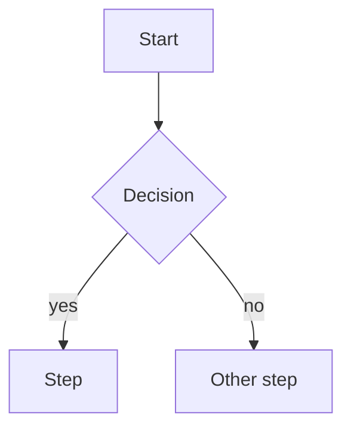
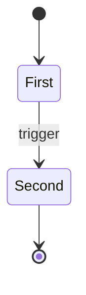

# REQ-<n>: <short title>

- **Status:** draft
- **Owner:** @radityaaa43
- **Module:** module:<name>
- **Updated:** YYYY-MM-DD

<!-- Every section is required. A section that truly doesn't apply says "n/a — <reason>".
     A REQ is `ready` only when every section is filled or n/a with a reason (README.md → Status). -->

## User stories

<!-- One story per affected role (owner, branch manager, cashier, waiter, kitchen staff, guest,
     central warehouse staff...). Each story names the journey it lives in and the criteria that
     prove it, so story → journey → AC can be followed both ways. -->

| # | Story | Journey | AC |
|---|---|---|---|
| US-1 | As a <role>, I want <capability>, so that <outcome>. | J1 | AC-01, AC-02 |

## Context

Why this is needed, what happens today, and links to designs, issues or docs.

**Decisions** (each dated, with who decided):

1. <decision> (<who>, YYYY-MM-DD)

## Process

**As-is.** What each role does today, step by step, and where it goes wrong.

**To-be.** What each role does after this ships, step by step.

## User journey and flow

<!-- Required for every REQ (maintainer, 2026-11-26). Show how each role moves through the feature,
     not just the end state. A reviewer should be able to walk each journey and find every criterion. -->

### Journeys per role

<!-- One table per journey: setup or one-time steps, the main path, and every failure or
     unusual path (payment fails, device offline, cancellation, shift close, permission denied...).
     Each step names the actor, what they see or do, and the AC it maps to. A step with no AC is a gap:
     add a criterion or say why none is needed. -->

**J1. <journey name>** (<role(s)>, <when>)

| # | Step | Actor | What they see or do | AC | Weak point |
|---|---|---|---|---|---|
| 1 | | | | | |

### Flow

<!-- A Mermaid flowchart of the main path and its branches (decisions, failures, retries). -->

### States

<!-- For every thing that changes status (an order, an item, a bill, a job): a Mermaid state diagram
     with every allowed transition and who or what triggers it. "n/a — <reason>" if nothing has a
     status. -->

## Stakeholders

| Party | Role in the flow | What they care about | What they decide |
|---|---|---|---|
| | | | |

## Acceptance criteria

<!-- Given/When/Then, grouped by flow. Never renumber a criterion an issue or PR references. -->

### <flow>

- **AC-01:** Given <situation>, when <action>, then <observable result>.

<!-- Edge cases. Each one is covered by a criterion or marked n/a with a reason:
     - offline (POS queued sale)                - split payment
     - insufficient stock                       - cancellation before payment
     - cancellation or refund after payment     - shift close with open work
     - failed or expired payment                - permission denied (UI and server)
     - two users acting at the same time        - existing data on release (defaults, backfill)
     - an event that comes late or twice         - master data deleted or renamed while in use
       (webhook, retry, double tap)
     - the same action from another channel     - what another outlet sees (shared customers,
       (POS, table QR, portal, API)               shop-wide lists)
     - every new UI text, in Indonesian and English -->

## Business rules

- **Money:** when it counts as paid, receivables, cash difference, rounding.
- **Stock:** when it is taken or restored, which warehouse.
- **Permissions:** which steps need which permission (configurable per shop, never a hard-coded role).
- **Settings:** per shop or per outlet, default, who may change it.

## Non-functional requirements

- **Speed:** <e.g. shows within N seconds; report opens for one outlet and one month>.
- **Reliability:** behaviour when the connection drops or a service is down.
- **Security:** server-side permission checks, data visible only to the user's outlet.
- **Audit:** which changes are written to the audit log.
- **Language and accessibility:** Indonesian and English; touch targets and contrast where relevant.

## Data and integrations

- **Data:** where each value comes from, new fields, defaults for existing records.
- **Integrations:** payment gateways, WhatsApp, webhooks, or "none new".

## Success metrics

- **<metric>:** formula, data source, period and time zone, target or baseline.

## Out of scope

- ...

## Risks and assumptions

| Risk | Impact | Mitigation |
|---|---|---|
| | | |

- [assumption] ...

## Open questions

- **Q1:** <question> — decides: <who>. `?` until answered.

## Delivered by

<!-- Issues and PRs, filled in as work ships. -->
