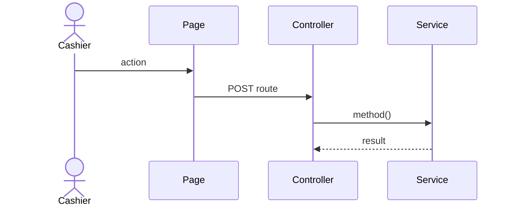
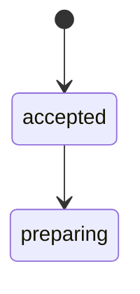

# Handoff standard: task, delivery, review

How work moves between the six agent sessions of this team: `business` (Business / PM), `tech-lead`,
`verifier`, and `dev1`, `dev2`, `dev3`. What this team runs short of is context, CI runs and
hand-offs, so every rule here is sized to spend few of them. A comment that lacks a required field
is sent back, not acted on.

A session started from the team's role definitions (`claude --agent <role>`) brings the general
rules with it. This file is this project's fit of them: its columns, formats, limits and commands.
Where the two differ, this file wins. Roles and board columns:
[`issue-tracker.md` → Board and roles](issue-tracker.md#board-and-roles).

- [0. Flow rules: pull, limits, priorities](#0-flow-rules-pull-limits-priorities)
- [1. Task: Tech Lead → developer](#1-task-tech-lead--developer)
- [2. Delivery: developer → Tech Lead → Verifier](#2-delivery-developer--tech-lead--verifier)
- [3. Review: pre-review, then verification](#3-review-pre-review-then-verification)
- [4. Business track: Business / PM](#4-business-track-business--pm)
- [5. Flow track: Verifier](#5-flow-track-verifier)

## 0. Flow rules: pull, limits, priorities

Set by the maintainer on 2026-11-26 to keep three developers busy without waiting on anyone. These
rules come before sections 1–4.

### 0a. Pull, don't wait

- **A developer pulls their own work.** When they have no ticket In progress, they take the next card in
  Todo whose plan names them (`Builder: devN`) and whose `Blocked by` issues are all merged. They move
  it to In progress. The card is the notice (0e).
- **Stacking.** A ticket whose only open blocker is in the same developer's chain, and is already built
  on a branch, can be pulled too. The developer stacks it on that branch and opens its PR only after
  the blocker merges.
- **Nothing of their own is ready:** they take any unblocked `low` card in Todo and say so.
- **Nothing at all is ready:** they wake the Verifier with `idle` once, and the Verifier gets their
  next ticket planned first.
- A session that restarts reads the board and its memory and carries on. It doesn't ask what to do.

- **Tech-only tickets skip the business track** (maintainer, 2026-11-26). These are tooling changes,
  dependency upgrades and refactors (test and CI work gets no ticket, 0d): `Backlog: none`, with no change a user
  sees.
  - The Tech Lead files them straight into Todo, with a plan and a `Builder`.
  - They get the Review column, technical part only (no business part).
  - If such a change does alter what a user sees, it goes through Backlog and Business / PM as usual.

### 0b. Finish before starting

Everyone takes work in this order:

1. **Unblock merges:** a red `main`, a PR waiting for a review you owe.
2. **Finish your In progress work.**
3. **Pull new work.**

The Verifier merges and reviews (technical and business) before flow work. The Tech Lead answers
questions and pre-reviews developer PRs before planning.

### 0c. Column limits

| Column | Limit | Owner when it's off |
|---|---|---|
| Planning | at least 2 per developer, ready to plan | Business / PM prepares more (section 4, rule 4) |
| Todo | at least 1 per developer with blockers merged | Tech Lead plans more |
| In progress | 1 main ticket per developer, plus 1 stacked next-in-chain ticket, plus up to 2 `low` | The developer finishes before pulling |
| Review | at most 3 | The Verifier reviews before anything else |

The Verifier watches the limits and wakes the owner of a column that is off (section 5).

### 0d. Quality that costs no waiting

- **Self code review (Expected size L or larger, before Review).** The developer
  runs `/code-review` (low, in a sonnet subagent) on their diff, fixes what it finds and pastes the
  result in the PR; for XS, S and M the pre-review and the Verifier's review cover it (owner rule,
  2026-11-28). The Evidence table (2a) is complete, with one row per AC, BR and TC, plus the
  screenshots. The Verifier's review confirms; it doesn't discover.
- **Pre-review gate** (maintainer, 2026-11-28): the Tech Lead pre-reviews every developer PR against
  its plan before it reaches Review (2b). The card stays In progress until it passes.
- **Tests and flaky tests get no ticket of their own** (maintainer, 2026-11-28). Tests are written
  inside the feature PR and run in CI. A flaky test is fixed inside the next feature PR that meets
  it. A PR is re-run at most once for a known flake.
- **E2E is the full regression suite** (maintainer, 2026-11-26).
  - CI runs **every** feature's e2e on every PR. Shards split the same full suite and never run a subset.
  - **Every feature or change PR writes its own e2e in the same PR.** It goes in the feature's folder
    under `tests/e2e/features/`, with one test per AC tagged `@REQ-<n>-AC-<n>` that proves the AC as
    written. A PR without it isn't reviewed.
  - That test joins the regression suite for good, so every later PR re-proves the feature, and a new
    feature can't silently break an older one.
  - An e2e test is never skipped, `fixme`'d or deleted to get a PR green. A test changes only when its
    behaviour is changed on purpose, and the PR names the AC or decision behind the change.
  - A flaky test gets fixed, not silenced.
- **Push when ready.** Push once the Evidence is complete, and batch fix-ups into one push, so CI
  isn't cancelled and restarted.

### 0e. The board is the channel

Set by the maintainer on 2026-11-28. Sessions talk through the board and the issue, so nothing is
said twice and a restarted session misses nothing.

- **Moving the card is the hand-off.** A card's column says who holds the ticket. Whoever causes the
  change moves the card in the same step.
- **What the next owner needs is a comment** on the issue or the PR: the plan, the Evidence, the
  verdict, the decision. It is written there once.
- **A message is only a wake-up**, because an idle session doesn't see the board. It is one line,
  `#<n> | <column or event>`, sent to the session that now holds the ticket. Several tickets for one
  session go in one message.

  | Card moves to | Wake-up to |
  |---|---|
  | Backlog (sent back to be cut, 0g) | `business` |
  | Planning | `tech-lead` |
  | Todo | the `Builder` |
  | In progress (sent back) | the developer |
  | Review | `verifier`, from `tech-lead` after a passed pre-review (2b) |

  Events without a card move: `pre-review <PR URL>` to `tech-lead` (2b), `question` to the session
  that decides, `blocked` and `idle` to `verifier`.
- **Everything else is read from the board:** started, merged, done. A wake-up gets no reply; the
  next card move is the answer.
- **Read your columns** when a session starts, after each finished task, and when a wake-up arrives.
- **Changes to these rules** go into one Standards PR per day, at most. Each one rests on the daily
  flow report (Verifier): time per column, rework rounds, CI cancelled or failed, stuck PRs.

### 0f. Multi-agent: build in parallel

Set by the maintainer on 2026-11-26. Developers **use subagents to build faster**.

- **One subagent and one git worktree per ticket** (`git worktree add ../poc-pos-wt-<issue> …`, each
  with its own `npm ci`). Up to the 0c limit: 1 main, 1 stacked and 2 `low` tickets in parallel per
  developer.
- **Inside one ticket, split independent parts across subagents**: for example backend with its
  PHPUnit, frontend with its Vitest, and the e2e per AC. The developer merges the parts in one branch
  and owns the result.
- **The developer stays accountable.** They read every subagent diff, run the fast checks locally
  (Pint, Vitest, build; PHPUnit and e2e run only on CI), run `/code-review` on the combined diff and
  write the Evidence table themselves. A subagent never pushes, opens a PR, merges or moves a card.
- **Subagents get the full context they need in their brief:**
  - the issue number
  - its AC, BR and TC lines
  - the plan sections that apply
  - the files they own
  - which files they must not touch
- **Two subagents never edit the same file at the same time.** Hotspot files (AGENTS.md → Working in
  parallel) belong to the developer, who edits them after the parts are merged.
- **Model and effort:** `sonnet` with high effort for building, and `/code-review` low on `sonnet` for
  the self-review.

### 0g. Size: one ticket, one outcome

Set by the maintainer on 2026-11-28. Every ticket pays the same fixed cost: a plan, two reviews, a
full CI run and a merge. So a ticket is sized to the outcome it delivers.

- **One ticket delivers one user journey of the REQ, end to end:** schema, server, UI, wording and
  its e2e. Business / PM cuts a REQ along its journeys, usually into two or three tickets. A layer
  ("server half", "UI half") or a single AC of a journey belongs inside its journey's ticket.
- **One PR closes the ticket.** Aim under 1500 counted lines (tests count). 2000 is the limit: above
  it a PR needs a second approver, and a team on one login has none.
- **Too big?** When the plan estimates more than 2000 lines, the Tech Lead says so on the issue and
  moves the card back to Backlog, and Business / PM cuts the ticket again along the journey. Each part still shows a user something and carries its
  own AC and e2e.
- **Enabling work ships alone only when other tickets wait on it.** A schema, contract or rename
  that in-flight tickets build on is its own tech-only ticket (0a). Otherwise it stays inside the
  ticket that needs it.
- **Review runs once per ticket,** on the PR that closes it.

## 1. Task: Tech Lead → developer

A task is a **technical plan comment** on the issue. The card moves Planning → Todo once the plan has
been re-reviewed, and that move assigns it.

### 1a. Plan comment (on the issue)

A plan is structured, complete and comprehensive (maintainer, 2026-11-26), the technical twin of the REQ
template (`backlog/TEMPLATE.md`, with journeys and a state diagram).

- **Depth follows risk** (maintainer, 2026-11-28), so a plan costs its readers (the builder and both
  reviewers) only the context the ticket needs:

  | Plan | When | Sections |
  |---|---|---|
  | Short | Effort `low` | 1, 13, 14, 15, 16 |
  | Standard | Effort `medium` | the Short ones, plus each of 2–12 the change touches |
  | Full | Effort `high`, or any change to money, stock, locking, a webhook or existing data | all 16; one that doesn't apply says `n/a — <reason>` |

  Risk wins over Effort: a ten-line change on a payment path gets a Full plan.
- **Diagrams** (Mermaid, so GitHub renders them) are required when a flow spans three or more
  components (page → controller → service → job or webhook) and when the change has a status.
- **Cite the code** a decision rests on as `path:line` on `origin/main`, or mark it `[unverified]`.
- **Quote the REQ's UI text, point at the rest.** UI text is the REQ's exact wording, and the
  replacement is used for every retired term (`GLOSSARY.md` → Retired terms). Everything else is
  named by id (`US-2`, `J3.1`, `AC-05`, decision 5), which the reader can open.

````markdown
## Technical plan (Tech Lead)

### 1. Context
REQ-<n> and what this ticket covers, by id: user stories (`US-n`), journeys (`J-n`), AC and BR. The
trace runs US → J → AC / BR → TC → test. Also: what it builds on (merged PRs, the frozen contracts it
uses), what it deliberately leaves to other tickets, and a 2–4 sentence summary.

### 2. Architecture
Components touched (layer by layer) and where new code sits in the existing structure (no new layer
without a reason). One sequence diagram per key flow:


### 3. Data model
Tables and columns (type, null, default), constraints, indexes and FKs, migration file names in
order, `up()` / `down()`, backfill and release defaults (matching the REQ), expected volume.

### 4. API and routes
Each route or endpoint: method, path, request fields and validation, response, middleware. Spatie
permission and Sanctum ability, kept aligned. Web and API twins.

### 5. Backend logic
Services and methods; `DB::transaction` boundaries and `lockForUpdate` rows; idempotency
(what makes a retry or a double tap safe); jobs, schedules, webhooks, after-commit work. Stock writes
update `product_warehouse.stock` and `products.stock` together.

### 6. Frontend
Pages and components (extract instead of growing oversized files). The **loading, empty, error and
offline states** of each screen. i18n keys in `en.json` and `id.json` with the REQ's exact wording.
Accessibility (labels, focus, touch size, contrast), Menu.jsx.

### 7. States
How the REQ's state diagram maps to columns and allowed transitions (forward only? who triggers
each?), and what each state shows the user. `n/a — no status` when there is none.


### 8. Edge cases
Every failure path in the REQ's journeys, plus the technical ones (concurrency, offline, retries,
partial failure, missing data), each with its handling and its test:
| Case (journey step id, e.g. `J4.1`, or BR) | Handling | Test |
Every failure step of the covered journeys has a row, so the check is mechanical.

### 9. Security
Server-side authorization per action, input validation and mass assignment, data exposure (what
each role sees, outlet scope), audit log entries, secrets.

### 10. Performance
Queries per request and N+1, indexes for the new filters, polling or job load, payload size,
memory for reports (`shortcut:` comment when bounded on purpose).

### 11. Observability
Logs (what, at which level), audit events, counters or reports the owner or the flow report uses,
how a failure is noticed.

### 12. Rollout and rollback
Migration order against other open PRs, compatibility with old data and old clients (offline
queues, API), release defaults, how to undo (`down()`, feature off), anything the maintainer must do.

### 13. Test plan
One row per AC, BR and behaviour:
| Line (AC / BR / behaviour) | PHPUnit | Vitest | E2E (`@REQ-<n>-AC-<n>`) |
Regression impact (existing tests changed, and why, per AC or decision). Before/after screenshots
for UI changes. The e2e joins the full suite for good (§0d).

### 14. Technical acceptance criteria
- [ ] [TC-1] <one checkable line each: schema, server-side permissions, tests per behaviour, e2e per
  AC, screenshots, docs, size, standards>

### 15. Files, hotspots, collisions
Files created and changed, hotspot files (append only), migrations, overlap with other in-flight
tickets, stacking base (`Blocked by` / branch), and the worktree, branch and ports to use.

### 16. Decision, risks, Effort, Builder
    Decision (Tech Lead, delegated by the maintainer, YYYY-MM-DD): <what>
    Why: <reason, with the rule or code it rests on>
    Rejected: <alternatives and why>
    Review: rules ✓ code ✓ AC ✓ BR ✓ data ✓ security ✓ parallel ✓ tests ✓
Risks (risk → impact → mitigation), counted lines (aim < 1500, limit 2000; §0g), **Effort**, **Builder: devN**.

_Plan re-review ✓ (YYYY-MM-DD): cited lines match `origin/main` <sha>; every AC, BR and REQ journey
step (main and failure paths) maps to a section, a test or a TC; no file overlap with other in-flight
tickets._
````

**Acceptance lists.** The issue holds two checklists, written before any code: **Business acceptance
criteria** (`[AC-xx]` from the REQ and `[BR-n]` for each business rule or edge case; Business / PM
writes them in Backlog) and **Technical acceptance criteria** (`[TC-n]`; the Tech Lead writes them in
the plan's `### Technical acceptance criteria` block and copies the block into the issue body's
`## Technical acceptance criteria` section, so the issue holds both lists). Tickets already in Todo or
later keep their current form (Done when).

**Re-review before Todo.** Read the plan again against current `main`. Check that the cited lines
haven't moved, that the requirement wording is quoted, that every AC, BR and **REQ journey step
(main and failure path)** maps to a section, a test or a TC, and that parallel tickets don't share
files. Then add the re-review line. Plans posted before 2026-11-26 keep their form; the 16-section
form applies from the REQ-004 plans onward, and plan depth from plans posted on 2026-11-28 or later.

### 1b. Assignment (the card moves to Todo)

The Tech Lead moves the card to Todo and wakes the builder with `#<n> | Todo`. The plan carries the
rest (its sections 15 and 16), and the developer pulls the card under 0a.

- **Several tickets at once:** a developer may hold up to three `low` Effort tickets that touch
  different files. Each one gets its own worktree, branch, PR and subagent (model `sonnet`, effort
  `high`). The developer integrates: reviews each subagent's diff, verifies it, opens the PR.
- **Questions:** a technical question goes to the Tech Lead, a business one to Business / PM. It is
  posted on the issue with a proposed default, the deciding session is woken with `#<n> | question`,
  and the answer is written on the issue. The developer keeps building on the default meanwhile.

## 2. Delivery: developer → Tech Lead → Verifier

A task is delivered when the PR carries an **Evidence** table and has passed the Tech Lead's
pre-review, so its card is in Review (2b). "Done" without evidence is not done.

### 2a. Evidence (in the PR body, the `## Evidence` section)

**Mandatory evidence** (maintainer, 2026-11-25):

- **Every UI change** has before and after screenshots attached to the PR, showing the REQ wording. A failed upload blocks the merge, and there is no waiver.
- **Every feature or flow change** has e2e tests, including a backend-only flow, which is asserted through the e2e state query.
- `E2E: none — <reason>` is allowed only for docs, governance and pure refactors.

One row per Done-when line, per AC on the `Backlog:` line, and per plan item. When the issue has the
acceptance lists (section 1a), the rows are exactly its `[AC-xx]`, `[BR-n]` and `[TC-n]` lines, in
that order, with the tag in the first column (`AC-01`, `BR-1`, `TC-1`).

```markdown
| # | Item (Done-when / AC / plan) | Done | Evidence |
|---|---|---|---|
| 1 | [AC-01] <criterion, in the REQ's words> | ✓ | `ProductPreparationTest::test_store_saves_…` pass; e2e `41-products/04-…` `@REQ-003-AC-01` pass |
| 2 | Plan: migration reversible | ✓ | `down()` drops both columns; `test_release_backfill_…` runs down → up |
| 3 | Full suite | ✓ | CI run <link>: PHPUnit 831 pass / 0 fail / 1 skip, e2e all shards green; locally Vitest 225 pass, `npm run build` ok |
| 4 | CI | ✓ | <link to the green run> |
| 5 | Manual test as <role> | ✓ | <steps> → <what you saw>; screenshot before / after |
```

Valid evidence is one of these:
- a test name and its result;
- a command and its counts;
- an e2e spec and its `@REQ` tag;
- a CI run link;
- a screenshot;
- a manual step and what you saw;
- a `path:line` for a pure code fact.

"Works", "tested" or "done" alone is not evidence. UI text must use the REQ's exact wording. A skip
or exception needs its reason.

### 2b. Ready (pre-review, then Review)

The developer leaves the card In progress and wakes the Tech Lead with
`#<n> | pre-review <PR URL>`. A developer never moves their own card to Review. The counted lines,
hotspots, migrations and the `/code-review` result (Expected size L+ only) are in the PR.

Before sending, on a ticket with Expected size L or larger: run `/code-review low` in a `sonnet`
subagent against the worktree diff (not the shared checkout), fix or answer each finding, and post
the result on the PR. Run the manual test on the host, never Docker (setup: #403).

The Tech Lead pre-reviews the PR against its plan and posts a **pre-review** comment on it:

- **Passed:** the Tech Lead moves the card to Review with
  `dev-tools/board-move.sh <n> review` and wakes the Verifier with `#<n> | Review <PR>`.
- **Changes:** the findings go on the PR, the card stays In progress, and the Tech Lead wakes the
  developer.

## 3. Review: pre-review, then verification

Reviews run in a fixed order, and each step starts only when the one before it passes. The Verifier
reviews each PR in the Review column, technical and business (maintainer, 2026-11-28). `business` and
`tech-lead` review no PR there.

1. **Pre-review (Tech Lead).** The card is In progress (2b). The Tech Lead checks the PR against its
   plan. On a pass it moves the card to Review.
2. **Verification (Verifier).** The Verifier checks the PR against the issue's criteria, the plan and
   the standards, and uses the running app for each AC (below). On a **high-risk** ticket (money,
   stock, locking, a webhook, existing data, or a change of architecture) it also checks lock order,
   idempotency and redelivery, partial failure and rollback, and the plan's TCs against the diff.
3. **Business acceptance (Verifier).** Still in the Review column, the Verifier checks the business
   criteria alongside the technical ones. This applies to `feat` PRs and to any PR whose
   `Backlog:` line names criteria. It happens once per ticket, on the PR that closes it (0g), as the
   per-AC comment `AC check — Review (verifier)` (section 4, rule 7).
4. **Merge (Verifier).** Both reviews passed, CI is green on the latest commit and the `Verifier`
   status is posted (below). A `Backlog: none` PR is merged with its business part skipped.
5. **Done (Verifier).** The board's *Item closed* workflow moves the card when the merged PR's
   `Closes #n` closes the issue. The Verifier checks the card landed and moves it by hand only if it
   didn't.

**Sent back.** A failed verification (technical or business) is a comment on the PR that names the
failing criteria and what was seen. The reviewer moves the card back to In progress and wakes the
developer. After the fix the developer sends it to pre-review again (2b), and the Verifier re-verifies
the failing lines.

**Who covers whom.** The Tech Lead reviews a PR the Verifier wrote (those PRs only; the owner may
change this), because an author never verifies their own change. When the Verifier is unreachable,
the Tech Lead is the backup merger (below).

**The `Verifier` status.** `main` requires a `Verifier` commit status (GitHub ruleset 27731300, added
2026-11-28). The Verifier posts it with `dev-tools/verifier-status.py` only after a **VERIFIED**
checklist comment that names the PR's head commit. Then the PR is merged with a literal
`gh pr merge`. The backup merger posts the same status the same way after the same checklist. A push
after the status needs a new checklist and a new status.

The Verifier's verdict is a **Requirement & AC checklist** comment on the PR
([`REVIEW.md`](../../REVIEW.md) → Review against, item 7). The code review itself may run as
`/code-review low` in a `sonnet` subagent; the checklist and the verdict are the Verifier's.

```markdown
**Verifier: Requirement & AC checklist** (YYYY-MM-DD, REQ-<n> read on <date>, head `<sha>`)

**Verdict: VERIFIED | CHANGES**

| # | Requirement / AC / plan item | Status | Verified at |
|---|---|---|---|
| 1 | [AC-01] <criterion> | ✓ / ✗ | <code line, test, CI run, screenshot, or what I did in the app and saw> |

**Findings** (REVIEW.md severities): 🔴 … · 🟡 … · 🟣 …
```

- **Every `[AC-xx]`, `[BR-n]` and `[TC-n]` line of the issue has a row.** The Verifier ticks the
  `[TC-n]` lines in the issue, and the `[AC-xx]` and `[BR-n]` lines after the business check. A new
  technical finding is first added as a `[TC-n]` line, then checked.
- **Mechanical checks come first:** CI green on the latest commit, no file of another ticket
  deleted, size inside the limit, no retired term (`GLOSSARY.md` → Retired terms), no test skipped
  or loosened.
- **Use the app for each AC a user can see,** as the role the criterion names, on its main path and
  its failure path, in a review app on the host, never Docker (setup: #403). PHPUnit and e2e still run
  on CI only. When the app can't be
  run, the verdict says so and names what stays unproven.
- Every Evidence row is re-checked against the REQ text, the plan and the code. It is not copied.
- Any ✗ or unproven row means **CHANGES**, and there is no merge.

## 4. Business track: Business / PM

Rules the maintainer set on 2026-11-25 for the business side. Business / PM decides under the
delegation in [`issue-tracker.md` → Delegation](issue-tracker.md#delegation).

1. **Requirements are structured, detailed, complete and comprehensive.** Every REQ follows
   [`backlog/TEMPLATE.md`](../../backlog/TEMPLATE.md): every section filled or `n/a — <reason>`, every
   edge case in its checklist covered by a criterion or marked n/a.
   - **One feasibility read per REQ.** Before a REQ is `ready`, the Tech Lead reads it once against
     the code, and Business / PM writes the answers into the REQ. That one pass serves every ticket
     of the REQ.
   - **Tickets are cut along the REQ's journeys** (0g).
2. **Review before deciding.** Check each business decision against:
   - earlier decisions: the REQ, the issue body **and every comment**, ADRs, GLOSSARY
   - the code as it is
   - the impact on the cashier, the owner's money and stock
   - the edge-case checklist
   - per-shop permissions (never a hard-coded role)
   - the general-POS rule (no tenant names)
   - reversibility (if it can't be undone, it goes to the maintainer)

   Record it on the issue:

   ```
   Decision (Business/PM, delegated by the maintainer, YYYY-MM-DD): <what>
   Why: <reason>
   Rejected: <alternatives and why>
   ```
3. **Review again before Planning.** Before moving a card to Planning, re-read the issue against
   rules 1–2, verify its claims in the code, fix any gap in the body, and post a comment starting
   `**Business re-read before Planning**` that lists what was checked. Only then move the card.
4. **Keep Planning fed.** Each time the Tech Lead takes cards, prepare the next Backlog items under
   rule 3. Target: at least two ready items per developer. A REQ ticket waiting on unmerged work can
   still go to Planning once its REQ is on `main`; the Tech Lead sequences it.
5. **Shift-left AC check.** When a card enters Todo, Business / PM checks its plan against the
   criteria and the business rules, including exact REQ wording for UI text. It doesn't block: the
   developer starts at once. Business / PM comments on the issue only about a missed criterion, and
   wakes the Tech Lead with `#<n> | question`.
6. **Questions found while planning.** A plan should need none, because the REQ answers them
   (rule 1). When one comes up, the Tech Lead proposes a default and keeps planning with it. Business /
   PM confirms or corrects it on the issue under rule 2, and writes the answer into the REQ, so the
   next ticket doesn't ask again.
7. **Business acceptance of a PR** (step 3 of section 3) is done by the Verifier, not by Business / PM
   (maintainer, 2026-11-28). Business / PM reviews no PR in the Review column. It is one PR comment:

   ```markdown
   **AC check — Review (verifier)** (REQ-<n> read on `main` YYYY-MM-DD; issue #<n>)

   **Verdict: AC check: OK | changes requested**

   | # | Requirement / AC | Evidence in the diff | Result |
   |---|---|---|---|
   | AC-01 | <criterion> | <code, test, e2e tag> | ✅ / ❌ |
   ```

   - One row per tagged criterion, Done-when item, recorded decision and business rule or edge case.
   - **Issues with the acceptance lists:** tick only the `[AC-xx]` and `[BR-n]` lines against the
     Evidence and post `AC check: OK (AC-…, BR-… ✓)`, or name the unticked lines with what was seen. A
     business rule found at review is first added as a `[BR-n]` line, then checked; if it changes
     scope, it goes back through Planning.
   - UI wording must match the REQ terms exactly.
   - Start from the technical checklist (section 3), and read the diff where a criterion turns on
     wording, a decision or a screenshot. Never pass a PR on its description alone.
   - Add screenshots per role the criterion names.
   - On ✅, the PR is merged under section 3, step 4. On ❌, the PR goes back (section 3, *Sent back*).
8. **After Done.** Update the REQ's *Delivered by* (issues and PRs per criterion). When every
   criterion has shipped, set the REQ to `done`.

## 5. Flow track: Verifier

The Verifier is the team's scrum master (maintainer, 2026-11-28). It reviews (technical and
business), merges (section 3), and it keeps work moving.

1. **Single watcher.** Only the Verifier polls GitHub (CI runs, PR state, the board), at most once a
   minute, because every session shares one API budget. The other sessions read their columns when
   they start, after each task and on a wake-up (0e).
2. **Order of work:** a red `main` first, then merges, then verification, then flow.
3. **Limits (0c).** When a column is off, the Verifier wakes its owner: `business` for Planning,
   `tech-lead` for Todo. An idle developer's next ticket is planned first.
4. **Stuck work.** A card that hasn't moved, a PR with a conflict or a red check, a blocked ticket:
   the Verifier comments on it and wakes the session that holds it.
5. **Flaky tests** get no ticket: the next feature PR that meets one fixes it (0d). A PR the Verifier
   wrote is reviewed by the Tech Lead.
6. **Daily flow report:** tickets finished, time per column, rework rounds, CI cancelled or failed,
   stuck PRs, and the one bottleneck to remove next.
7. **Process changes** start from the flow report and go to the maintainer, as one Standards PR per
   day at most (0e).
