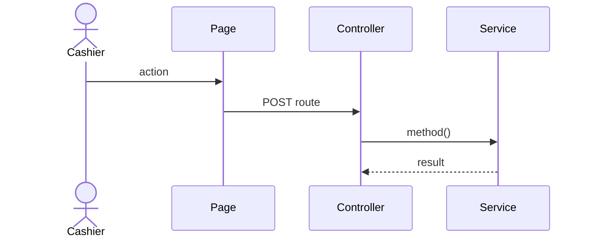
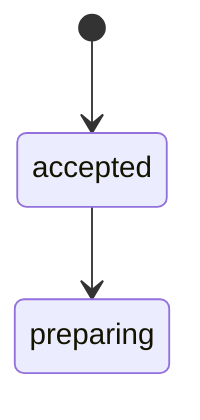

# Handoff standard: task, delivery, review

How work moves between the Tech Lead and the developers. These are the only three formats. A message
or comment that lacks a required field is sent back, not acted on. Roles and board columns:
[`issue-tracker.md` → Board and roles](issue-tracker.md#board-and-roles).

- [0. Flow rules: pull, limits, priorities](#0-flow-rules-pull-limits-priorities)
- [1. Task: Tech Lead → developer](#1-task-tech-lead--developer)
- [2. Delivery: developer → Tech Lead](#2-delivery-developer--tech-lead)
- [3. Review: Tech Lead → PR](#3-review-tech-lead--pr)
- [4. Business track: Business / PM](#4-business-track-business--pm)

## 0. Flow rules: pull, limits, priorities

Set by the maintainer on 2026-11-26 to keep three developers busy without waiting on anyone. These
rules come before sections 1–4.

### 0a. Pull, don't wait

- **A developer pulls their own work.** When they have no ticket In progress, they take the next card in
  Todo whose plan names them (`Builder: devN`) and whose `Blocked by` issues are all merged. They move
  it to In progress, then tell the Tech Lead they started. They don't wait for an assignment message.
- **Stacking.** A ticket whose only open blocker is in the same developer's chain, and is already built
  on a branch, can be pulled too. The developer stacks it on that branch and opens its PR only after
  the blocker merges.
- **Nothing of their own is ready:** they take any unblocked `low` card in Todo, or the top test-fix or
  flaky-test issue, and say so.
- **Nothing at all is ready:** they tell the Tech Lead "idle" once, and the Tech Lead plans their next
  ticket first.
- A session that restarts reads the board and its memory and carries on. It doesn't ask what to do.

- **Tech-only tickets skip the business track** (maintainer, 2026-11-26). These are flaky-test fixes,
  CI and tooling changes, dependency upgrades and refactors: `Backlog: none`, with no change a user
  sees.
  - The Tech Lead files them straight into Todo, with a plan and a `Builder`.
  - They get the technical review only.
  - If such a change does alter what a user sees, it goes through Backlog and Business / PM as usual.

### 0b. Finish before starting

Everyone takes work in this order:

1. **Unblock merges:** a red `main`, a flaky test, a PR waiting for a review you owe.
2. **Finish your In progress work.**
3. **Pull new work.**

The Tech Lead reviews before planning. Business / PM reviews before preparing new tickets.

### 0c. Column limits

| Column | Limit | Owner when it's off |
|---|---|---|
| Planning | at least 2 per developer, ready to plan | Business / PM prepares more (section 4, rule 4) |
| Todo | at least 1 per developer with blockers merged | Tech Lead plans more |
| In progress | 1 main ticket per developer, plus 1 stacked next-in-chain ticket, plus up to 2 `low` | The developer finishes before pulling |
| Technical review | at most 3 | The Tech Lead stops planning and reviews |
| Business review | at most 2 | Business / PM reviews before anything else |

### 0d. Quality that costs no waiting

- **Before Technical review,** the developer runs `/code-review` (low, in a sonnet subagent) on their
  diff, fixes what it finds and pastes the result in the PR. The Evidence table (2a) is complete, with
  one row per AC, BR and TC, plus the screenshots. The Tech Lead's review confirms; it doesn't discover.
- **Flaky tests:** a test that fails and then passes on re-run gets a `test(...)` issue the same day.
  It goes to the next free developer ahead of feature work. A PR is re-run at most once for a known
  flake.
- **E2E is the full regression suite** (maintainer, 2026-11-26).
  - CI runs **every** feature's e2e on every PR. Shards split the same full suite and never run a subset.
  - **Every feature or change PR writes its own e2e in the same PR.** It goes in the feature's folder
    under `tests/e2e/features/`, with one test per AC tagged `@REQ-<n>-AC-<n>` that proves the AC as
    written. A PR without it isn't reviewed.
  - That test joins the regression suite for good, so every later PR re-proves the feature, and a new
    feature can't silently break an older one.
  - An e2e test is never skipped, `fixme`'d or deleted to get a PR green. A test changes only when its
    behaviour is changed on purpose, and the PR names the AC or decision behind the change.
  - A flaky test gets fixed, not silenced.
- **Push when ready.** Push once the Evidence is complete, and batch fix-ups into one push, so CI
  isn't cancelled and restarted.

### 0e. Talk less, show more

- **The board and the issue are the record.** Messages only carry the hand-off formats in 1b, 2b
  and 3, plus "idle", "blocked" and "question". There's no status chatter.
- **Changes to these rules** go into one Standards PR per day, at most. Each one rests on the daily
  flow report (Business / PM): time per column, rework rounds, CI cancelled or failed, stuck PRs.

## 1. Task: Tech Lead → developer

A task is a **technical plan comment** on the issue, then an **assignment message** to the developer.
The card moves Planning → Todo only after both, and only after the plan has been re-reviewed.

### 1a. Plan comment (on the issue)

A plan is structured, complete and comprehensive (maintainer, 2026-11-26), the technical twin of the REQ
template (`backlog/TEMPLATE.md`, with journeys and a state diagram).

- **Every heading below stays in every plan.** A section that doesn't apply says `n/a — <reason>`;
  it is never deleted. A `low` ticket is mostly `n/a` lines; a `high` one fills them all.
- **Diagrams** (Mermaid, so GitHub renders them) are required when a flow spans three or more
  components (page → controller → service → job or webhook) and when the change has a status.
- **Cite the code** a decision rests on as `path:line` on `origin/main`, or mark it `[unverified]`.
- **Quote the REQ.** UI text is the REQ's exact wording; retired terms (REQ decisions) are never used.

````markdown
## Technical plan (Tech Lead)

### 1. Context
REQ-<n> and the AC, BR and edge cases this ticket covers (by tag), what it builds on (merged PRs, the
frozen contracts it uses), and what it deliberately leaves to other tickets. Summary in 2–4 sentences.

### 2. Architecture
Components touched (layer by layer) and where new code sits in the existing structure (no new layer
without a reason). One sequence diagram per key flow:


### 3. Data model
Tables and columns (type, null, default), constraints, indexes and FKs, migration file names in
order, `up()` / `down()`, backfill and release defaults (matching the REQ), expected volume.

### 4. API and routes
Each route or endpoint: method, path, request fields and validation, response, middleware. Spatie
permission and Sanctum ability, kept aligned. Web and API twins.

### 5. Backend logic
Services and methods; `DB::transaction` boundaries and `lockForUpdate` rows; idempotency
(what makes a retry or a double tap safe); jobs, schedules, webhooks, after-commit work. Stock writes
update `product_warehouse.stock` and `products.stock` together.

### 6. Frontend
Pages and components (extract instead of growing oversized files). The **loading, empty, error and
offline states** of each screen. i18n keys in `en.json` and `id.json` with the REQ's exact wording.
Accessibility (labels, focus, touch size, contrast), Menu.jsx.

### 7. States
How the REQ's state diagram maps to columns and allowed transitions (forward only? who triggers
each?), and what each state shows the user. `n/a — no status` when there is none.


### 8. Edge cases
Every failure path in the REQ's journeys, plus the technical ones (concurrency, offline, retries,
partial failure, missing data), each with its handling and its test:
| Case (REQ journey step / BR) | Handling | Test |

### 9. Security
Server-side authorization per action, input validation and mass assignment, data exposure (what
each role sees, outlet scope), audit log entries, secrets.

### 10. Performance
Queries per request and N+1, indexes for the new filters, polling or job load, payload size,
memory for reports (`shortcut:` comment when bounded on purpose).

### 11. Observability
Logs (what, at which level), audit events, counters or reports the owner or the flow report uses,
how a failure is noticed.

### 12. Rollout and rollback
Migration order against other open PRs, compatibility with old data and old clients (offline
queues, API), release defaults, how to undo (`down()`, feature off), anything the maintainer must do.

### 13. Test plan
One row per AC, BR and behaviour:
| Line (AC / BR / behaviour) | PHPUnit | Vitest | E2E (`@REQ-<n>-AC-<n>`) |
Regression impact (existing tests changed, and why, per AC or decision). Before/after screenshots
for UI changes. The e2e joins the full suite for good (§0d).

### 14. Technical acceptance criteria
- [ ] [TC-1] <one checkable line each: schema, server-side permissions, tests per behaviour, e2e per
  AC, screenshots, docs, size, standards>

### 15. Files, hotspots, collisions
Files created and changed, hotspot files (append only), migrations, overlap with other in-flight
tickets, stacking base (`Blocked by` / branch).

### 16. Decision, risks, Effort, Builder
    Decision (Tech Lead, delegated by the maintainer, YYYY-MM-DD): <what>
    Why: <reason, with the rule or code it rests on>
    Rejected: <alternatives and why>
    Review: rules ✓ code ✓ AC ✓ BR ✓ data ✓ security ✓ parallel ✓ tests ✓
Risks (risk → impact → mitigation), counted lines (aim < 300), **Effort**, **Builder: devN**.

_Plan re-review ✓ (YYYY-MM-DD): cited lines match `origin/main` <sha>; every AC, BR and REQ journey
step (main and failure paths) maps to a section, a test or a TC; no file overlap with other in-flight
tickets._
````

**Acceptance lists.** The issue holds two checklists, written before any code: **Business acceptance
criteria** (`[AC-xx]` from the REQ and `[BR-n]` for each business rule or edge case; Business / PM
writes them in Backlog) and **Technical acceptance criteria** (`[TC-n]`; the Tech Lead writes them in
the plan's `### Technical acceptance criteria` block and copies the block into the issue body's
`## Technical acceptance criteria` section, so the issue holds both lists). Tickets already in Todo or
later keep their current form (Done when).

**Re-review before Todo.** Read the plan again against current `main`. Check that the cited lines
haven't moved, that the requirement wording is quoted, that every AC, BR and **REQ journey step
(main and failure path)** maps to a section, a test or a TC, and that parallel tickets don't share
files. Then add the re-review line. Plans posted before 2026-11-26 keep their form; the 16-section
form applies from the REQ-004 plans onward.

### 1b. Assignment message (SendMessage to the developer)

```text
#<n> assigned to devN — start now.
Plan: <plan comment URL>
Board: Todo, ready-for-agent, Effort <level>, Builder devN.
Worktree ../poc-pos-wt-<n>, branch <type>/<n>-<slug> from origin/main, ports <review>/<e2e>.
Cleared hotspots and migrations: <list from the plan, or none>.
Parallel with: #<m> (no shared files) | none.
Report: "#<n> | started" now; "#<n> | ready for review" with the delivery (section 2).
```

- **Several tickets at once:** a developer may hold up to three `low` Effort tickets that touch
  different files. Each one gets its own worktree, branch, PR and subagent (model `sonnet`, effort
  `high`). The developer integrates: reviews each subagent's diff, verifies it, opens the PR.
- **Questions:** a technical question goes to the Tech Lead. A business question goes to the Tech
  Lead, who takes it to Business / PM. Never guess.

## 2. Delivery: developer → Tech Lead

A task is delivered when the PR carries an **Evidence** table and the developer sends a **ready
message**. "Done" without evidence is not done.

### 2a. Evidence (in the PR body, the `## Evidence` section)

**Mandatory evidence** (maintainer, 2026-11-25):

- **Every UI change** has before and after screenshots attached to the PR, showing the REQ wording. A failed upload blocks the merge, and there is no waiver.
- **Every feature or flow change** has e2e tests, including a backend-only flow, which is asserted through the e2e state query.
- `E2E: none — <reason>` is allowed only for docs, governance and pure refactors.

One row per Done-when line, per AC on the `Backlog:` line, and per plan item. When the issue has the
acceptance lists (section 1a), the rows are exactly its `[AC-xx]`, `[BR-n]` and `[TC-n]` lines, in
that order, with the tag in the first column (`AC-01`, `BR-1`, `TC-1`).

```markdown
| # | Item (Done-when / AC / plan) | Done | Evidence |
|---|---|---|---|
| 1 | [AC-01] <criterion, in the REQ's words> | ✓ | `ProductPreparationTest::test_store_saves_…` pass; e2e `41-products/04-…` `@REQ-003-AC-01` pass |
| 2 | Plan: migration reversible | ✓ | `down()` drops both columns; `test_release_backfill_…` runs down → up |
| 3 | Full suite | ✓ | PHPUnit 831 pass / 0 fail / 1 skip (skips on main too); Vitest 225 pass; `npm run build` ok |
| 4 | CI | ✓ | <link to the green run> |
| 5 | Manual test as <role> | ✓ | <steps> → <what you saw>; screenshot before / after |
```

Valid evidence is one of these:
- a test name and its result;
- a command and its counts;
- an e2e spec and its `@REQ` tag;
- a CI run link;
- a screenshot;
- a manual step and what you saw;
- a `path:line` for a pure code fact.

"Works", "tested" or "done" alone is not evidence. UI text must use the REQ's exact wording. A skip
or exception needs its reason.

### 2b. Ready message (SendMessage to the Tech Lead)

```text
#<n> | ready for review | PR <url> | CI green <run url> | <counted lines> lines
Evidence: <k>/<k> rows ✓ (table in the PR)
Hotspots: <files> | Migrations: <names> | Pre-PR review: /code-review low (sonnet) posted on the PR
```

Before sending: run `/code-review low` in a `sonnet` subagent against the worktree diff (not the
shared checkout), fix or answer each finding, and post the result on the PR. Move the card to In
review.

## 3. Review: technical first, then business

Reviews run in a fixed order, and each step starts only when the one before it passes:

1. **Technical review (Tech Lead).** It covers code, tests, the plan, and the requirement and technical
   AC checklist below.
2. **Business review (Business / PM).** It covers the AC check against *What good looks like*. The
   Tech Lead hands the PR over only after a technical **APPROVE**, with a message to Business / PM:
   `#<n> | PR <url> | technical APPROVE | ready for business review`. In the same step the Tech Lead moves the issue's card from Technical review to Business review, so the hand-over and the board can't drift. This applies to `feat` PRs and
   to any PR whose `Backlog:` line names criteria. Business / PM doesn't review a PR before the
   handover.
3. **Merge (Tech Lead).** Both reviews passed and CI is green. The Tech Lead merges and tells
   Business / PM.
4. **Done (Business / PM).** Business / PM moves the card to Done once every review has passed and
   the PR is merged. The board's *Item closed* workflow does this on its own when the merged PR's
   `Closes #n` closes the issue; Business / PM checks the card landed and moves it by hand only if
   it didn't.

If business review doesn't pass, Business / PM sends its evaluation to the Tech Lead: the criteria
not met and what it saw. The Tech Lead turns it into a fix for the developer, moves the card back to
In progress, and the order starts again at step 1.

The Tech Lead's technical approval is a **Requirement & AC checklist** comment on the PR
([`REVIEW.md`](../../REVIEW.md) → Review against, item 7). The code review itself runs as
`/code-review low` in a `sonnet` subagent; the checklist is done by the Tech Lead.

```markdown
**Tech Lead review: Requirement & AC checklist** (YYYY-MM-DD, REQ-<n> read on <date>)

**Verdict: APPROVE | CHANGES**

| # | Requirement / AC / plan item | Status | Verified at |
|---|---|---|---|
| 1 | [AC-01] <criterion> | ✓ / ✗ | <code line, test, CI run, screenshot> |

**Findings** (REVIEW.md severities): 🔴 … · 🟡 … · 🟣 …
```

- **Issues with the acceptance lists:** the Tech Lead ticks only the `[TC-n]` lines in the issue,
  against the Evidence, and posts `Technical: APPROVE (TC-1..n ✓)` or the failing `TC-n` lines with
  what was seen. There is no free-form re-derivation. A new technical finding is first added as a
  `[TC-n]` line, then checked. The table above is the form for tickets that predate the lists.
- Every Evidence row is re-checked against the REQ text, the plan and the code. It is not copied.
- Any ✗ or unproven row means **CHANGES**, and there is no merge.
- On APPROVE, hand the PR to Business / PM (step 2). Merge only when the checklist is all ✓, CI is
  green and Business / PM's AC check is OK. Then tell Business / PM, who moves the card to Done.

## 4. Business track: Business / PM

Rules the maintainer set on 2026-11-25 for the business side. Business / PM decides under the
delegation in [`issue-tracker.md` → Delegation](issue-tracker.md#delegation).

1. **Requirements are structured, detailed, complete and comprehensive.** Every REQ follows
   [`backlog/TEMPLATE.md`](../../backlog/TEMPLATE.md): every section filled or `n/a — <reason>`, every
   edge case in its checklist covered by a criterion or marked n/a.
2. **Review before deciding.** Check each business decision against:
   - earlier decisions: the REQ, the issue body **and every comment**, ADRs, GLOSSARY
   - the code as it is
   - the impact on the cashier, the owner's money and stock
   - the edge-case checklist
   - per-shop permissions (never a hard-coded role)
   - the general-POS rule (no tenant names)
   - reversibility (if it can't be undone, it goes to the maintainer)

   Record it on the issue:

   ```
   Decision (Business/PM, delegated by the maintainer, YYYY-MM-DD): <what>
   Why: <reason>
   Rejected: <alternatives and why>
   ```
3. **Review again before Planning.** Before moving a card to Planning, re-read the issue against
   rules 1–2, verify its claims in the code, fix any gap in the body, and post a comment starting
   `**Business review before Planning**` that lists what was checked. Only then move the card.
4. **Keep Planning fed.** Each time the Tech Lead takes cards, prepare the next Backlog items under
   rule 3. Target: at least two ready items per developer. A REQ ticket waiting on unmerged work can
   still go to Planning once its REQ is on `main`; the Tech Lead sequences it.
5. **Shift-left AC check.** When the Tech Lead posts a plan (message `#<n> plan posted`), Business /
   PM checks it against the criteria and the business rules, including exact REQ wording for UI
   text, and comments on the issue. It doesn't block: the developer starts at once, and Business /
   PM messages the Tech Lead only about a missed criterion.
6. **Questions found while planning.** The Tech Lead proposes a default for each business question
   and keeps planning with it; Business / PM confirms or corrects it on the issue under rule 2.
7. **Business review of a PR** (step 2 of section 3) is one PR comment:

   ```markdown
   **AC check — Business/PM** (REQ-<n> read on `main` YYYY-MM-DD; issue #<n>)

   **Verdict: AC check: OK | changes requested**

   | # | Requirement / AC | Evidence in the diff | Result |
   |---|---|---|---|
   | AC-01 | <criterion> | <code, test, e2e tag> | ✅ / ❌ |
   ```

   - One row per tagged criterion, Done-when item, recorded decision and business rule or edge case.
   - **Issues with the acceptance lists:** tick only the `[AC-xx]` and `[BR-n]` lines against the
     Evidence and post `AC check: OK (AC-…, BR-… ✓)`, or name the unticked lines with what was seen. A
     business rule found at review is first added as a `[BR-n]` line, then checked; if it changes
     scope, it goes back through Planning.
   - UI wording must match the REQ terms exactly.
   - Read the full diff. Never pass a PR on its description alone.
   - On ❌, send the evaluation to the Tech Lead (section 3).
8. **After Done.** Update the REQ's *Delivered by* (issues and PRs per criterion). When every
   criterion has shipped, set the REQ to `done`.
